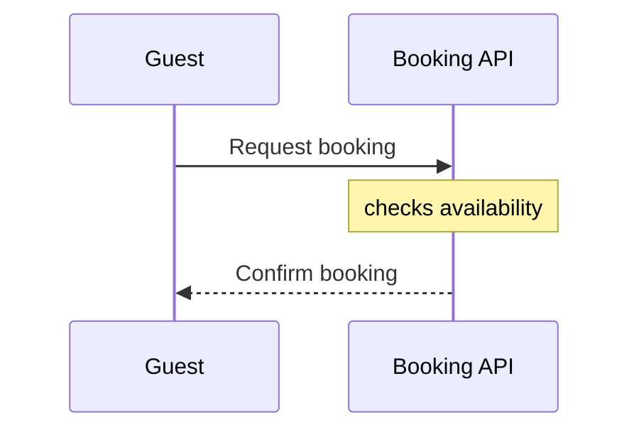

The check failed as you expected, with exit status 1, and it named both rules. I wrote nothing to FigJam file `<test-file-key>` and created no new file, because a model that fails the check never gets written to a board.

**Model** (a scratch file in a temp directory outside the repo):



**Command:** `python3 -I sk-create-figjam/scripts/flow_check.py <model.md>`

**Output:**

```
  diagram 1, sequence: line 3: BookingApi carries the alias Booking API, which the generator drops: the id is what the board shows, so make the id readable
  diagram 1, sequence: line 5: a note is dropped by the generator: draw it afterwards through the hybrid workflow
FAILED 1 of 1 diagram(s) in model.md
```

**Exit status:** `1`, which the script defines as "a rule fails" (0 means every diagram passes, 2 means the file couldn't be read).

- **Alias rule** (`figjam_checks/sequence.py:71`): the board generator drops `as Booking API`, so the participant's id has to be readable on its own.
- **Note rule** (`DROPPED` table, `sequence.py:38`): the generator drops notes. You add one after the board exists, using the hybrid workflow.

To get a model that passes, remove the alias and the `Note` line. You could then add the note to the board afterwards, in file `<test-file-key>` as you asked.