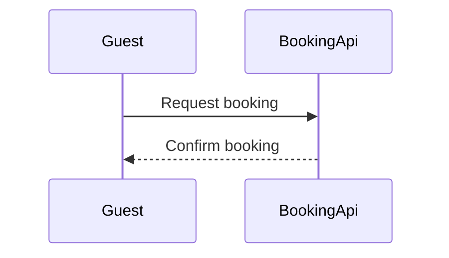

**Write gate.** This is the step that writes to Figma. Your last "yes" approved the reading, not the write.

**Question and outcome:** in what order do Guest and BookingApi exchange the booking messages? After the write you can confirm that the fixed model draws, reads back, and takes the note added on top.

**Three glances**
- **First:** message 1, "Request booking". It's the board's opening message, so it doesn't need a highlight.
- **Second:** message 2, "Confirm booking", which closes the exchange.
- **Last:** the "checks availability" note on BookingApi.

**Checked model:** it passes the check (exit 0, 2 participants and 2 messages). The composed code is 47,651 characters, under the 50,000-character limit for one call.

**Target: a new FigJam file named "Booking request test"**
- It goes in the **<figma-plan-1>** plan (`team::1297132374291579406`), where you have a Full seat on Pro. It stays in drafts, with no project.
- I won't write into `<test-file-key>`. Flow Mode only writes into a new file or a board this work already drew, and that file wasn't drawn by this work. That makes your stated fallback the target.

**What gets written**
- One framed board with the title, subtitle, two participants with their lifelines, two numbered messages, the key and the source line.
- **Planned extension:** one sticky note reading "checks availability", placed beside BookingApi's lifeline.

**Calls, five in total:** `create_new_file`, `create_session`, one `use_figma` to draw the board, one `use_figma` to add the sticky, and one `get_figjam` to read it back. Your Full seat on Pro isn't affected by the Starter six-calls-a-month limit.

**Rollback:** delete the new file. The sticky can also be removed on its own.

Shall I write this board, with the note sticky, to a new file in the <figma-plan-1> plan's drafts?