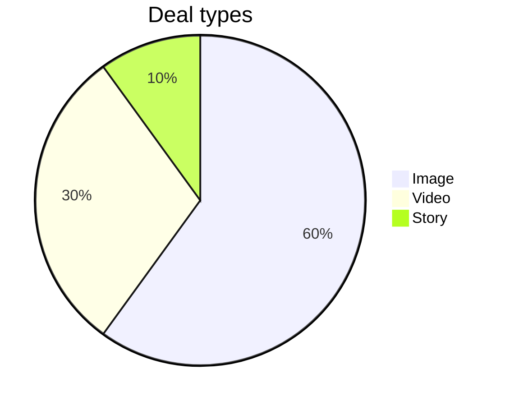

# FJ-006 turn 1 transcript

**User:** As the operator, run the sk-create-figjam check on a pie chart model. Verify it fails and points at the type table. Return the output and exit status.

Write the board into the existing FigJam file with key <test-file-key> rather than a new file. If you need a new file instead, create it in the Barter team plan and leave it in drafts, with no project.

**Tool call:** `Bash` `{"command": "cd /private/var/folders/3c/zfqcqsts0kn19cgblj82gqhm0000gn/T/devin-compare-bench/FJ-006; ls sk-create-figjam sk-create-figjam/*; grep -n -i \"check\\|operator\\|pie\" sk-create-figjam/SKILL.md | head -60"}`

**Tool result:** `Bash`

```text
"sk-create-figjam/README.md\nsk-create-figjam/SKILL.md\n\nsk-create-figjam:\nassets\nREADME.md\nreferences\nscripts\nSKILL.md\n\nsk-create-figjam/assets:\ncompose-board.js\nexamples\nfigjam-design.md\nflow-templates.md\nscreenshots\ntemplates\n\nsk-create-figjam/references:\nflow-mode.md\nhybrid-workflow.md\nquality-rubric.md\nstyle-guide.md\ntypes\n\nsk-create-figjam/scripts:\ncompose_board.py\ncompose-trace.mjs\nfigjam_checks\nflow_check.py\nvendored\n3:description: \"Draws FigJam diagrams, from user flows to sequence, state, ER and gantt, as checked Mermaid models composed into framed boards.\"\n12:The Product Owner packet that draws FigJam diagrams. It picks the diagram type the reader's question needs, turns screenshots, a Figma flow, a product doc, a schema or a plan into a Mermaid model of that type with a provenance table, checks the model and, after a yes, composes it into a framed FigJam board with a title, zones, colour by kind and a key. Seven types are drawn: user flow, process, architecture, sequence, state, ER and gantt. The hub [`../SKILL.md`](../SKILL.md) picks this packet, the hub [`../ROUTER.md`](../ROUTER.md) maps a Flow request to its leaves, and Section 2 routes inside it.\n28:- A pie chart, mindmap, Venn, class, journey, timeline, quadrant, C4, git graph or requirement diagram as such, which Flow Mode does not draw. `references/flow-mode.md` Section 3 names the nearest type it does draw\n66:| CONDITIONAL | `references/flow-mode.md` with `assets/flow-tem
```

**Tool call:** `Bash` `{"command": "cd /private/var/folders/3c/zfqcqsts0kn19cgblj82gqhm0000gn/T/devin-compare-bench/FJ-006/sk-create-figjam; sed -n 1,80p scripts/flow_check.py; grep -n -i \"pie\\|type table\\|usage\\|argv\\|argparse\\|add_argument\" scripts/flow_check.py | head -40"}`

**Tool result:** `Bash`

```text
"#!/usr/bin/env python3\n# \u2500\u2500\u2500\u2500\u2500\u2500\u2500\u2500\u2500\u2500\u2500\u2500\u2500\u2500\u2500\u2500\u2500\u2500\u2500\u2500\u2500\u2500\u2500\u2500\u2500\u2500\u2500\u2500\u2500\u2500\u2500\u2500\u2500\u2500\u2500\u2500\u2500\u2500\u2500\u2500\u2500\u2500\u2500\u2500\u2500\u2500\u2500\u2500\u2500\u2500\u2500\u2500\u2500\u2500\u2500\u2500\u2500\u2500\u2500\u2500\u2500\u2500\u2500\n# COMPONENT: FIGJAM MODEL PRE-WRITE CHECK\n# \u2500\u2500\u2500\u2500\u2500\u2500\u2500\u2500\u2500\u2500\u2500\u2500\u2500\u2500\u2500\u2500\u2500\u2500\u2500\u2500\u2500\u2500\u2500\u2500\u2500\u2500\u2500\u2500\u2500\u2500\u2500\u2500\u2500\u2500\u2500\u2500\u2500\u2500\u2500\u2500\u2500\u2500\u2500\u2500\u2500\u2500\u2500\u2500\u2500\u2500\u2500\u2500\u2500\u2500\u2500\u2500\u2500\u2500\u2500\u2500\u2500\u2500\u2500\n\n\"\"\"Check a FigJam diagram model before it is written to a board.\n\nA board is slow to fix once it exists: the composer owns its layout, so every\nfix is a new write. Worse, neither the composer nor the generated fallback\ndraws all that Mermaid can say, so a model can promise a reader something the\nboard never shows. The rules each diagram kind carries are checked on the\nMermaid model first, and a model that breaks one is never written. The same\nparse is measured, so a shape that is legal and still hard to read, such as a\nrank of six steps or a connector that doubles back, is caught here rather than\non the board.\n\nEach Mermaid block in the file is
```

**Tool call:** `Bash` `{"command": "cd /private/var/folders/3c/zfqcqsts0kn19cgblj82gqhm0000gn/T/devin-compare-bench/FJ-006/sk-create-figjam; grep -n -i \"pie\\|type table\\|nearest\" references/flow-mode.md | head -20"}`

**Tool result:** `Bash`

```text
"156:The composer draws the seven types in the table above and no other. Neither it nor Figma's `generate_diagram` fallback draws a pie chart, a mindmap, a Venn diagram, a class diagram, a journey, a timeline, a quadrant chart, a C4 diagram, a git graph or a requirement diagram. Say so plainly rather than drawing a stand-in. Offer the nearest type Flow Mode does draw when one answers the same question:\n158:| Asked for | Nearest drawable type |\n164:| Pie, mindmap, Venn, quadrant | None. Offer a table or a list in a Doc |\n206:- Read each image in place. A screenshot is never copied into this repository\n222:- No verb copies a design frame onto a board, so frame content is retyped into the model\n269:1. **An explicit edge.** A source that states a connection also states its label, and both are copied as given. No rung below is consulted while a stated edge exists, because an inferred edge never overrides one\n349:- A new board lands 400 pixels to the right of everything already on the page, its top level with the highest node there, so it never covers existing content and the diagrams of one piece of work read left to right in the order they were written"
```

**Assistant:**

Now write a pie model to a temp folder outside the repo and run the check.

**Tool call:** `Bash` `{"command": "d=$(mktemp -d); cat > \"$d/pie-model.md\" <<'EOF'\n# Pie model\n\n```mermaid\npie title Deal types\n    \"Image\" : 60\n    \"Video\" : 30\n    \"Story\" : 10\n```\nEOF\npython3 -I /private/var/folders/3c/zfqcqsts0kn19cgblj82gqhm0000gn/T/devin-compare-bench/FJ-006/sk-create-figjam/scripts/flow_check.py \"$d/pie-model.md\"; echo \"EXIT=$?\"; rm -rf \"$d\""}`

**Tool result:** `Bash`

```text
"  diagram 1, unknown: a pie block: Flow Mode does not draw it, see references/flow-mode.md Section 3\nFAILED 1 of 1 diagram(s) in pie-model.md\nEXIT=1"
```

**Tool call:** `Bash` `{"command": "grep -n \"^## \" references/flow-mode.md | head; sed -n 158,166p references/flow-mode.md"}`

**Tool result:** `Bash`

```text
"30:## 1. OVERVIEW\n57:## 2. WORKFLOW\n109:## 3. PICK THE DIAGRAM TYPE\n168:## 4. INTAKE\n298:## 5. RULES EVERY TYPE SHARES\n336:## 6. WRITE ROUTES\n395:## 7. READ-BACK\n420:## 8. DELIVERY\n457:## 9. ERROR RECOVERY\n| Asked for | Nearest drawable type |\n|---|---|\n| Journey | A user flow of the screens it visits |\n| Timeline | A gantt chart, with each event as a milestone |\n| Class diagram | An ER diagram of the data the classes hold |\n| C4 container or context | An architecture |\n| Pie, mindmap, Venn, quadrant | None. Offer a table or a list in a Doc |\n\n---"
```

**Assistant:**

The check fails on the pie chart model and exits with status 1, as expected. Nothing was written to the FigJam file `<test-file-key>`, and no new file was created.

**Command:** `python3 -I sk-create-figjam/scripts/flow_check.py <tmp>/pie-model.md`

The model was one Mermaid block:



**Output:**
```
  diagram 1, unknown: a pie block: Flow Mode does not draw it, see references/flow-mode.md Section 3
FAILED 1 of 1 diagram(s) in pie-model.md
EXIT=1
```

**Exit status:** `1`, which per the script's usage lines means "a rule fails". `0` means everything passed and `2` means the model couldn't be read.

**Where it points:** the message names `references/flow-mode.md` Section 3, "Pick the diagram type", which holds the type table. The table's row for this case (line 164) says: "Pie, mindmap, Venn, quadrant | None. Offer a table or a list in a Doc". So no Flow Mode diagram type can stand in for a pie chart.

**Why I didn't write the board:** the packet allows no write until every diagram passes this check, and this one can't pass. I didn't fall back to a new file in the Barter team drafts either, because that would also need a passing model. The temporary model was written outside the repo and deleted after the run. Nothing went to `export/`, since this was an operator check and not an artifact.

If you need the deal-type split on a board, the type table's suggestion is a table or list in a Doc (`$doc`). I can draft that if you want it.
