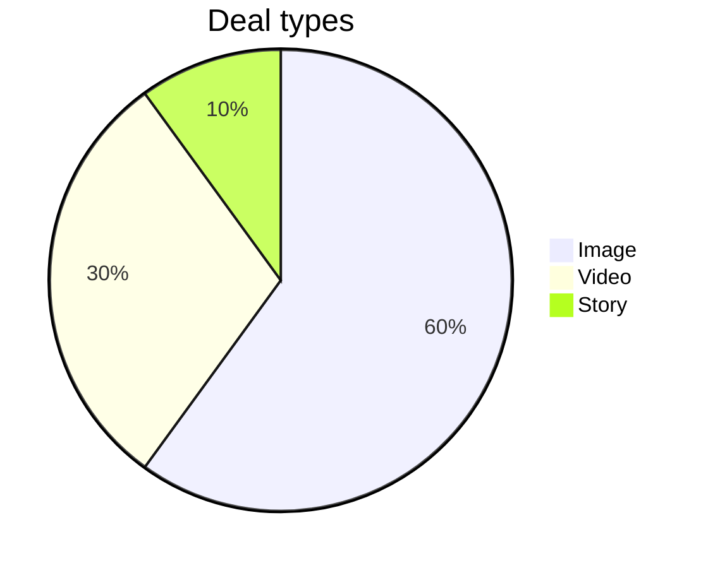

The check fails on the pie chart model and exits with status 1, as expected. Nothing was written to the FigJam file `<test-file-key>`, and no new file was created.

**Command:** `python3 -I sk-create-figjam/scripts/flow_check.py <tmp>/pie-model.md`

The model was one Mermaid block:



**Output:**
```
  diagram 1, unknown: a pie block: Flow Mode does not draw it, see references/flow-mode.md Section 3
FAILED 1 of 1 diagram(s) in pie-model.md
EXIT=1
```

**Exit status:** `1`, which per the script's usage lines means "a rule fails". `0` means everything passed and `2` means the model couldn't be read.

**Where it points:** the message names `references/flow-mode.md` Section 3, "Pick the diagram type", which holds the type table. The table's row for this case (line 164) says: "Pie, mindmap, Venn, quadrant | None. Offer a table or a list in a Doc". So no Flow Mode diagram type can stand in for a pie chart.

**Why I didn't write the board:** the packet allows no write until every diagram passes this check, and this one can't pass. I didn't fall back to a new file in the Barter team drafts either, because that would also need a passing model. The temporary model was written outside the repo and deleted after the run. Nothing went to `export/`, since this was an operator check and not an artifact.

If you need the deal-type split on a board, the type table's suggestion is a table or list in a Doc (`$doc`). I can draft that if you want it.