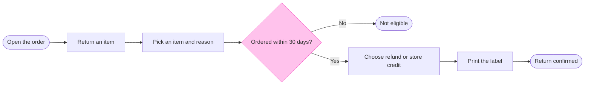

# FJ-010 turn 3 transcript

**User:** Yes, that reading is right.

**Tool call:** `Bash` `{"command": "D=$(mktemp -d); echo $D; cat > $D/model.md <<'EOF'\n```mermaid\n%% title: Fernhouse returns\n%% subtitle: Which screens a customer passes through to return an item, and where the return can stop\n%% source: Source: the Fernhouse returns doc, as summarised in the request. Left out: refund and store credit processing, warehouse handling, cancelling partway (not in the doc).\nflowchart LR\n    openOrder([Open the order]) --> tapReturn[Return an item]\n    tapReturn --> pickItem[Pick an item and reason]\n    pickItem --> withinWindow{Ordered within 30 days?}\n    withinWindow -->|No| `

**Tool result:** `Bash`

```text
"/var/folders/3c/zfqcqsts0kn19cgblj82gqhm0000gn/T/tmp.GqGysM7V1w\nmermaid_extract: --help: not a Mermaid file\nUNREADABLE --help: the extractor refused it\n36:The board's look is a design a team can change. `assets/figjam-design.md` holds it as tokens: the palette pair each colour role draws, the role each kind takes, the accent, the type sizes, the line colours, the zone tints and the words on the key. The tables below record the shipped design. A design that changes a token changes the board and not this guide, and a token that breaks a gate in Section 4 or a floor in that file's Section 7 falls back to its shipped value with a warning.\n38:The board carries one accent, by default a heavy pink outline on the node, message or task the first glance names. A user flow or a process marks it with a `style` line and the check refuses a model that has none. The other five types may name it with a `%% focus:` line. A `style` line does not colour a node for the board. It tells the composer what the node means, as Section 3 sets out.\n64:The accent is not a kind. A styled goal, error, decision or any other node keeps the kind and fill it has and takes the pink outline on top, so a goal stays green and reads first. Only a styled step has no kind of its own to keep, so it is drawn light pink. The key adds `In focus` whenever the board carries an accent, and its sample is drawn as the marked node is, its own kind under the pink outline, so a goal in focus shows a green sample and a styl
```

**Tool call:** `Bash` `{"command": "D=/var/folders/3c/zfqcqsts0kn19cgblj82gqhm0000gn/T/tmp.GqGysM7V1w; sed -i '' 's/fill:#FFC7F3,stroke:#FF6DE2/fill:#FFC2EC,stroke:#F849C1/' $D/model.md; python3 scripts/flow_check.py $D/model.md; echo \"exit $?\"; python3 scripts/compose_board.py $D/model.md --diagram 1 --out $D/code.js; echo \"exit $?\"; wc -c $D/code.js", "description": "Run pre-write check and compose the board code"}`

**Tool result:** `Bash`

```text
"  diagram 1, user flow: ok, 8 nodes and 7 connectors, widest rank 2 steps, longest path 7 steps, 0.9 connectors per step, labels average 18 characters, 0 crossing pairs\nPASSED 1 diagram(s) in model.md\nexit 0\nCOMPOSED diagram 1, 8 nodes and 7 connectors, widest rank 2 steps, longest path 7 steps, 0.9 connectors per step, labels average 18 characters, 0 crossing pairs: 8 nodes and 7 connectors to read back, 48427 characters in /var/folders/3c/zfqcqsts0kn19cgblj82gqhm0000gn/T/tmp.GqGysM7V1w/code.js, drawn in the design FigJam default\nexit 0\n   48427 /var/folders/3c/zfqcqsts0kn19cgblj82gqhm0000gn/T/tmp.GqGysM7V1w/code.js"
```

**Tool call:** `Bash` `{"command": "sed -n 1,400p references/quality-rubric.md | grep -v \"^$\" | head -150", "description": "Read quality rubric"}`

**Tool result:** `Bash`

```text
"---\ntitle: \"FigJam Diagram Quality Rubric\"\ndescription: \"The taste gate a FigJam model passes before the write gate, translated from sk-design-diagram's success criteria: type fit, the remove test, signal, the check, the board, the design rubric that scores a composed board and the reply.\"\ncontextType: implementation\nimportance_tier: important\ntrigger_phrases:\n  - \"figjam quality rubric\"\n  - \"diagram taste gate\"\n  - \"remove test\"\n  - \"figjam review checklist\"\n  - \"figjam design rubric\"\nversion: 1.0.2.0\n---\n# FigJam Diagram Quality Rubric\nThe script checks what a script can see. This rubric is the rest: whether the diagram should exist, whether every node earns its place and whether the reader can trust what lands on the board. Walk it after the check passes and before the write gate.\n**Loading Condition:** CONDITIONAL, on every Flow route before the write gate\n**Purpose:** The judgement pass between the pre-write check and the gate\n**Scope:** The model, the provenance table, the planned extensions and, after the write, the board and the reply\n---\n## 1. TYPE FIT\n- [ ] The type answers the reader's question, as `references/flow-mode.md` Section 3 maps it\n- [ ] A table, a list or a paragraph would not do the same job. If it would, say so and offer that instead\n- [ ] The type's reference in `references/types/` was loaded and its judged-by-hand rules were applied\n- [ ] A request for a kind Flow Mode does not draw was answered with the nearest 
```

**Tool call:** `ToolSearch` `{"query": "select:mcp__figma-remote__create_new_file", "max_results": 1}`

**Tool result:** `ToolSearch`

```text
[{"type": "tool_reference", "tool_name": "mcp__figma-remote__create_new_file"}]
```

**Assistant:**

**Write gate: Fernhouse returns**

The model passed both scripts. The pre-write check passed on 8 nodes and 7 arrows with no crossings. The board-layout script built a drawing for the same 8 nodes and 7 arrows, small enough to send to Figma in one call.

**What the board answers.** Which screens does a customer pass through to return an item, and where can the return stop? After reading it, the team can decide whether the 30-day check is in the right place and whether an exit is missing.

**What the eye should land on**
- **First:** "Ordered within 30 days?", the only node highlighted in pink
- **Second:** the "Not eligible" ending, and the fact that the customer has already picked an item and a reason before the check runs
- **Last:** the key and the source line, which lists what was left out

**The checked model**


**Layout check**
- **Where does the eye go first?** To the 30-day check, the one node with a heavy pink outline. It's the node the board most needs read.
- **Does anything compete with it?** No. "Return confirmed" stays green without an outline, and the title doesn't repeat the claim.
- **Does it read in one direction?** Yes, left to right, with the route to "Return confirmed" on one straight line and "Not eligible" just off it.
- **Can anything be removed?** No. Each step is a screen the customer passes through.

**The write**
- **Plan:** <figma-plan-1> (`team::<plan-id>`). Your seat there is Full on a Pro plan, so Figma's six-calls-a-month limit doesn't apply.
- **File:** a new FigJam file called "Fernhouse returns", left in your drafts with no project. The file `<test-file-key>` is not touched.
- **On the board:** one framed section with the title, subtitle, the 8 nodes and 7 arrows, a key and the source line. No pins or sticky notes are added.
- **Figma calls:** 4. One creates the file, one opens a session, one draws the board and one reads it back to check it. The plan lookup has already run.
- **To undo:** delete the new file. Nothing else changes.

Write this board to a new file in <figma-plan-1> drafts?

HVR self-scan: 0 hard blockers. Fixed: none. Kept with reason: none.
