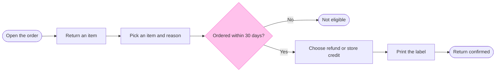

**Write gate: Fernhouse returns**

The model passed both scripts. The pre-write check passed on 8 nodes and 7 arrows with no crossings. The board-layout script built a drawing for the same 8 nodes and 7 arrows, small enough to send to Figma in one call.

**What the board answers.** Which screens does a customer pass through to return an item, and where can the return stop? After reading it, the team can decide whether the 30-day check is in the right place and whether an exit is missing.

**What the eye should land on**
- **First:** "Ordered within 30 days?", the only node highlighted in pink
- **Second:** the "Not eligible" ending, and the fact that the customer has already picked an item and a reason before the check runs
- **Last:** the key and the source line, which lists what was left out

**The checked model**

**Layout check**
- **Where does the eye go first?** To the 30-day check, the one node with a heavy pink outline. It's the node the board most needs read.
- **Does anything compete with it?** No. "Return confirmed" stays green without an outline, and the title doesn't repeat the claim.
- **Does it read in one direction?** Yes, left to right, with the route to "Return confirmed" on one straight line and "Not eligible" just off it.
- **Can anything be removed?** No. Each step is a screen the customer passes through.

**The write**
- **Plan:** <figma-plan-1> (`team::1297132374291579406`). Your seat there is Full on a Pro plan, so Figma's six-calls-a-month limit doesn't apply.
- **File:** a new FigJam file called "Fernhouse returns", left in your drafts with no project. The file `<test-file-key>` is not touched.
- **On the board:** one framed section with the title, subtitle, the 8 nodes and 7 arrows, a key and the source line. No pins or sticky notes are added.
- **Figma calls:** 4. One creates the file, one opens a session, one draws the board and one reads it back to check it. The plan lookup has already run.
- **To undo:** delete the new file. Nothing else changes.

Write this board to a new file in <figma-plan-1> drafts?

HVR self-scan: 0 hard blockers. Fixed: none. Kept with reason: none.