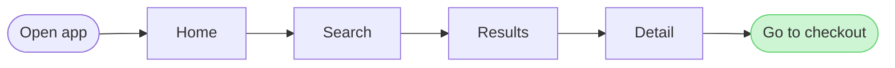
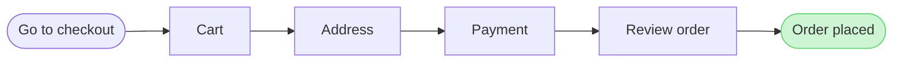

# FJ-014 turn 3 transcript

**User:** Yes, go ahead.

**Tool call:** `Bash` `{"command": "cd /private/var/folders/3c/zfqcqsts0kn19cgblj82gqhm0000gn/T/devin-compare-bench/FJ-014/sk-create-figjam && sed -n 336,360p references/flow-mode.md; grep -n -A12 \"^## 3\" references/quality-rubric.md | head -30"}`

**Tool result:** `Bash`

```text
"## 6. WRITE ROUTES\n\n### Composed route, primary\n\nFlow Mode composes the board itself. `scripts/compose_board.py` reads the checked model and fills `assets/compose-board.js`, and one `use_figma` call runs that code in the file the gate named. The call draws a framed board: the title and the subtitle, the diagram with its zones, every shape sized to its text and coloured by its kind, the routed connectors, a key of every mark the board uses and the source line, all on an 8 pixel grid. It draws every type in Section 3.\n\nThe route is a native MCP connection to Figma's server at `https://mcp.figma.com/mcp`, which Figma's own plugin declares in its root `mcp.json`. The connection comes from that plugin or from the client's connector. Code Mode holds no manual for Figma's hosted server here, and its `figma` manual runs Framelink's `figma-developer-mcp` instead. Whether Figma's OAuth-gated server would admit a Code Mode client is unverified. The vendored `mcp-figma` packet's wiring guide covers that Code Mode path, and its Section 6 records how a headless Claude Code or Codex child reaches the hosted server. The `allowed-tools` frontmatter of this packet names Code Mode as its only MCP tool and no native tool, because the native names depend on the client. Claude Code serves them under the name its config gives the server, such as `mcp__figma-remote__use_figma`. Codex serves them through the Figma app on the ChatGPT account as `figma.use_figma`, and `codex exec` refuses that c
```

**Tool call:** `ToolSearch` `{"query": "select:mcp__figma-remote__whoami", "max_results": 1}`

**Tool result:** `ToolSearch`

```text
[{"type": "tool_reference", "tool_name": "mcp__figma-remote__whoami"}]
```

**Tool call:** `Bash` `{"command": "grep -n -A14 \"^## 8\" references/hybrid-workflow.md"}`

**Tool result:** `Bash`

```text
"163:## 8. A BOARD OF SEVERAL DIAGRAMS\n164-\n165-Work that needs two or more diagrams is planned before the first write, so a reader knows where one ends and the next begins and where to start.\n166-\n167-- Each diagram is its own composed board, with its own title, key and tag, in the one file this work writes\n168-- The title carries the diagram's ordinal and then its name, such as `%% title: 2. Workspace setup`, so the boards read as one numbered set\n169-- The composer places each new board 400 pixels to the right of everything already on the page, its top level with the highest node, so the boards read left to right in the order they were written. Write them in reading order, because no later call moves one\n170-- A split flow ends one board on a named hand-off node and starts the next board from the same name, so the reader follows the hand-off from one board to the next\n171-- The reply names the board a reader opens first, by its ordinal and its name, and that first board is the one the reader's question starts in"
```

**Tool call:** `mcp__figma-remote__whoami` `{}`

**Tool result:** `mcp__figma-remote__whoami`

```text
"{\"whoami\":{\"user_id\":\"<redacted>\",\"handle\":\"<redacted>\",\"email\":\"<email>\",\"code_layers_enabled\":true,\"plans\":[{\"name\":\"<figma-plan-3>\",\"seat\":\"View\",\"tier\":\"starter\",\"key\":\"team::<plan-id>\",\"role\":\"admin\",\"specs_enabled\":true,\"code_layers_enabled\":true},{\"name\":\"<figma-plan-1>\",\"seat\":\"Full\",\"tier\":\"pro\",\"key\":\"team::<plan-id>\",\"role\":\"admin\",\"specs_enabled\":false,\"code_layers_enabled\":true},{\"name\":\"<figma-plan-2>\",\"seat\":\"Full\",\"tier\":\"pro\",\"key\":\"team::<plan-id>\",\"role\":\"member\",\"specs_enabled\":false,\"code_layers_enabled\":true}]},\"instructions\":\"For more details on rate limits and access, refer to https://developers.figma.com/docs/figma-mcp-server/rate-limits-access/\"}"
```

**Tool call:** `Bash` `{"command": "D=$(mktemp -d) && cat > \"$D/model.md\" <<'EOF'\n```mermaid\nflowchart LR\n    %% title: 1. Find a product\n    start([Open app]) --> home[Home]\n    home --> search[Search]\n    search --> results[Results]\n    results --> detail[Detail]\n    detail --> toCheckout([Go to checkout])\n    style toCheckout fill:#CDF4D3,stroke:#66D575\n```\n\n```mermaid\nflowchart LR\n    %% title: 2. Check out\n    fromDetail([Go to checkout]) --> cart[Cart]\n    cart --> address[Address]\n    address --> payment[Payment]\n    payment --> review[Review order]\n    review --> done([Order placed])\n  `

**Tool result:** `Bash`

```text
"  diagram 1, user flow: ok, 6 nodes and 5 connectors, widest rank 1 steps, longest path 6 steps, 0.8 connectors per step, labels average 8 characters, 0 crossing pairs\n  diagram 2, user flow: ok, 6 nodes and 5 connectors, widest rank 1 steps, longest path 6 steps, 0.8 connectors per step, labels average 9 characters, 0 crossing pairs\nPASSED 2 diagram(s) in model.md\ncheck exit=0\nCOMPOSED diagram 1, 6 nodes and 5 connectors, widest rank 1 steps, longest path 6 steps, 0.8 connectors per step, labels average 8 characters, 0 crossing pairs: 6 nodes and 5 connectors to read back, 47780 characters in /var/folders/3c/zfqcqsts0kn19cgblj82gqhm0000gn/T/tmp.2VtNPKablC/d1.js, drawn in the design FigJam default\ncompose 1 exit=0\nCOMPOSED diagram 2, 6 nodes and 5 connectors, widest rank 1 steps, longest path 6 steps, 0.8 connectors per step, labels average 9 characters, 0 crossing pairs: 6 nodes and 5 connectors to read back, 47787 characters in /var/folders/3c/zfqcqsts0kn19cgblj82gqhm0000gn/T/tmp.2VtNPKablC/d2.js, drawn in the design FigJam default\ncompose 2 exit=0\n   47780 /var/folders/3c/zfqcqsts0kn19cgblj82gqhm0000gn/T/tmp.2VtNPKablC/d1.js\n   47787 /var/folders/3c/zfqcqsts0kn19cgblj82gqhm0000gn/T/tmp.2VtNPKablC/d2.js\n   95567 total\n/var/folders/3c/zfqcqsts0kn19cgblj82gqhm0000gn/T/tmp.2VtNPKablC"
```

**Assistant:**

Your yes confirms the reading. Here is exactly what the write will do. Nothing goes to Figma until you approve this step.

**What the board answers:** which screens a person passes through from opening the app to placing an order. The result is two numbered boards that read left to right and connect through a step called "Go to checkout".

**What a reader sees first, second and last:**
- **First:** "Order placed", highlighted on board 2 as the goal of the whole flow.
- **Second:** the five checkout steps leading up to it: Go to checkout → Cart → Address → Payment → Review order.
- **Last:** board 1, "Find a product", which a reader can look back at. Its end step, "Go to checkout", is highlighted as the hand-off to board 2.

**The two diagrams:**


- **Check:** both diagrams pass (exit `0`), each with 6 nodes, 5 connectors and no crossing lines.
- **Size:** each composed board is about 47,800 characters, which fits under the 50,000-character limit for one write.
- **Labels:** all placeholders, as you agreed.

**Where it goes:**
- **Plan:** <figma-plan-1> (`team::<plan-id>`), Pro plan with a Full seat, so the six-calls-a-month limit doesn't apply. I already used one call (`whoami`) to look up this plan.
- **File:** a new FigJam file named "Find a product and check out", left in drafts with no project. I won't write to `<test-file-key>`, because Flow Mode only writes to a new file or a board this work already wrote.
- **Extensions:** none.

**Figma calls:** `create_new_file` once, `create_session` once, `use_figma` twice (one per board, board 1 first) and `get_figjam` once to read both boards back.

**Rollback:** deleting the new file removes everything. Nothing that already exists in Figma is touched.

Should I create the file in the <figma-plan-1> plan and write both boards?

HVR self-scan: 0 hard blockers. Fixed: none. Kept with reason: none.
