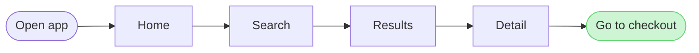
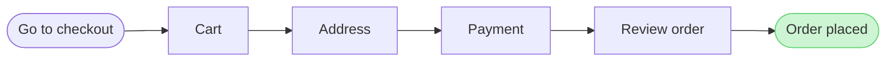

Your yes confirms the reading. Here is exactly what the write will do. Nothing goes to Figma until you approve this step.

**What the board answers:** which screens a person passes through from opening the app to placing an order. The result is two numbered boards that read left to right and connect through a step called "Go to checkout".

**What a reader sees first, second and last:**
- **First:** "Order placed", highlighted on board 2 as the goal of the whole flow.
- **Second:** the five checkout steps leading up to it: Go to checkout → Cart → Address → Payment → Review order.
- **Last:** board 1, "Find a product", which a reader can look back at. Its end step, "Go to checkout", is highlighted as the hand-off to board 2.

**The two diagrams:**

- **Check:** both diagrams pass (exit `0`), each with 6 nodes, 5 connectors and no crossing lines.
- **Size:** each composed board is about 47,800 characters, which fits under the 50,000-character limit for one write.
- **Labels:** all placeholders, as you agreed.

**Where it goes:**
- **Plan:** <figma-plan-1> (`team::<plan-id>`), Pro plan with a Full seat, so the six-calls-a-month limit doesn't apply. I already used one call (`whoami`) to look up this plan.
- **File:** a new FigJam file named "Find a product and check out", left in drafts with no project. I won't write to `<test-file-key>`, because Flow Mode only writes to a new file or a board this work already wrote.
- **Extensions:** none.

**Figma calls:** `create_new_file` once, `create_session` once, `use_figma` twice (one per board, board 1 first) and `get_figjam` once to read both boards back.

**Rollback:** deleting the new file removes everything. Nothing that already exists in Figma is touched.

Should I create the file in the <figma-plan-1> plan and write both boards?

HVR self-scan: 0 hard blockers. Fixed: none. Kept with reason: none.