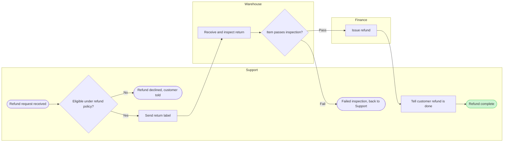

# FJR-002 turn 4 transcript

**User:** Yes, go ahead.

**Tool call:** `Bash` `{"command": "cd /private/var/folders/3c/zfqcqsts0kn19cgblj82gqhm0000gn/T/devin-compare-bench/FJR-002/sk-create-figjam && sed -n 1,200p assets/templates/process.md | head -150; sed -n 25,60p assets/flow-templates.md; python3 scripts/flow_check.py --help 2>&1 | head -30", "description": "Read process template, model comment lines, check usage"}`

**Tool result:** `Bash`

```text
"---\ntitle: \"FigJam Process Templates\"\ndescription: \"Process patterns that pass the pre-write check: a decision tree, a laned process with its handoff step in focus and a pipeline with a store and data in and out.\"\ncontextType: general\nimportance_tier: important\ntrigger_phrases:\n  - \"process templates\"\n  - \"laned process pattern\"\n  - \"decision tree pattern\"\nversion: 1.0.1.0\n---\n\n# FigJam Process Templates\n\nCopy/apply patterns for a process model. Each pattern passes `scripts/flow_check.py`, and `references/types/process.md` holds the rules.\n\n**Loading Condition:** CONDITIONAL, with `references/types/process.md`\n**Purpose:** Starting points for a process or decision flowchart\n**Scope:** Three patterns. The provenance table and the reply shape are in `assets/flow-templates.md`\n\n---\n\n## 1. USAGE\n\n- Keep the `%% type: process` line first, or the check reads the block as a user flow\n- Name a lane after the actor, `subgraph agent [\"CS agent\"]`, and keep its id short and camelCase\n- A lane takes the neutral pair or no style, and the one accent goes on the focal step, such as the step that hands work to the next lane. The composer draws that step in focus. A `linkStyle` passes the check and changes nothing on a composed board\n- `-.->` marks a step that is optional or happens later, such as a log write\n- The patterns all run left to right, because the check reads every process in one file as one flow that runs one way\n\n---\n\n## 2. PATTERNS\n\
```

**Tool call:** `Bash` `{"command": "D=$(mktemp -d) && echo $D && cat > $D/refund.md <<'EOF'\n```mermaid\n%% type: process\n%% title: Refund process: Support, Warehouse, Finance\n%% subtitle: Who handles each refund step and where work changes teams\n%% source: Outline accepted in chat on 26 Oct 2026, not checked against a Barter runbook\nflowchart LR\n    subgraph support [\"Support\"]\n        request([Refund request received])\n        eligible{Eligible under refund policy?}\n        declined([\"Refund declined, customer told\"])\n        label[Send return label]\n        failed([\"Failed inspection, back to Suppo`

**Tool result:** `Bash`

```text
"/var/folders/3c/zfqcqsts0kn19cgblj82gqhm0000gn/T/tmp.aCMXRoLnFF\n  diagram 1, process: ok, 10 nodes and 9 connectors, widest rank 2 steps, longest path 8 steps, 0.9 connectors per step, labels average 24 characters, 0 crossing pairs\nPASSED 1 diagram(s) in refund.md\nexit 0"
```

**Tool call:** `Bash` `{"command": "grep -n \"^## \\|^### \" references/quality-rubric.md && awk '/^## 3/,/^## 4/' references/quality-rubric.md | head -60; python3 scripts/compose_board.py /var/folders/3c/zfqcqsts0kn19cgblj82gqhm0000gn/T/tmp.aCMXRoLnFF/refund.md --diagram 1 --out /var/folders/3c/zfqcqsts0kn19cgblj82gqhm0000gn/T/tmp.aCMXRoLnFF/compose.js; echo \"exit $?\"", "description": "Read rubric glance section and dry-run composer"}`

**Tool result:** `Bash`

```text
"25:## 1. TYPE FIT\n34:## 2. THE REMOVE TEST\n54:## 3. SIGNAL\n78:## 4. PROVENANCE\n87:## 5. THE CHECK AND THE GATE\n98:## 6. THE BOARD\n126:## 7. THE DESIGN RUBRIC\n146:## 8. THE REPLY\n## 3. SIGNAL\n\nThe marked node is chosen against a target written down first. A board judged only against itself cannot catch a second focal object, such as a title that repeats the claim the marked node was meant to carry. Three lines are written before the first Mermaid block:\n\n1. **First glance.** The one claim, decision or object that should win within two seconds\n2. **Second glance.** The evidence or relationship that advances it\n3. **Last glance.** The risk, the metadata or the appendix that stays available without competing\n\nThose three lines travel into the gate, so the marked node is chosen from them and the reply can say what should win. After the first glance, filled shapes and their keyed fills outweigh connector labels and text in the overview, so the lines name a filled group such as the gray end states before the labels between them.\n\n- [ ] One accent on a user flow or a process, on the node a reader would keep if they could keep only one, never the node that comes first. The goal, a failure end, a decision and the one step in focus are the candidates, as `references/style-guide.md` Section 3 sets out. Two that tie mean the diagram splits\n- [ ] The three glance lines were written before the model and named in the gate\n- [ ] On a user flow or a process the first glanc
```

**Tool call:** `Bash` `{"command": "D=/var/folders/3c/zfqcqsts0kn19cgblj82gqhm0000gn/T/tmp.aCMXRoLnFF && sed -i '' 's|^%% source: .*|%% source: Outline accepted in chat on 26 Oct 2026, not checked against a Barter runbook. Left out: partial refunds, refunds without a return, approval limits, next step after a failed inspection.|' $D/refund.md && cd /private/var/folders/3c/zfqcqsts0kn19cgblj82gqhm0000gn/T/devin-compare-bench/FJR-002/sk-create-figjam && python3 scripts/flow_check.py $D/refund.md && python3 scripts/compose_board.py $D/refund.md --diagram 1 --out $D/compose.js", "description": "Add left-out items to sou`

**Tool result:** `Bash`

```text
"  diagram 1, process: ok, 10 nodes and 9 connectors, widest rank 2 steps, longest path 8 steps, 0.9 connectors per step, labels average 24 characters, 0 crossing pairs\nPASSED 1 diagram(s) in refund.md\nCOMPOSED diagram 1, 10 nodes and 9 connectors, widest rank 2 steps, longest path 8 steps, 0.9 connectors per step, labels average 24 characters, 0 crossing pairs: 10 nodes and 9 connectors to read back, 48896 characters in /var/folders/3c/zfqcqsts0kn19cgblj82gqhm0000gn/T/tmp.aCMXRoLnFF/compose.js, drawn in the design FigJam default"
```

**Assistant:**

Thanks, that confirms the outline. Before I write to the file, here's exactly what will happen. Nothing is on the board yet.

**What the board does**
- **Question:** who does what in a refund, and where does the work move from one team to the next?
- **Outcome:** the leads agree who owns each handoff and can see where refunds get stuck
- **What the eye lands on first:** "Refund complete", the goal, highlighted with a pink outline
- **Then:** the three arrows where work moves between teams (label → inspect, inspect → issue refund, issue refund → tell customer)
- **Then, quieter:** the two exits off the main path and the source line

**The diagram as it will be drawn** (it passed the automated layout check: 10 boxes, 9 arrows, 3 lanes, no crossing lines)



**The write**
- **File:** your existing FigJam file `<test-file-key>`. Before drawing I'll check that it opens and is a FigJam file.
- **What gets added:** one framed section with the title, subtitle, three lanes, the diagram, a key and the source line. The source line lists what was left out. The section goes 400 px to the right of whatever is already on the page, and nothing already there is moved, changed or deleted.
- **Extra notes or stickies:** none
- **Figma tool calls:** 3. One opens a session on the file, one draws the board and one reads it back to check it. If you're on a Starter plan or a View or Collab seat, that's half of your six calls for the month.
- **If that file can't be used:** I stop and come back to you. Creating a new file in Barter team drafts with no project needs its own yes, which costs one more call to find the Barter plan and one to create the file.
- **Undo:** I can delete the one section this write adds, but only after you ask for it by name.
- **Size and detail:** balanced detail and plain team terms, sized to read on a laptop screen

Shall I write this board into `<test-file-key>`?
