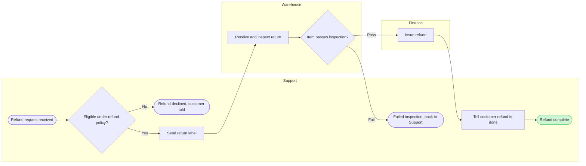

Thanks, that confirms the outline. Before I write to the file, here's exactly what will happen. Nothing is on the board yet.

**What the board does**
- **Question:** who does what in a refund, and where does the work move from one team to the next?
- **Outcome:** the leads agree who owns each handoff and can see where refunds get stuck
- **What the eye lands on first:** "Refund complete", the goal, highlighted with a pink outline
- **Then:** the three arrows where work moves between teams (label → inspect, inspect → issue refund, issue refund → tell customer)
- **Then, quieter:** the two exits off the main path and the source line

**The diagram as it will be drawn** (it passed the automated layout check: 10 boxes, 9 arrows, 3 lanes, no crossing lines)

**The write**
- **File:** your existing FigJam file `<test-file-key>`. Before drawing I'll check that it opens and is a FigJam file.
- **What gets added:** one framed section with the title, subtitle, three lanes, the diagram, a key and the source line. The source line lists what was left out. The section goes 400 px to the right of whatever is already on the page, and nothing already there is moved, changed or deleted.
- **Extra notes or stickies:** none
- **Figma tool calls:** 3. One opens a session on the file, one draws the board and one reads it back to check it. If you're on a Starter plan or a View or Collab seat, that's half of your six calls for the month.
- **If that file can't be used:** I stop and come back to you. Creating a new file in Barter team drafts with no project needs its own yes, which costs one more call to find the Barter plan and one to create the file.
- **Undo:** I can delete the one section this write adds, but only after you ask for it by name.
- **Size and detail:** balanced detail and plain team terms, sized to read on a laptop screen

Shall I write this board into `<test-file-key>`?