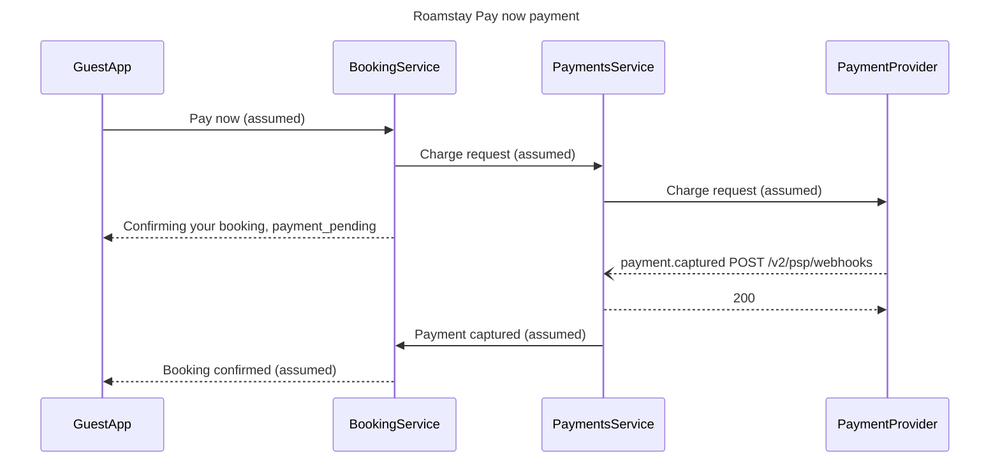

# FJR-004 turn 4 transcript

**User:** Yes, go ahead.

**Tool call:** `Bash` `{"command": "cd /private/var/folders/3c/zfqcqsts0kn19cgblj82gqhm0000gn/T/devin-compare-bench/FJR-004/sk-create-figjam; cat assets/templates/sequence.md | sed -n 1,80p; python3 scripts/flow_check.py --help 2>&1 | head -20", "description": "Read sequence template and check usage"}`

**Tool result:** `Bash`

```text
"---\ntitle: \"FigJam Sequence Templates\"\ndescription: \"Sequence patterns that pass the pre-write check: a request and response chain and an event handoff with async messages.\"\ncontextType: general\nimportance_tier: important\ntrigger_phrases:\n  - \"sequence templates\"\n  - \"figjam sequence pattern\"\nversion: 1.0.0.0\n---\n\n# FigJam Sequence Templates\n\nCopy/apply patterns for a sequence model. Each pattern passes `scripts/flow_check.py`, and `references/types/sequence.md` holds the subset the board draws.\n\n**Loading Condition:** CONDITIONAL, with `references/types/sequence.md`\n**Purpose:** Starting points for a sequence\n**Scope:** Two patterns. The provenance table and the reply shape are in `assets/flow-templates.md`\n\n---\n\n## 1. USAGE\n\n- The participant id is what the board shows, so write `AuthServer`, never `a` with an alias\n- Declare every participant in the order the board should show them\n- `->>` for a request and `-->>` for its return. `-)` and `--)` only when the message really is fire-and-forget\n- A failure path is a second diagram, because `alt` renders flat\n\n---\n\n## 2. PATTERNS\n\n### Request and response chain\n\n```mermaid\nsequenceDiagram\n    title Sign in\n    participant WebApp\n    participant AuthServer\n    participant UserStore\n    WebApp->>AuthServer: POST /sessions\n    AuthServer->>UserStore: Find user by email\n    UserStore-->>AuthServer: User record\n    AuthServer-->>WebApp: 201 with session token\n```\n\n### Event han
```

**Tool call:** `Bash` `{"command": "cd /private/var/folders/3c/zfqcqsts0kn19cgblj82gqhm0000gn/T/devin-compare-bench/FJR-004/sk-create-figjam; grep -n \"%% title\\|%% subtitle\\|%% source\\|%% focus\" assets/flow-templates.md references/style-guide.md | head; sed -n 1,60p assets/examples/sequence-roamstay-checkout.md | grep -n \"%%\\|title\" ", "description": "Find board comment-line conventions"}`

**Tool result:** `Bash`

```text
"assets/flow-templates.md:46:%% title: Start a return\nassets/flow-templates.md:47:%% subtitle: How a customer starts a return in the app, from the order list to a confirmed return\nassets/flow-templates.md:48:%% source: Sources: five app screenshots and the returns doc. Left out: free pickup over 100 euros, a proposal.\nassets/flow-templates.md:53:- `%% title:` names the board. With none, the composer takes a Mermaid frontmatter title, a sequence or gantt `title` line, then `Diagram <n>`\nassets/flow-templates.md:54:- `%% subtitle:` is one sentence under the title on who reads the board and why\nassets/flow-templates.md:55:- `%% source:` is the line under the key naming the sources and what was left out\nassets/flow-templates.md:113:Divide the ordered source list into groups of at most 9 nodes before the first Mermaid block, each group ending on a hand-off node that names it, so the split is read off the sources rather than a model that already overran. A flow over 9 nodes ends the first diagram on a named hand-off and starts the second diagram from the same name. Both diagrams go into the same file as two boards, read left to right: the second write passes the `fileKey` the first one used, and each board's `%% title:` carries its ordinal and its hand-off, such as `1. Sign up` and `2. Setup`. Every source step lands in one of the diagrams or is listed as left out under the provenance table.\nreferences/style-guide.md:38:The board carries one accent, by default a heavy pink o
```

**Tool call:** `Bash` `{"command": "D=$(mktemp -d /tmp/flowmodel.XXXX); echo $D; cat > $D/model.md <<'EOF'\n```mermaid\nsequenceDiagram\n    title Roamstay Pay now payment\n    %% subtitle: One card payment from Pay now to a confirmed booking\n    %% source: INC-0412 incident notes, Payments squad, 2026-09-10. Calls marked assumed are unconfirmed. Left out: the declined payment and the 30 minute expiry, no source states them.\n    %% focus: 5\n    participant GuestApp\n    participant BookingService\n    participant PaymentsService\n    participant PaymentProvider\n    GuestApp->>BookingService: Pay now (assumed)\n `

**Tool result:** `Bash`

```text
"/tmp/flowmodel.WtMs\n  diagram 1, sequence: ok, 4 participants and 8 messages\nPASSED 1 diagram(s) in model.md\nexit 0"
```

**Tool call:** `Bash` `{"command": "cd /private/var/folders/3c/zfqcqsts0kn19cgblj82gqhm0000gn/T/devin-compare-bench/FJR-004/sk-create-figjam; python3 scripts/compose_board.py /tmp/flowmodel.WtMs/model.md --diagram 1 --out /tmp/flowmodel.WtMs/code.js; echo \"exit $?\"; wc -c /tmp/flowmodel.WtMs/code.js; sed -n '/^## 3\\./,/^## 4\\./p' references/quality-rubric.md | head -60", "description": "Compose board code and read rubric glance section"}`

**Tool result:** `Bash`

```text
"COMPOSED diagram 1, 4 participants and 8 messages: 4 nodes and 8 connectors to read back, 48503 characters in /tmp/flowmodel.WtMs/code.js, drawn in the design FigJam default\nexit 0\n   48503 /tmp/flowmodel.WtMs/code.js\n## 3. SIGNAL\n\nThe marked node is chosen against a target written down first. A board judged only against itself cannot catch a second focal object, such as a title that repeats the claim the marked node was meant to carry. Three lines are written before the first Mermaid block:\n\n1. **First glance.** The one claim, decision or object that should win within two seconds\n2. **Second glance.** The evidence or relationship that advances it\n3. **Last glance.** The risk, the metadata or the appendix that stays available without competing\n\nThose three lines travel into the gate, so the marked node is chosen from them and the reply can say what should win. After the first glance, filled shapes and their keyed fills outweigh connector labels and text in the overview, so the lines name a filled group such as the gray end states before the labels between them.\n\n- [ ] One accent on a user flow or a process, on the node a reader would keep if they could keep only one, never the node that comes first. The goal, a failure end, a decision and the one step in focus are the candidates, as `references/style-guide.md` Section 3 sets out. Two that tie mean the diagram splits\n- [ ] The three glance lines were written before the model and named in the gate\n- [ ] On a use
```

**Tool call:** `Bash` `{"command": "cd /private/var/folders/3c/zfqcqsts0kn19cgblj82gqhm0000gn/T/devin-compare-bench/FJR-004/sk-create-figjam; sed -i '' 's|%% subtitle: .*|%% subtitle: For engineers and the PM agreeing where a Pay now payment needs failure handling|' /tmp/flowmodel.WtMs/model.md; python3 scripts/flow_check.py /tmp/flowmodel.WtMs/model.md && python3 scripts/compose_board.py /tmp/flowmodel.WtMs/model.md --diagram 1 --out /tmp/flowmodel.WtMs/code.js", "description": "Update subtitle, recheck and recompose"}`

**Tool result:** `Bash`

```text
"  diagram 1, sequence: ok, 4 participants and 8 messages\nPASSED 1 diagram(s) in model.md\nCOMPOSED diagram 1, 4 participants and 8 messages: 4 nodes and 8 connectors to read back, 48531 characters in /tmp/flowmodel.WtMs/code.js, drawn in the design FigJam default"
```

**Assistant:**

The model passes the pre-write check and composes into a single `use_figma` call. Nothing has been written to Figma yet. Here is the write gate.

**What the board answers:** in what order the guest app, booking-service, payments-service and the payment provider exchange messages during a Roamstay Pay now payment, so engineers and the PM can agree where failure handling is needed.

**Glance lines**
- First glance: message 5, the `payment.captured` webhook to `/v2/psp/webhooks`. It gets the one pink accent through `%% focus: 5`.
- Second glance: messages 1 to 4, the charge request and the "Confirming your booking" wait.
- Last glance: messages 6 to 8, the `200` and the booking confirmation.

**The checked model**

- Check: passed, with 4 participants and 8 messages (the budget is 5 and 12).
- Composer: 4 participants and 8 messages to read back, 48,531 of the 50,000 characters one call allows, in the default FigJam design.
- Settings: Balanced detail, Engineer audience, Laptop reading distance.

**Critique**
- Where the eye goes first: message 5, the accented webhook, which is the message the board most needs read.
- The title names the flow without repeating the webhook claim.
- Five of the eight messages say "(assumed)" in their label, so they won't read as confirmed behavior.
- Nothing drawn competes with the accent: there are no zones, and sequence diagrams take no other styling.

**Target file:** `<test-file-key>`, the existing file you named. This work didn't create it, so I'll read it first to confirm it's a FigJam board and to record what's already on it. The new board goes in its own section, 400 px to the right of the existing content, and nothing already there is moved or deleted. If the read shows the file isn't a FigJam board, I'll stop and come back to you before switching to a new file in the Barter team plan, left in drafts with no project.

**What gets written:** one framed board section containing the title, subtitle, 4 participants with their lifelines, 8 numbered messages, the key and the source line. No pins, stickies or other extensions.

**Calls this will use:** `create_session`, a `get_figjam` read before the write, one `use_figma` compose call and a `get_figjam` read-back. That's four calls. If you're on a Starter plan or a View or Collab seat, those four come out of a monthly allowance of six.

**Rollback:** delete the one board section this write returns. That only happens if you later say yes to a question that names the board by its title.

Should I write the "Roamstay Pay now payment" board into `<test-file-key>` as described?

HVR self-scan: 0 hard blockers. Fixed: none. Kept with reason: none.
