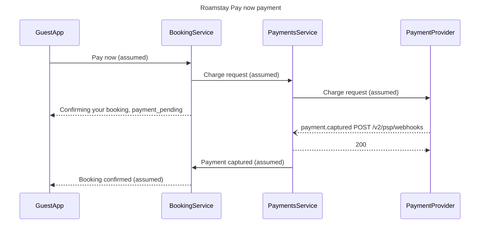

The model passes the pre-write check and composes into a single `use_figma` call. Nothing has been written to Figma yet. Here is the write gate.

**What the board answers:** in what order the guest app, booking-service, payments-service and the payment provider exchange messages during a Roamstay Pay now payment, so engineers and the PM can agree where failure handling is needed.

**Glance lines**
- First glance: message 5, the `payment.captured` webhook to `/v2/psp/webhooks`. It gets the one pink accent through `%% focus: 5`.
- Second glance: messages 1 to 4, the charge request and the "Confirming your booking" wait.
- Last glance: messages 6 to 8, the `200` and the booking confirmation.

**The checked model**

- Check: passed, with 4 participants and 8 messages (the budget is 5 and 12).
- Composer: 4 participants and 8 messages to read back, 48,531 of the 50,000 characters one call allows, in the default FigJam design.
- Settings: Balanced detail, Engineer audience, Laptop reading distance.

**Critique**
- Where the eye goes first: message 5, the accented webhook, which is the message the board most needs read.
- The title names the flow without repeating the webhook claim.
- Five of the eight messages say "(assumed)" in their label, so they won't read as confirmed behavior.
- Nothing drawn competes with the accent: there are no zones, and sequence diagrams take no other styling.

**Target file:** `<test-file-key>`, the existing file you named. This work didn't create it, so I'll read it first to confirm it's a FigJam board and to record what's already on it. The new board goes in its own section, 400 px to the right of the existing content, and nothing already there is moved or deleted. If the read shows the file isn't a FigJam board, I'll stop and come back to you before switching to a new file in the Barter team plan, left in drafts with no project.

**What gets written:** one framed board section containing the title, subtitle, 4 participants with their lifelines, 8 numbered messages, the key and the source line. No pins, stickies or other extensions.

**Calls this will use:** `create_session`, a `get_figjam` read before the write, one `use_figma` compose call and a `get_figjam` read-back. That's four calls. If you're on a Starter plan or a View or Collab seat, those four come out of a monthly allowance of six.

**Rollback:** delete the one board section this write returns. That only happens if you later say yes to a question that names the board by its title.

Should I write the "Roamstay Pay now payment" board into `<test-file-key>` as described?

HVR self-scan: 0 hard blockers. Fixed: none. Kept with reason: none.