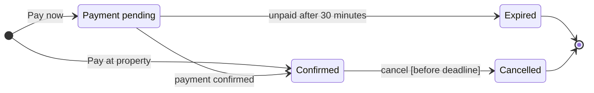

# FJR-005 turn 3 transcript

**User:** Yes, go ahead.

**Tool call:** `Bash` `{"command": "cd /private/var/folders/3c/zfqcqsts0kn19cgblj82gqhm0000gn/T/devin-compare-bench/FJR-005/sk-create-figjam; cat assets/templates/state.md; cat references/quality-rubric.md; wc -l references/style-guide.md; python3 scripts/flow_check.py --help 2>&1 | head -30", "description": "Read state template, quality rubric and check usage"}`

**Tool result:** `Bash`

```text
"---\ntitle: \"FigJam State Templates\"\ndescription: \"State patterns that pass the pre-write check: a lifecycle, a composite with its own entry and a guarded choice.\"\ncontextType: general\nimportance_tier: important\ntrigger_phrases:\n  - \"state templates\"\n  - \"figjam state pattern\"\nversion: 1.0.0.0\n---\n\n# FigJam State Templates\n\nCopy/apply patterns for a state model. Each pattern passes `scripts/flow_check.py`, and `references/types/state.md` holds the rules.\n\n**Loading Condition:** CONDITIONAL, with `references/types/state.md`\n**Purpose:** Starting points for a state diagram\n**Scope:** Three patterns. The provenance table and the reply shape are in `assets/flow-templates.md`\n\n---\n\n## 1. USAGE\n\n- States are nouns or adjectives and labels are the events that move between them\n- A long state name goes in a description, `Pending: Waiting for payment`, so the id stays one word\n- No note and no style line, which would grow phantom states on the board\n\n---\n\n## 2. PATTERNS\n\n### Lifecycle\n\n```mermaid\nstateDiagram-v2\n    direction LR\n    [*] --> Draft\n    Draft --> InReview: submit\n    InReview --> Draft: request changes\n    InReview --> Published: approve\n    Published --> Archived: archive\n    Archived --> [*]\n```\n\n### Composite with its own entry\n\n```mermaid\nstateDiagram-v2\n    direction LR\n    [*] --> Trial\n    Trial --> Active: subscribe\n    state Active {\n        [*] --> Paid\n        Paid --> PastDue: payment fails\n       
```

**Tool call:** `Bash` `{"command": "cd /private/var/folders/3c/zfqcqsts0kn19cgblj82gqhm0000gn/T/devin-compare-bench/FJR-005/sk-create-figjam; grep -n \"%% title\\|%% subtitle\\|%% source\\|%% focus\" assets/flow-templates.md references/style-guide.md | head; sed -n 1,60p assets/examples/state-roamstay-booking.md | grep -n \"%%\\|mermaid\" ", "description": "Check comment line format for model metadata"}`

**Tool result:** `Bash`

```text
"assets/flow-templates.md:46:%% title: Start a return\nassets/flow-templates.md:47:%% subtitle: How a customer starts a return in the app, from the order list to a confirmed return\nassets/flow-templates.md:48:%% source: Sources: five app screenshots and the returns doc. Left out: free pickup over 100 euros, a proposal.\nassets/flow-templates.md:53:- `%% title:` names the board. With none, the composer takes a Mermaid frontmatter title, a sequence or gantt `title` line, then `Diagram <n>`\nassets/flow-templates.md:54:- `%% subtitle:` is one sentence under the title on who reads the board and why\nassets/flow-templates.md:55:- `%% source:` is the line under the key naming the sources and what was left out\nassets/flow-templates.md:113:Divide the ordered source list into groups of at most 9 nodes before the first Mermaid block, each group ending on a hand-off node that names it, so the split is read off the sources rather than a model that already overran. A flow over 9 nodes ends the first diagram on a named hand-off and starts the second diagram from the same name. Both diagrams go into the same file as two boards, read left to right: the second write passes the `fileKey` the first one used, and each board's `%% title:` carries its ordinal and its hand-off, such as `1. Sign up` and `2. Setup`. Every source step lands in one of the diagrams or is listed as left out under the provenance table.\nreferences/style-guide.md:38:The board carries one accent, by default a heavy pink o
```

**Tool call:** `Bash` `{"command": "sed -n 38,56p /private/var/folders/3c/zfqcqsts0kn19cgblj82gqhm0000gn/T/devin-compare-bench/FJR-005/sk-create-figjam/assets/flow-templates.md; mkdir -p /tmp/po-flow-booking && cat > /tmp/po-flow-booking/model.md <<'EOF'\n```mermaid\n%% title: Booking status lifecycle\n%% subtitle: Which statuses a booking can hold and what moves it between them, for the Booking squad\n%% source: Source: Roamstay company context, reviewed 2026-09-18. Left out: what follows Confirmed, cancelling after the deadline, date changes.\n%% focus: PaymentPending\nstateDiagram-v2\n    direction LR\n    state `

**Tool result:** `Bash`

```text
"- A user flow and a process each carry exactly one `style` line, which marks the first glance. A styled goal, failing end or decision keeps its kind and takes a pink outline, and a styled step is drawn light pink. `style done fill:#CDF4D3,stroke:#66D575` makes that end the goal and the light red pair makes an end a failure. Every pair comes from `references/style-guide.md`, and any other colour is refused or counts as a second accent\n- Write `flowchart LR` unless the chain is short, because a board reads wider than it reads tall\n\n### Board lines\n\nThe board's own text rides on `%%` comment lines, which the check ignores and the composer reads. Each one is optional, and the generated fallback strips them all:\n\n```text\n%% title: Start a return\n%% subtitle: How a customer starts a return in the app, from the order list to a confirmed return\n%% source: Sources: five app screenshots and the returns doc. Left out: free pickup over 100 euros, a proposal.\n%% zone: Find the order: orders, detail\n%% zone: Request the return: window, reason, method\n```\n\n- `%% title:` names the board. With none, the composer takes a Mermaid frontmatter title, a sequence or gantt `title` line, then `Diagram <n>`\n- `%% subtitle:` is one sentence under the title on who reads the board and why\n- `%% source:` is the line under the key naming the sources and what was left out\n- `%% zone: <label>: <id>, <id>` groups nodes in a tinted section. A user flow or a process without lanes reads its zo
```

**Tool call:** `Bash` `{"command": "sed -i '' 's/state \"payment pending\"/state \"Payment pending\"/' /tmp/po-flow-booking/model.md && python3 scripts/flow_check.py /tmp/po-flow-booking/model.md && python3 scripts/compose_board.py /tmp/po-flow-booking/model.md --diagram 1 --out /tmp/po-flow-booking/compose.js; wc -c /tmp/po-flow-booking/compose.js", "description": "Recheck the model and compose the board code"}`

**Tool result:** `Bash`

```text
"  diagram 1, state: ok, 4 states and 7 transitions\nPASSED 1 diagram(s) in model.md\nCOMPOSED diagram 1, 4 states and 7 transitions: 8 nodes and 7 connectors to read back, 48424 characters in /tmp/po-flow-booking/compose.js, drawn in the design FigJam default\n   48424 /tmp/po-flow-booking/compose.js"
```

**Assistant:**

The reading is settled, so this is the separate write gate. The model below passes the pre-write check, and I composed the board code from it (about 48,000 characters, under the 50,000 a single call allows). Nothing has been written to Figma yet.



**What the board answers:** which statuses can a booking hold, and what moves it between them? That lets the Booking squad check expiry and cancellation edge cases before planning work.

**How it reads**
- **First glance:** Payment pending, outlined in pink, because that's where the expiry edge case starts.
- **Second glance:** the two exits from Payment pending, confirmed by webhook or expired after 30 minutes.
- **Last glance:** the Pay at property route straight to Confirmed, and the Cancelled end.

**Four quick checks on the sketch**
- Your eye lands on Payment pending first, which is the state the board most needs read.
- Nothing pulls focus from it. The title names the topic, not the claim.
- Confirmed has no end arrow, which could look unfinished. The source line at the bottom names that gap.
- The settings are Balanced detail, a Mixed audience, Laptop distance and no zones.

**Write plan**
- **Target:** the existing FigJam file `<test-file-key>`. I'll add one framed board with the title, subtitle, 4 states, 7 transitions, a key and the source line. I'm not adding any notes or other extras.
- **Placement:** 400 px to the right of everything already in the file. I won't move, change or delete any existing content.
- **Plan:** you didn't say which plan this file is in, and adding a board doesn't change it.
- **Calls (4):**
  - `create_session`
  - `get_figjam`, to record what's already in the file so I can confirm afterwards that it wasn't touched
  - `use_figma`, to draw the board
  - `get_figjam`, to read the board back

  Each call counts against Figma's monthly limit of six calls on a Starter plan or a View or Collab seat.
- **If the file isn't FigJam or won't open:** I'll stop and ask before creating a new file in the Barter team plan, in drafts with no project. A new file needs its own yes.
- **Rollback:** delete the one board section this write creates. I'll only do that if you ask, naming it, and it never touches content already in the file.

**Question:** Shall I write this board into `<test-file-key>`?
- Recommended: yes.
- Why: the model passed the check, every state and transition comes from the source, and the write only adds a board.

HVR self-scan: 0 hard blockers. Fixed: none. Kept with reason: none.
