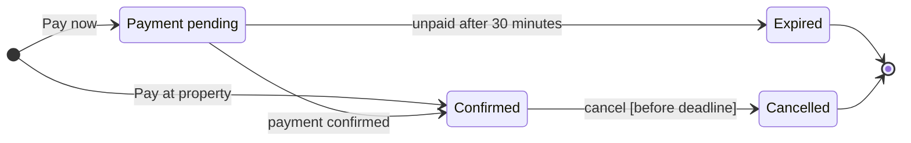

The reading is settled, so this is the separate write gate. The model below passes the pre-write check, and I composed the board code from it (about 48,000 characters, under the 50,000 a single call allows). Nothing has been written to Figma yet.

**What the board answers:** which statuses can a booking hold, and what moves it between them? That lets the Booking squad check expiry and cancellation edge cases before planning work.

**How it reads**
- **First glance:** Payment pending, outlined in pink, because that's where the expiry edge case starts.
- **Second glance:** the two exits from Payment pending, confirmed by webhook or expired after 30 minutes.
- **Last glance:** the Pay at property route straight to Confirmed, and the Cancelled end.

**Four quick checks on the sketch**
- Your eye lands on Payment pending first, which is the state the board most needs read.
- Nothing pulls focus from it. The title names the topic, not the claim.
- Confirmed has no end arrow, which could look unfinished. The source line at the bottom names that gap.
- The settings are Balanced detail, a Mixed audience, Laptop distance and no zones.

**Write plan**
- **Target:** the existing FigJam file `<test-file-key>`. I'll add one framed board with the title, subtitle, 4 states, 7 transitions, a key and the source line. I'm not adding any notes or other extras.
- **Placement:** 400 px to the right of everything already in the file. I won't move, change or delete any existing content.
- **Plan:** you didn't say which plan this file is in, and adding a board doesn't change it.
- **Calls (4):**
  - `create_session`
  - `get_figjam`, to record what's already in the file so I can confirm afterwards that it wasn't touched
  - `use_figma`, to draw the board
  - `get_figjam`, to read the board back

  Each call counts against Figma's monthly limit of six calls on a Starter plan or a View or Collab seat.
- **If the file isn't FigJam or won't open:** I'll stop and ask before creating a new file in the Barter team plan, in drafts with no project. A new file needs its own yes.
- **Rollback:** delete the one board section this write creates. I'll only do that if you ask, naming it, and it never touches content already in the file.

**Question:** Shall I write this board into `<test-file-key>`?
- Recommended: yes.
- Why: the model passed the check, every state and transition comes from the source, and the write only adds a board.

HVR self-scan: 0 hard blockers. Fixed: none. Kept with reason: none.