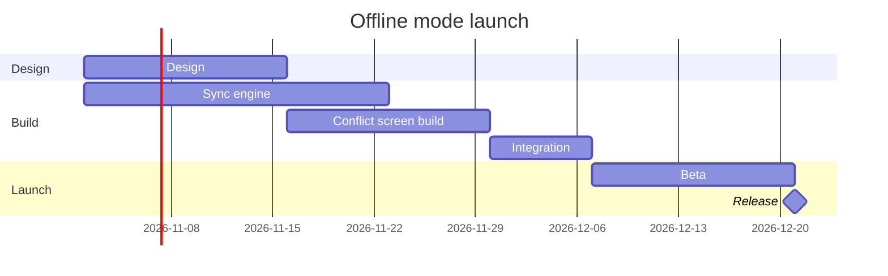

# FJ-009 turn 2 transcript

**User:** Yes, that reading is right.

**Tool call:** `ToolSearch` `{"query": "figma", "max_results": 10}`

**Tool result:** `ToolSearch`

```text
"No matching deferred tools found"
```

**Tool call:** `Read` `{"file_path": "/private/var/folders/3c/zfqcqsts0kn19cgblj82gqhm0000gn/T/devin-compare-bench/FJ-009/sk-create-figjam/references/quality-rubric.md"}`

**Tool result:** `Read`

```text
"1\t---\n2\ttitle: \"FigJam Diagram Quality Rubric\"\n3\tdescription: \"The taste gate a FigJam model passes before the write gate, translated from sk-design-diagram's success criteria: type fit, the remove test, signal, the check, the board, the design rubric that scores a composed board and the reply.\"\n4\tcontextType: implementation\n5\timportance_tier: important\n6\ttrigger_phrases:\n7\t  - \"figjam quality rubric\"\n8\t  - \"diagram taste gate\"\n9\t  - \"remove test\"\n10\t  - \"figjam review checklist\"\n11\t  - \"figjam design rubric\"\n12\tversion: 1.0.4.0\n13\t---\n14\t\n15\t# FigJam Diagram Quality Rubric\n16\t\n17\tThe script checks what a script can see. This rubric is the rest: whether the diagram should exist, whether every node earns its place and whether the reader can trust what lands on the board. Walk it after the check passes and before the write gate.\n18\t\n19\t**Loading Condition:** CONDITIONAL, on every Flow route before the write gate\n20\t**Purpose:** The judgement pass between the pre-write check and the gate\n21\t**Scope:** The model, the provenance table, the planned extensions and, after the write, the board and the reply\n22\t\n23\t---\n24\t\n25\t## 1. TYPE FIT\n26\t\n27\t- [ ] The type answers the reader's question, as `references/flow-mode.md` Section 3 maps it\n28\t- [ ] A table, a list or a paragraph would not do the same job. If it would, say so and offer that instead\n29\t- [ ] The type's reference in `references/types/` was loaded and i
```

**Tool call:** `Read` `{"file_path": "/private/var/folders/3c/zfqcqsts0kn19cgblj82gqhm0000gn/T/devin-compare-bench/FJ-009/sk-create-figjam/references/style-guide.md"}`

**Tool result:** `Read`

```text
"1\t---\n2\ttitle: \"FigJam Diagram Style Guide\"\n3\tdescription: \"The colour every composed FigJam board draws by kind in the shipped design, the type scale and the 8 pixel grid, the palette pairs the check accepts with their measured contrast, and the spacing bands, translated from sk-design-diagram's style guide and derivation record.\"\n4\tcontextType: implementation\n5\timportance_tier: important\n6\ttrigger_phrases:\n7\t  - \"figjam style guide\"\n8\t  - \"figjam palette\"\n9\t  - \"figjam colour by kind\"\n10\t  - \"figjam type scale\"\n11\t  - \"palette derivation record\"\n12\t  - \"figjam contrast\"\n13\tversion: 1.0.3.0\n14\t---\n15\t\n16\t# FigJam Diagram Style Guide\n17\t\n18\tThe rules for colour, type and spacing on a FigJam board. The composer in `assets/compose-board.js` draws every board in the design `assets/figjam-design.md` holds, which ships as the tables below record, and every hex a model, a design or a note extension uses comes from the palette in Section 3. `scripts/flow_check.py` refuses any other.\n19\t\n20\t**Loading Condition:** CONDITIONAL, before the gate on every Flow route, and when a model or a note extension uses colour\n21\t**Purpose:** Names the colour each kind draws in, the type scale, the grid, the palette pairs the check accepts and the measured contrast record\n22\t**Scope:** The composed board, Mermaid `style`, `classDef` and `linkStyle` colours, sticky and pin colours for notes, and the contrast record the self-test re-measures\n
```

**Tool call:** `Bash` `{"command": "S=$(mktemp -d) && echo \"$S\" > /dev/null && cat > \"$S/model.md\" <<'EOF'\n```mermaid\ngantt\n    title Offline mode launch\n    %% subtitle: Which offline mode work runs when, and what Integration waits for before the release\n    %% source: Source: the offline mode launch plan as given in the request. Dates follow from the durations, weeks count as 7 calendar days.\n    %% focus: release\n    dateFormat YYYY-MM-DD\n    section Design\n    Design :design, 2026-11-02, 2w\n    section Build\n    Sync engine :engine, 2026-11-02, 3w\n    Conflict screen build :screen, after design, `

**Tool result:** `Bash`

```text
"  diagram 1, gantt: ok, 6 tasks in 3 sections\nPASSED 1 diagram(s) in model.md\nexit 0\nCOMPOSED diagram 1, 6 tasks in 3 sections: 6 nodes and 5 connectors to read back, 18044 characters in /var/folders/3c/zfqcqsts0kn19cgblj82gqhm0000gn/T/tmp.B8HRKQt33J/code.js, drawn in the design FigJam default\nexit 0\n/var/folders/3c/zfqcqsts0kn19cgblj82gqhm0000gn/T/tmp.B8HRKQt33J"
```

**Tool call:** `Bash` `{"command": "rm -rf /var/folders/3c/zfqcqsts0kn19cgblj82gqhm0000gn/T/tmp.B8HRKQt33J && echo removed", "description": "Delete the scratch folder"}`

**Tool result:** `Bash`

```text
"removed"
```

**Assistant:**

The model passes the check and composes. The board can't be written yet, because no Figma board tool is connected. I searched the tool list again this turn and found no `use_figma`, `get_figjam`, `create_session` or `generate_diagram`. The `fj` route can't draw a gantt chart. Nothing exists on the board.



**Check:** `PASSED`, 6 task lines in 3 sections. The check counts the Release milestone as a task, and the board counts it once, as a milestone.

**Question:** which offline mode work runs when, and when does it release?
**Outcome:** a reader sees the order of the work, what Integration waits for and the release date.
**First glance:** the Release milestone on 21 December, marked by the `%% focus:` line.
**Second glance:** Integration, which waits for Sync engine and Conflict screen build.
**Last glance:** Design and Sync engine, which start together on 2 November.

**Plan and file:** Loomlist Product, as you named it. The target is the existing file `<draft-file-key>`, as a new board section beside what it holds. No new file or plan lookup is needed.
**Writes:** one composed board with 3 sections, 5 tasks, 1 milestone and 5 dependency arrows on one axis. It has a title, a subtitle, a key and a source line, and reads at laptop distance.
**Extensions:** none.
**Calls once a Figma connection exists:**
- `create_session` with the file key.
- One `get_figjam` read of the file before the write, to check for a section already titled "Offline mode launch" and to have something to compare against.
- One `use_figma` call.
- The `get_figjam` read-back.
- One more read of the file to confirm existing content is unchanged.

That is five Figma calls. A Starter plan or a View or Collab seat allows only six a month.
**Rollback:** delete the one board section the write returns, only on a reply that names it.

**Missing:** Figma's hosted MCP server connected with `use_figma` and `get_figjam`. The model above is yours to keep either way.

Do you want me to hold this board until that connection is in place and then write it into the file on your yes?
