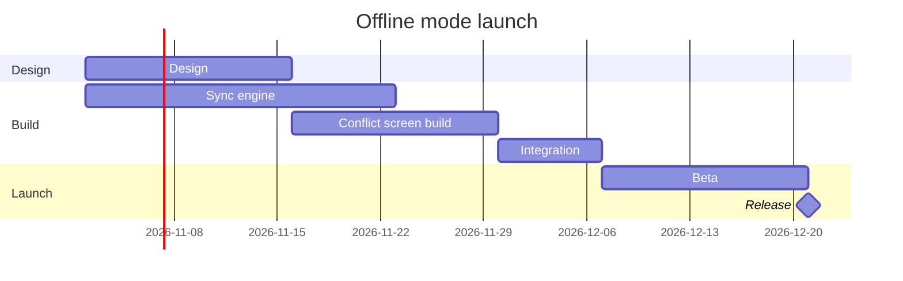

The model passes the check and composes. The board can't be written yet, because no Figma board tool is connected. I searched the tool list again this turn and found no `use_figma`, `get_figjam`, `create_session` or `generate_diagram`. The `fj` route can't draw a gantt chart. Nothing exists on the board.

**Check:** `PASSED`, 6 task lines in 3 sections. The check counts the Release milestone as a task, and the board counts it once, as a milestone.

**Question:** which offline mode work runs when, and when does it release?
**Outcome:** a reader sees the order of the work, what Integration waits for and the release date.
**First glance:** the Release milestone on 21 December, marked by the `%% focus:` line.
**Second glance:** Integration, which waits for Sync engine and Conflict screen build.
**Last glance:** Design and Sync engine, which start together on 2 November.

**Plan and file:** Loomlist Product, as you named it. The target is the existing file `<draft-file-key>`, as a new board section beside what it holds. No new file or plan lookup is needed.
**Writes:** one composed board with 3 sections, 5 tasks, 1 milestone and 5 dependency arrows on one axis. It has a title, a subtitle, a key and a source line, and reads at laptop distance.
**Extensions:** none.
**Calls once a Figma connection exists:**
- `create_session` with the file key.
- One `get_figjam` read of the file before the write, to check for a section already titled "Offline mode launch" and to have something to compare against.
- One `use_figma` call.
- The `get_figjam` read-back.
- One more read of the file to confirm existing content is unchanged.

That is five Figma calls. A Starter plan or a View or Collab seat allows only six a month.
**Rollback:** delete the one board section the write returns, only on a reply that names it.

**Missing:** Figma's hosted MCP server connected with `use_figma` and `get_figjam`. The model above is yours to keep either way.

Do you want me to hold this board until that connection is in place and then write it into the file on your yes?