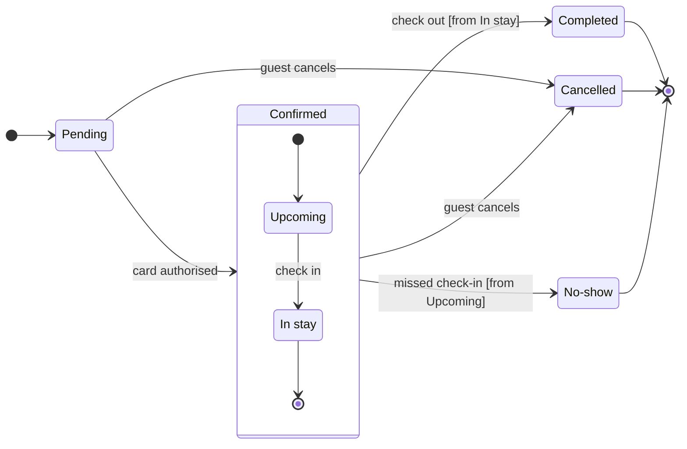

# FJ-017 turn 2 transcript

**User:** Yes, that reading is right.

**Tool call:** `Read` `{"file_path": "/private/var/folders/3c/zfqcqsts0kn19cgblj82gqhm0000gn/T/devin-compare-bench/FJ-017/sk-create-figjam/references/quality-rubric.md"}`

**Tool result:** `Read`

```text
"1\t---\n2\ttitle: \"FigJam Diagram Quality Rubric\"\n3\tdescription: \"The taste gate a FigJam model passes before the write gate, translated from sk-design-diagram's success criteria: type fit, the remove test, signal, the check, the board, the design rubric that scores a composed board and the reply.\"\n4\tcontextType: implementation\n5\timportance_tier: important\n6\ttrigger_phrases:\n7\t  - \"figjam quality rubric\"\n8\t  - \"diagram taste gate\"\n9\t  - \"remove test\"\n10\t  - \"figjam review checklist\"\n11\t  - \"figjam design rubric\"\n12\tversion: 1.0.4.0\n13\t---\n14\t\n15\t# FigJam Diagram Quality Rubric\n16\t\n17\tThe script checks what a script can see. This rubric is the rest: whether the diagram should exist, whether every node earns its place and whether the reader can trust what lands on the board. Walk it after the check passes and before the write gate.\n18\t\n19\t**Loading Condition:** CONDITIONAL, on every Flow route before the write gate\n20\t**Purpose:** The judgement pass between the pre-write check and the gate\n21\t**Scope:** The model, the provenance table, the planned extensions and, after the write, the board and the reply\n22\t\n23\t---\n24\t\n25\t## 1. TYPE FIT\n26\t\n27\t- [ ] The type answers the reader's question, as `references/flow-mode.md` Section 3 maps it\n28\t- [ ] A table, a list or a paragraph would not do the same job. If it would, say so and offer that instead\n29\t- [ ] The type's reference in `references/types/` was loaded and i
```

**Tool call:** `Read` `{"file_path": "/private/var/folders/3c/zfqcqsts0kn19cgblj82gqhm0000gn/T/devin-compare-bench/FJ-017/sk-create-figjam/references/style-guide.md"}`

**Tool result:** `Read`

```text
"1\t---\n2\ttitle: \"FigJam Diagram Style Guide\"\n3\tdescription: \"The colour every composed FigJam board draws by kind in the shipped design, the type scale and the 8 pixel grid, the palette pairs the check accepts with their measured contrast, and the spacing bands, translated from sk-design-diagram's style guide and derivation record.\"\n4\tcontextType: implementation\n5\timportance_tier: important\n6\ttrigger_phrases:\n7\t  - \"figjam style guide\"\n8\t  - \"figjam palette\"\n9\t  - \"figjam colour by kind\"\n10\t  - \"figjam type scale\"\n11\t  - \"palette derivation record\"\n12\t  - \"figjam contrast\"\n13\tversion: 1.0.3.0\n14\t---\n15\t\n16\t# FigJam Diagram Style Guide\n17\t\n18\tThe rules for colour, type and spacing on a FigJam board. The composer in `assets/compose-board.js` draws every board in the design `assets/figjam-design.md` holds, which ships as the tables below record, and every hex a model, a design or a note extension uses comes from the palette in Section 3. `scripts/flow_check.py` refuses any other.\n19\t\n20\t**Loading Condition:** CONDITIONAL, before the gate on every Flow route, and when a model or a note extension uses colour\n21\t**Purpose:** Names the colour each kind draws in, the type scale, the grid, the palette pairs the check accepts and the measured contrast record\n22\t**Scope:** The composed board, Mermaid `style`, `classDef` and `linkStyle` colours, sticky and pin colours for notes, and the contrast record the self-test re-measures\n
```

**Tool call:** `Bash` `{"command": "mktemp -d", "description": "Create scratch folder for the model"}`

**Tool result:** `Bash`

```text
"/var/folders/3c/zfqcqsts0kn19cgblj82gqhm0000gn/T/tmp.aGl9mrecbG"
```

**Tool call:** `Write` `{"file_path": "/var/folders/3c/zfqcqsts0kn19cgblj82gqhm0000gn/T/tmp.aGl9mrecbG/model.md", "content": "```mermaid\nstateDiagram-v2\n    %% title: Booking status\n    %% subtitle: Every status a Roamstay booking passes through and what moves it on, for support to follow a booking to its end\n    %% source: Source: the booking status description from the product owner. Left out: what happens when card authorisation fails, because no exit was given.\n    %% focus: Cancelled\n    direction LR\n    state \"In stay\" as InStay\n    state \"No-show\" as NoShow\n    [*] --> Pending\n    Pending --> Con`

**Tool result:** `Write`

```text
"File created successfully at: /var/folders/3c/zfqcqsts0kn19cgblj82gqhm0000gn/T/tmp.aGl9mrecbG/model.md (file state is current in your context \u2014 no need to Read it back)"
```

**Tool call:** `Bash` `{"command": "S=/var/folders/3c/zfqcqsts0kn19cgblj82gqhm0000gn/T/tmp.aGl9mrecbG && python3 -I sk-create-figjam/scripts/flow_check.py $S/model.md && python3 -I sk-create-figjam/scripts/compose_board.py $S/model.md --diagram 1 --out $S/compose.js", "description": "Run pre-write check and compose the board code"}`

**Tool result:** `Bash`

```text
"  diagram 1, state: ok, 7 states and 12 transitions\nPASSED 1 diagram(s) in model.md\nCOMPOSED diagram 1, 7 states and 12 transitions: 12 nodes and 12 connectors to read back, 42480 characters in /var/folders/3c/zfqcqsts0kn19cgblj82gqhm0000gn/T/tmp.aGl9mrecbG/compose.js, drawn in the design FigJam default"
```

**Assistant:**

The model passed the pre-write check (7 states, 12 transitions), and it composes. Nothing is written yet.

**Sketch** (the checked model, not on a board):



**Question:** which statuses can a Roamstay booking have, what moves it between them and who sets the two statuses support asks about?
**Outcome:** support can follow a booking from Pending to its end and knows who to ask about a Cancelled or a No-show booking.
**First glance:** Cancelled, marked with the pink outline.
**Second glance:** the two notes, one beside Cancelled and one beside No-show, with the light gray end states around them.
**Last glance:** Pending, where every booking starts.
**Plan:** <figma-plan-1>, a Pro team plan where you hold a Full seat (`team::1297132374291579406`). Your account has no plan named "Roamstay Product" or "Barter team", and <figma-plan-1> is the only Barter plan on it. The other two are "<figma-plan-3>" and "<figma-plan-2>".
**File:** a new FigJam file named "Booking status", created in your drafts in that plan, with no project.
**Writes:** one composed board with a title, a subtitle, a key and a source line, at the Laptop reading distance. It draws 7 states and 12 transitions, with Confirmed as a section around Upcoming and In stay.
**Extensions:** two single stickies added after the board lands, one beside Cancelled reading "Set by the guest" and one beside No-show reading "Set by the hotel".
**Calls:** `create_new_file`, `create_session`, one `use_figma` for the board, one `use_figma` for the two stickies and one `get_figjam` read-back.
**Rollback:** delete the new file. If only the notes are wrong, delete the two stickies by their ids.

Write it?
