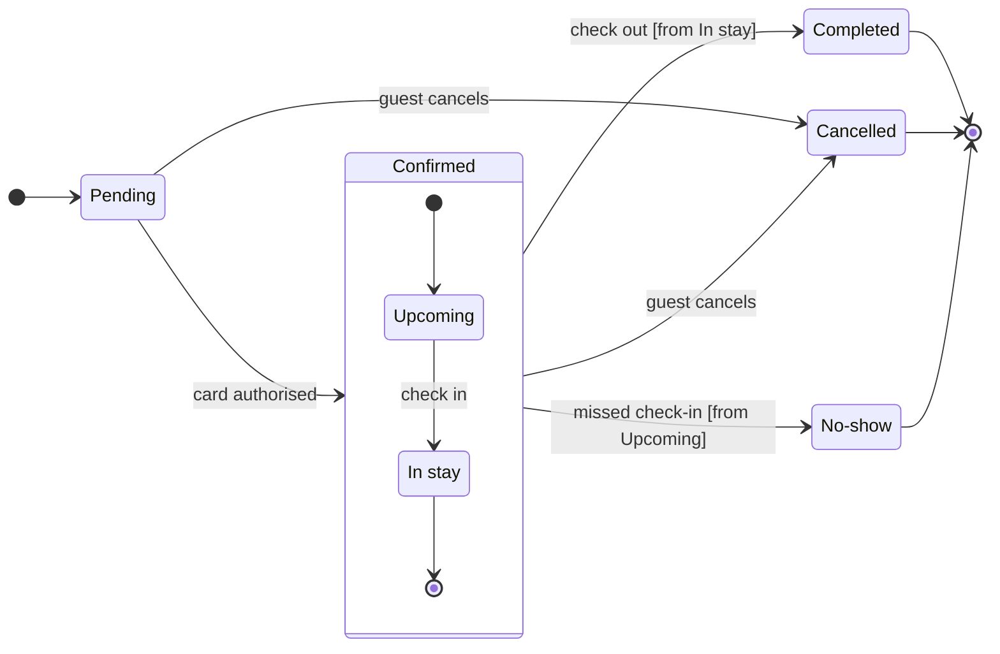

The model passed the pre-write check (7 states, 12 transitions), and it composes. Nothing is written yet.

**Sketch** (the checked model, not on a board):

**Question:** which statuses can a Roamstay booking have, what moves it between them and who sets the two statuses support asks about?
**Outcome:** support can follow a booking from Pending to its end and knows who to ask about a Cancelled or a No-show booking.
**First glance:** Cancelled, marked with the pink outline.
**Second glance:** the two notes, one beside Cancelled and one beside No-show, with the light gray end states around them.
**Last glance:** Pending, where every booking starts.
**Plan:** <figma-plan-1>, a Pro team plan where you hold a Full seat (`team::<plan-id>`). Your account has no plan named "Roamstay Product" or "Barter team", and <figma-plan-1> is the only Barter plan on it. The other two are "<figma-plan-3>" and "<figma-plan-2>".
**File:** a new FigJam file named "Booking status", created in your drafts in that plan, with no project.
**Writes:** one composed board with a title, a subtitle, a key and a source line, at the Laptop reading distance. It draws 7 states and 12 transitions, with Confirmed as a section around Upcoming and In stay.
**Extensions:** two single stickies added after the board lands, one beside Cancelled reading "Set by the guest" and one beside No-show reading "Set by the hotel".
**Calls:** `create_new_file`, `create_session`, one `use_figma` for the board, one `use_figma` for the two stickies and one `get_figjam` read-back.
**Rollback:** delete the new file. If only the notes are wrong, delete the two stickies by their ids.

Write it?