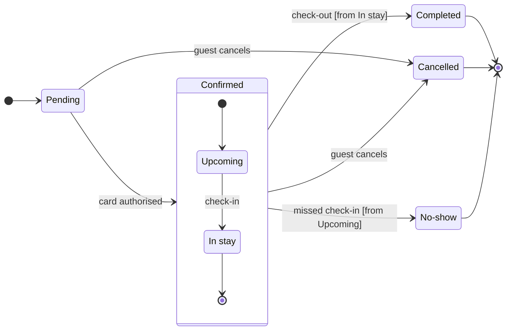

# FJ-026 turn 2 transcript

**User:** Yes, that reading is right.

**Tool call:** `ToolSearch` `{"query": "select:mcp__figma-remote__create_session,mcp__figma-remote__get_figjam,mcp__figma-remote__use_figma,mcp__figma-remote__whoami", "max_results": 4}`

**Tool result:** `ToolSearch`

```text
[{"type": "tool_reference", "tool_name": "mcp__figma-remote__create_session"}, {"type": "tool_reference", "tool_name": "mcp__figma-remote__get_figjam"}, {"type": "tool_reference", "tool_name": "mcp__figma-remote__use_figma"}, {"type": "tool_reference", "tool_name": "mcp__figma-remote__whoami"}]
```

**Tool call:** `Bash` `{"command": "mktemp -d && cd /private/var/folders/3c/zfqcqsts0kn19cgblj82gqhm0000gn/T/devin-compare-bench/FJ-026 && python3 sk-create-figjam/scripts/flow_check.py --help 2>&1 | head -30 && sed -n 1,60p sk-create-figjam/assets/examples/state-roamstay-booking.md", "description": "Create scratch folder, show check usage and a state example"}`

**Tool result:** `Bash`

```text
"/var/folders/3c/zfqcqsts0kn19cgblj82gqhm0000gn/T/tmp.RmZURlfTuF\nmermaid_extract: --help: not a Mermaid file\nUNREADABLE --help: the extractor refused it\n---\ntitle: \"Example - State - Roamstay Booking\"\ndescription: \"A worked state diagram on the fictional Roamstay booking marketplace: a booking's status field drawn from a product doc, its end states coloured by the composer, a playback, a gate message and the reply.\"\ncontextType: general\nimportance_tier: normal\ntrigger_phrases:\n  - \"state example\"\n  - \"roamstay booking states\"\nversion: 1.0.3.0\n---\n\n# Example - State - Roamstay Booking\n\nRoamstay is a fictional booking marketplace used across the Product Owner fixtures. Every state and rule here is invented for the example.\n\n---\n\n## 1. REQUEST\n\n```text\n$figjam the booking status lifecycle from the bookings doc, and colour the end states so support can spot them\n```\n\n| Doc line | Says | Class |\n|---|---|---|\n| 2.1 | A booking starts as Pending until the card is authorised | current behavior |\n| 2.2 | Confirmed covers Upcoming and In stay. Check-in moves Upcoming to In stay | current behavior |\n| 2.3 | Check-out ends the stay as Completed | current behavior |\n| 2.4 | A guest can cancel while Pending or Confirmed | current behavior |\n| 2.5 | The hotel marks No-show the day after a missed check-in | current behavior |\n\n---\n\n## 2. TYPE AND DIALS\n\n- **Reader question:** which statuses exist and what moves a booking between them? A state di
```

**Tool call:** `Read` `{"file_path": "/private/var/folders/3c/zfqcqsts0kn19cgblj82gqhm0000gn/T/devin-compare-bench/FJ-026/sk-create-figjam/assets/examples/state-roamstay-booking.md", "offset": 58}`

**Tool result:** `Read`

```text
"58\t\n59\t## 4. MODEL\n60\t\n61\t```mermaid\n62\tstateDiagram-v2\n63\t    %% title: Booking status\n64\t    %% subtitle: Every status a Roamstay booking passes through, and what moves it on\n65\t    %% source: Source: the bookings doc, Section 2.\n66\t    direction LR\n67\t    [*] --> Pending\n68\t    Pending --> Confirmed: card authorised\n69\t    state Confirmed {\n70\t        [*] --> Upcoming\n71\t        Upcoming --> InStay: check in\n72\t        InStay --> [*]\n73\t    }\n74\t    Confirmed --> Completed: check out [from InStay]\n75\t    Pending --> Cancelled: guest cancels\n76\t    Confirmed --> Cancelled: guest cancels\n77\t    Confirmed --> NoShow: missed check-in [from Upcoming]\n78\t    Completed --> [*]\n79\t    Cancelled --> [*]\n80\t    NoShow --> [*]\n81\t```\n82\t\n83\t`NoShow` reads `NoShow` on the board. A description line, `NoShow: No-show`, would show the doc's own word.\n84\t\n85\t### Provenance\n86\t\n87\t| State | Source | Source class |\n88\t|---|---|---|\n89\t| Pending | Doc 2.1 | current behavior |\n90\t| Confirmed, Upcoming, InStay | Doc 2.2 | current behavior |\n91\t| Completed | Doc 2.3 | current behavior |\n92\t| Cancelled | Doc 2.4 | current behavior |\n93\t| NoShow | Doc 2.5 | current behavior |\n94\t\n95\t### Check\n96\t\n97\t```text\n98\t  diagram 1, state: ok, 7 states and 12 transitions\n99\tPASSED 1 diagram(s) in model.md\n100\t```\n101\t\n102\t---\n103\t\n104\t## 5. GATE\n105\t\n106\tThe gate is its own reply, sent after the playback's ans
```

**Tool call:** `Bash` `{"command": "cd /private/var/folders/3c/zfqcqsts0kn19cgblj82gqhm0000gn/T/devin-compare-bench/FJ-026/sk-create-figjam/scripts && sed -n 1,50p flow_check.py | head -60; python3 compose_board.py --help 2>&1 | head -30", "description": "Show check and composer usage"}`

**Tool result:** `Bash`

```text
"#!/usr/bin/env python3\n# \u2500\u2500\u2500\u2500\u2500\u2500\u2500\u2500\u2500\u2500\u2500\u2500\u2500\u2500\u2500\u2500\u2500\u2500\u2500\u2500\u2500\u2500\u2500\u2500\u2500\u2500\u2500\u2500\u2500\u2500\u2500\u2500\u2500\u2500\u2500\u2500\u2500\u2500\u2500\u2500\u2500\u2500\u2500\u2500\u2500\u2500\u2500\u2500\u2500\u2500\u2500\u2500\u2500\u2500\u2500\u2500\u2500\u2500\u2500\u2500\u2500\u2500\u2500\n# COMPONENT: FIGJAM MODEL PRE-WRITE CHECK\n# \u2500\u2500\u2500\u2500\u2500\u2500\u2500\u2500\u2500\u2500\u2500\u2500\u2500\u2500\u2500\u2500\u2500\u2500\u2500\u2500\u2500\u2500\u2500\u2500\u2500\u2500\u2500\u2500\u2500\u2500\u2500\u2500\u2500\u2500\u2500\u2500\u2500\u2500\u2500\u2500\u2500\u2500\u2500\u2500\u2500\u2500\u2500\u2500\u2500\u2500\u2500\u2500\u2500\u2500\u2500\u2500\u2500\u2500\u2500\u2500\u2500\u2500\u2500\n\n\"\"\"Check a FigJam diagram model before it is written to a board.\n\nA board is slow to fix once it exists: the composer owns its layout, so every\nfix is a new write. Worse, neither the composer nor the generated fallback\ndraws all that Mermaid can say, so a model can promise a reader something the\nboard never shows. The rules each diagram kind carries are checked on the\nMermaid model first, and a model that breaks one is never written. The same\nparse is measured, so a shape that is legal and still hard to read, such as a\nrank of six steps or a connector that doubles back, is caught here rather than\non the board.\n\nEach Mermaid block in the file is
```

**Tool call:** `Write` `{"file_path": "/var/folders/3c/zfqcqsts0kn19cgblj82gqhm0000gn/T/tmp.RmZURlfTuF/model.md", "content": "```mermaid\nstateDiagram-v2\n    %% title: Roamstay booking status\n    %% subtitle: Every status a Roamstay booking can hold, what moves it on and which statuses end it, for support\n    %% source: Source: the request's description of the booking lifecycle, read as current behavior.\n    %% focus: Cancelled because two statuses lead here\n    direction LR\n    state \"In stay\" as InStay\n    state \"No-show\" as NoShow\n    [*] --> Pending\n    Pending --> Confirmed: card authorised\n    sta`

**Tool result:** `Write`

```text
"File created successfully at: /var/folders/3c/zfqcqsts0kn19cgblj82gqhm0000gn/T/tmp.RmZURlfTuF/model.md (file state is current in your context \u2014 no need to Read it back)"
```

**Tool call:** `Bash` `{"command": "S=/var/folders/3c/zfqcqsts0kn19cgblj82gqhm0000gn/T/tmp.RmZURlfTuF && python3 flow_check.py $S/model.md; echo \"exit $?\"; python3 compose_board.py $S/model.md --diagram 1 --out $S/code.js; echo \"exit $?\"; wc -c $S/code.js", "description": "Run pre-write check and compose the board code"}`

**Tool result:** `Bash`

```text
"  diagram 1, state: ok, 7 states and 12 transitions\nPASSED 1 diagram(s) in model.md\nexit 0\nCOMPOSED diagram 1, 7 states and 12 transitions: 12 nodes and 12 connectors to read back, 42448 characters in /var/folders/3c/zfqcqsts0kn19cgblj82gqhm0000gn/T/tmp.RmZURlfTuF/code.js, drawn in the design FigJam default\nexit 0\n   42448 /var/folders/3c/zfqcqsts0kn19cgblj82gqhm0000gn/T/tmp.RmZURlfTuF/code.js"
```

**Tool call:** `mcp__figma-remote__create_session` `{"fileKey": "<draft-file-key>", "description": "Draw the Roamstay booking status lifecycle as a FigJam state diagram board in the existing file"}`

**Tool result:** `mcp__figma-remote__create_session`

```text
"{\"sessionId\":\"69738111-0563-40f7-95c5-3bb90ca8fe8a\"}"
```

**Assistant:**

The model passed the pre-write check and composed. I'm reading the existing file once now, so the gate can name any board there with the same title.

**Tool call:** `mcp__figma-remote__get_figjam` `{"fileKey": "<draft-file-key>", "nodeId": "0:1", "sessionId": "69738111-0563-40f7-95c5-3bb90ca8fe8a", "includeImagesOfNodes": false}`

**Tool result:** `mcp__figma-remote__get_figjam`

```text
[{"type": "text", "text": "<canvas id=\"0:1\" name=\"Page 1\" x=\"0\" y=\"0\" width=\"0\" height=\"0\" />"}]
```

**Assistant:**

The file is empty: the read of its one page returned no sections, so no board there shares the title and nothing on it will change. The model passed the pre-write check (7 states, 12 transitions) and composed in the default design.

Sketch, as checked:



The labels use your words. "Guest cancels" adds the actor from your request. The arrow from In stay to the end dot inside Confirmed is how the model lets check-out leave the section, and the guard on that move names In stay.

Question: which statuses a Roamstay booking can hold, what moves it between them and which ones end it.
Outcome: support can tell an end status from an open one at a glance.
First glance: Cancelled, the gray end state with the one pink outline, marked "In focus: two statuses lead here" in the key.
Second glance: Completed and No-show, the other two gray end states with their heavy outline.
Last glance: Pending in light blue, where a booking starts, and the Confirmed section around Upcoming and In stay.

Critique questions on the sketch:
- Where does the eye go first? To the pink outline on Cancelled, which is the end that two statuses lead into
- Does any move double back? No. Every move runs forward toward an end, and the check flagged no layout measure
- Is every label in the source's words? Yes, and no move carries a trigger you did not state
- Does the key explain every mark? The composer draws it from the board, with Final state naming the gray and In focus the pink

Plan: Roamstay Product, as you said. The file keeps the plan it was made in, and the connector can't confirm which plan owns it.
File: <draft-file-key>, the board added as a new section on its empty page.
Writes: one board titled "Roamstay booking status", with a subtitle, the Confirmed section, a key and a source line, at laptop reading distance.
Not drawn: a declined-card path and refunds, because you named none.
Extensions: none.
Calls: one `use_figma` and one `get_figjam` read-back. The session and the read of the file are already spent. If your seat is on a Starter plan or is View or Collab, Figma caps tool calls at six a month, and these two count against it.
Rollback: delete the one board section the write returns. That leaves the file as it is now, and I would ask again by name before deleting.

Write it?
