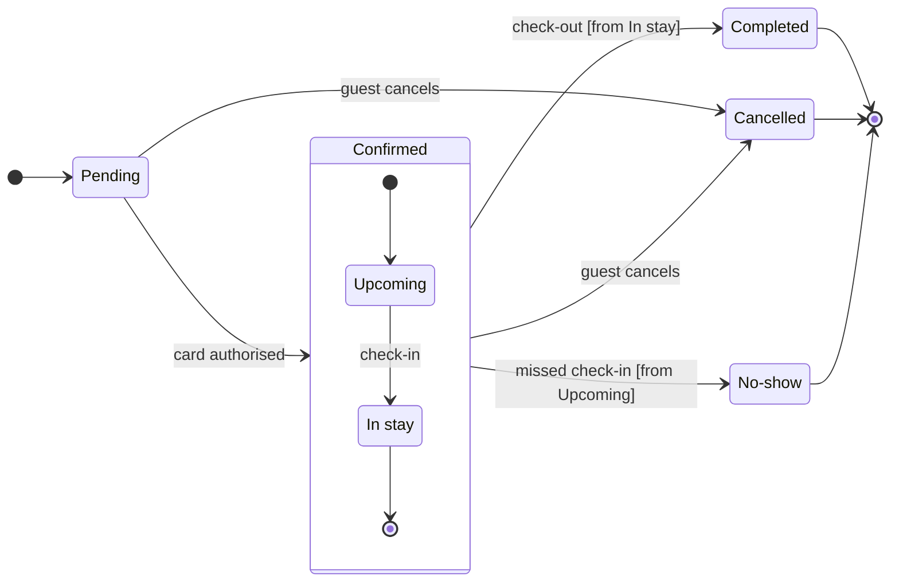

The file is empty: the read of its one page returned no sections, so no board there shares the title and nothing on it will change. The model passed the pre-write check (7 states, 12 transitions) and composed in the default design.

Sketch, as checked:

The labels use your words. "Guest cancels" adds the actor from your request. The arrow from In stay to the end dot inside Confirmed is how the model lets check-out leave the section, and the guard on that move names In stay.

Question: which statuses a Roamstay booking can hold, what moves it between them and which ones end it.
Outcome: support can tell an end status from an open one at a glance.
First glance: Cancelled, the gray end state with the one pink outline, marked "In focus: two statuses lead here" in the key.
Second glance: Completed and No-show, the other two gray end states with their heavy outline.
Last glance: Pending in light blue, where a booking starts, and the Confirmed section around Upcoming and In stay.

Critique questions on the sketch:
- Where does the eye go first? To the pink outline on Cancelled, which is the end that two statuses lead into
- Does any move double back? No. Every move runs forward toward an end, and the check flagged no layout measure
- Is every label in the source's words? Yes, and no move carries a trigger you did not state
- Does the key explain every mark? The composer draws it from the board, with Final state naming the gray and In focus the pink

Plan: Roamstay Product, as you said. The file keeps the plan it was made in, and the connector can't confirm which plan owns it.
File: <draft-file-key>, the board added as a new section on its empty page.
Writes: one board titled "Roamstay booking status", with a subtitle, the Confirmed section, a key and a source line, at laptop reading distance.
Not drawn: a declined-card path and refunds, because you named none.
Extensions: none.
Calls: one `use_figma` and one `get_figjam` read-back. The session and the read of the file are already spent. If your seat is on a Starter plan or is View or Collab, Figma caps tool calls at six a month, and these two count against it.
Rollback: delete the one board section the write returns. That leaves the file as it is now, and I would ask again by name before deleting.

Write it?