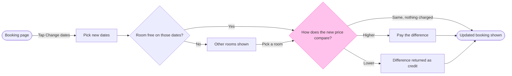

# FJ-036 turn 3 transcript

**User:** Yes, that reading is right.

**Tool call:** `ToolSearch` `{"query": "select:mcp__figma-remote__create_session,mcp__figma-remote__get_figjam,mcp__figma-remote__use_figma,mcp__figma-remote__get_screenshot", "max_results": 4}`

**Tool result:** `ToolSearch`

```text
[{"type": "tool_reference", "tool_name": "mcp__figma-remote__create_session"}, {"type": "tool_reference", "tool_name": "mcp__figma-remote__get_figjam"}, {"type": "tool_reference", "tool_name": "mcp__figma-remote__use_figma"}, {"type": "tool_reference", "tool_name": "mcp__figma-remote__get_screenshot"}]
```

**Tool call:** `Bash` `{"command": "cd /private/var/folders/3c/zfqcqsts0kn19cgblj82gqhm0000gn/T/devin-compare-bench/FJ-036/sk-create-figjam && mktemp -d && python3 -I scripts/flow_check.py --help 2>&1 | head -30 && python3 -I scripts/compose_board.py --help 2>&1 | head -30 && ls assets/examples", "description": "Create scratch folder and show script usage"}`

**Tool result:** `Bash`

```text
"/var/folders/3c/zfqcqsts0kn19cgblj82gqhm0000gn/T/tmp.ZnTpb5cnOY\nmermaid_extract: --help: not a Mermaid file\nUNREADABLE --help: the extractor refused it\n\n  compose_board.py <model.md> [--diagram N] [--out path]  -> 0 the filled code is written, 1 the model fails\n                                                             the check, 2 unreadable or no such diagram\n  compose_board.py <model.md> --model                      -> print the MODEL as JSON instead of the code\n  compose_board.py --template                              -> print the compact code with its MODEL and THEME\n                                                             placeholders, the text the Project's composer\n                                                             Knowledge file carries\n  compose_board.py --design-check                          -> print the design a board is drawn in, what it\n                                                             changes, its measures and the THEME it sends: 0 the\n                                                             design reads with no warning, 1 one or more warnings\n  compose_board.py --self-test                             -> prove every shipped model composes, its counts\n                                                             match the check, the code fits one use_figma call and\n                                                             the board it draws keeps its geometry and its design\narchitecture-loomlist-sync.md\ner-roa
```

**Tool call:** `Read` `{"file_path": "/private/var/folders/3c/zfqcqsts0kn19cgblj82gqhm0000gn/T/devin-compare-bench/FJ-036/sk-create-figjam/assets/examples/user-flow-fernhouse-return.md"}`

**Tool result:** `Read`

```text
"1\t---\n2\ttitle: \"Example - User Flow - Fernhouse Return\"\n3\tdescription: \"A worked user flow on the fictional Fernhouse store: app screenshots and a returns doc turned into a checked model with its board lines and zones, a playback, a gate message and the reply.\"\n4\tcontextType: general\n5\timportance_tier: normal\n6\ttrigger_phrases:\n7\t  - \"user flow example\"\n8\t  - \"fernhouse return flow\"\n9\tversion: 1.0.1.0\n10\t---\n11\t\n12\t# Example - User Flow - Fernhouse Return\n13\t\n14\tFernhouse is a fictional store used across the Product Owner fixtures. Every name, screen and rule here is invented for the example.\n15\t\n16\t---\n17\t\n18\t## 1. REQUEST\n19\t\n20\t```text\n21\t$flow how a customer starts a return in the app, from these screenshots and the returns doc\n22\t```\n23\t\n24\tSources: five app screenshots and a returns doc.\n25\t\n26\t| Source | Says |\n27\t|---|---|\n28\t| `Orders - Tap_ Order row.png` | The order list, a row under the finger |\n29\t| `Order detail - Tap_ Start a return.png` | The order page with a Start a return button |\n30\t| `Return reason - Select_ Reason.png` | A list of reasons |\n31\t| `Return method - Select_ Drop-off or pickup.png` | Two choices: a drop-off point or a courier pickup |\n32\t| `Return confirmed.png` | A confirmation with a QR code |\n33\t| Returns doc, Section 2 | Returns are open for 30 days after delivery. After that the app shows Contact support. Current behavior |\n34\t| Returns doc, Section 4 | A free pi
```

**Tool call:** `Write` `{"file_path": "/var/folders/3c/zfqcqsts0kn19cgblj82gqhm0000gn/T/tmp.ZnTpb5cnOY/model.md", "content": "```mermaid\nflowchart LR\n    %% title: Change booking dates\n    %% subtitle: How a Roamstay guest changes the dates of a booking in the app, from the booking page to the updated booking\n    %% source: Sources: the request description, read as current behavior. Left out: payment failure, backing out, booking rules such as cancellation windows.\n    %% zone: Choose the dates: bookingPage, pickDates, roomFree, otherRooms\n    %% zone: Settle the price: priceCheck, payDiff, creditBack, updated\`

**Tool result:** `Write`

```text
"File created successfully at: /var/folders/3c/zfqcqsts0kn19cgblj82gqhm0000gn/T/tmp.ZnTpb5cnOY/model.md (file state is current in your context \u2014 no need to Read it back)"
```

**Tool call:** `Bash` `{"command": "S=/var/folders/3c/zfqcqsts0kn19cgblj82gqhm0000gn/T/tmp.ZnTpb5cnOY && python3 -I scripts/flow_check.py $S/model.md; echo \"check exit $?\"; python3 -I scripts/compose_board.py $S/model.md --diagram 1 --out $S/code.js; echo \"compose exit $?\"; wc -c $S/code.js", "description": "Run pre-write check and compose board code"}`

**Tool result:** `Bash`

```text
"  diagram 1, user flow: ok, 8 nodes and 10 connectors, widest rank 2 steps, longest path 7 steps, 1.2 connectors per step, labels average 21 characters, 0 crossing pairs\nPASSED 1 diagram(s) in model.md\ncheck exit 0\nCOMPOSED diagram 1, 8 nodes and 10 connectors, widest rank 2 steps, longest path 7 steps, 1.2 connectors per step, labels average 21 characters, 0 crossing pairs: 8 nodes and 10 connectors to read back, 42517 characters in /var/folders/3c/zfqcqsts0kn19cgblj82gqhm0000gn/T/tmp.ZnTpb5cnOY/code.js, drawn in the design FigJam default\ncompose exit 0\n   42517 /var/folders/3c/zfqcqsts0kn19cgblj82gqhm0000gn/T/tmp.ZnTpb5cnOY/code.js"
```

**Tool call:** `mcp__figma-remote__create_session` `{"fileKey": "<draft-file-key>", "description": "Read the existing FigJam file before adding one new user-flow board section, Change booking dates, beside its current content"}`

**Tool result:** `mcp__figma-remote__create_session`

```text
"{\"sessionId\":\"7fc1f1ad-3e19-4c60-a97c-1d5c60682fcb\"}"
```

**Assistant:**

Session open. I'm now reading the FigJam file once, so I can check it for a section with the same title before the write gate.

**Tool call:** `mcp__figma-remote__get_figjam` `{"fileKey": "<draft-file-key>", "nodeId": "0:1", "includeImagesOfNodes": false, "sessionId": "7fc1f1ad-3e19-4c60-a97c-1d5c60682fcb"}`

**Tool result:** `mcp__figma-remote__get_figjam`

```text
[{"type": "text", "text": "<canvas id=\"0:1\" name=\"Page 1\" x=\"0\" y=\"0\" width=\"0\" height=\"0\" />"}]
```

**Assistant:**

Check passed and the board is composed, but nothing is on Figma yet. The file is empty, so there is no same-titled section to collide with.



The check printed `PASSED`: 8 nodes, 10 connectors, 0 crossing pairs, longest path 7 steps. The composer printed `COMPOSED` with no design warnings.

* **Question:** which screens does a guest pass through to change booking dates, and where do they choose?
* **Outcome:** the product and design team can decide whether the flow covers every price outcome.
* **First glance:** the price comparison, with the pink outline.
* **Second glance:** the Higher, Lower and Same exits with the two outcome steps.
* **Last glance:** the room check and the other-rooms detour.
* **Plan and file:** the Roamstay Product plan, as you named it, in the existing FigJam file `<draft-file-key>`. I can't verify the plan from the tools, because `whoami` lists the plans your account holds and not which one owns a file.
* **Writes:** one new board section called "Change booking dates", with 8 nodes and 10 connectors in two zones ("Choose the dates" and "Settle the price"), a title, a subtitle, a key and a source line, at Laptop reading distance. Nothing else in the file changes.
* **Extensions:** none.
* **Calls:** one `use_figma` call and one `get_figjam` read-back. The session and the file read are already spent. If your seat is capped at six Figma tool calls a month, this board uses 4 of them.
* **Rollback:** delete that one board section. I'd only do that on your separate yes to a question that names it.

Shall I write this board to the file?
