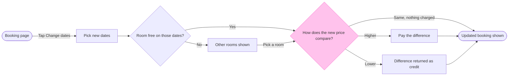

Check passed and the board is composed, but nothing is on Figma yet. The file is empty, so there is no same-titled section to collide with.

The check printed `PASSED`: 8 nodes, 10 connectors, 0 crossing pairs, longest path 7 steps. The composer printed `COMPOSED` with no design warnings.

* **Question:** which screens does a guest pass through to change booking dates, and where do they choose?
* **Outcome:** the product and design team can decide whether the flow covers every price outcome.
* **First glance:** the price comparison, with the pink outline.
* **Second glance:** the Higher, Lower and Same exits with the two outcome steps.
* **Last glance:** the room check and the other-rooms detour.
* **Plan and file:** the Roamstay Product plan, as you named it, in the existing FigJam file `<draft-file-key>`. I can't verify the plan from the tools, because `whoami` lists the plans your account holds and not which one owns a file.
* **Writes:** one new board section called "Change booking dates", with 8 nodes and 10 connectors in two zones ("Choose the dates" and "Settle the price"), a title, a subtitle, a key and a source line, at Laptop reading distance. Nothing else in the file changes.
* **Extensions:** none.
* **Calls:** one `use_figma` call and one `get_figjam` read-back. The session and the file read are already spent. If your seat is capped at six Figma tool calls a month, this board uses 4 of them.
* **Rollback:** delete that one board section. I'd only do that on your separate yes to a question that names it.

Shall I write this board to the file?