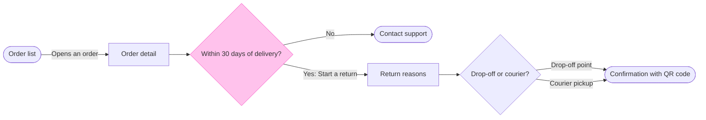

# FJ-045 turn 3 transcript

**User:** Yes, that reading is right.

**Tool call:** `Bash` `{"command": "cd /private/var/folders/3c/zfqcqsts0kn19cgblj82gqhm0000gn/T/devin-compare-bench/FJ-045/sk-create-figjam && python3 -I scripts/flow_check.py --help 2>&1 | head -30; echo ----; python3 -I scripts/compose_board.py --help 2>&1 | head -30; echo ----; sed -n 1,80p assets/examples/user-flow-fernhouse-return.md", "description": "Read check and composer usage and the user-flow example"}`

**Tool result:** `Bash`

```text
"mermaid_extract: --help: not a Mermaid file\nUNREADABLE --help: the extractor refused it\n----\n\n  compose_board.py <model.md> [--diagram N] [--out path]  -> 0 the filled code is written, 1 the model fails\n                                                             the check, 2 unreadable or no such diagram\n  compose_board.py <model.md> --model                      -> print the MODEL as JSON instead of the code\n  compose_board.py --template                              -> print the compact code with its MODEL and THEME\n                                                             placeholders, the text the Project's composer\n                                                             Knowledge file carries\n  compose_board.py --design-check                          -> print the design a board is drawn in, what it\n                                                             changes, its measures and the THEME it sends: 0 the\n                                                             design reads with no warning, 1 one or more warnings\n  compose_board.py --self-test                             -> prove every shipped model composes, its counts\n                                                             match the check, the code fits one use_figma call and\n                                                             the board it draws keeps its geometry and its design\n----\n---\ntitle: \"Example - User Flow - Fernhouse Return\"\ndescription: \"A worked user flow 
```

**Tool call:** `Bash` `{"command": "mktemp -d /tmp/flowXXXXXX", "description": "Create scratch folder for the model and composed code"}`

**Tool result:** `Bash`

```text
"/tmp/flowJb96pY"
```

**Tool call:** `Write` `{"file_path": "/tmp/flowJb96pY/model.md", "content": "```mermaid\nflowchart LR\n    %% title: Start a return\n    %% subtitle: How a customer starts a return in the app, from the order list to the QR confirmation, for Post-purchase and CS to check against the returns doc\n    %% source: Sources: the Fernhouse app and returns doc as described in the request, and the Fernhouse context doc for the 30-day window. Left out: everything after the confirmation, screens inside each method, item selection, orders not yet delivered, guest customers.\n    orderList([Order list]) -->|Opens an order| detail`

**Tool result:** `Write`

```text
"File created successfully at: /tmp/flowJb96pY/model.md (file state is current in your context \u2014 no need to Read it back)"
```

**Tool call:** `Bash` `{"command": "python3 -I scripts/flow_check.py /tmp/flowJb96pY/model.md; echo \"exit=$?\"", "description": "Run the pre-write check on the model"}`

**Tool result:** `Bash`

```text
"  diagram 1, user flow: edge window to reasons label holds a parenthesis, a colon or a slash: put it in double quotes\nFAILED 1 of 1 diagram(s) in model.md\nexit=1"
```

**Tool call:** `Edit` `{"replace_all": false, "file_path": "/tmp/flowJb96pY/model.md", "old_string": "    window -->|Yes: Start a return| reasons[Return reasons]", "new_string": "    window -->|\"Yes: Start a return\"| reasons[Return reasons]"}`

**Tool result:** `Edit`

```text
"The file /tmp/flowJb96pY/model.md has been updated successfully. (file state is current in your context \u2014 no need to Read it back)"
```

**Assistant:**

The check flagged one unquoted colon in an edge label. I fixed it and am running the check again, then composing the board code.

**Tool call:** `Bash` `{"command": "python3 -I scripts/flow_check.py /tmp/flowJb96pY/model.md; echo \"check exit=$?\"; python3 -I scripts/compose_board.py /tmp/flowJb96pY/model.md --diagram 1 --out /tmp/flowJb96pY/code.js; echo \"compose exit=$?\"; wc -c /tmp/flowJb96pY/code.js", "description": "Re-run the check and compose the board code"}`

**Tool result:** `Bash`

```text
"  diagram 1, user flow: ok, 7 nodes and 7 connectors, widest rank 2 steps, longest path 6 steps, 1.0 connectors per step, labels average 18 characters, 0 crossing pairs\nPASSED 1 diagram(s) in model.md\ncheck exit=0\nDESIGN shadow is no group this composer reads, so it was left out\nDESIGN role.goal fell back to \"lightGreen\": the goal role draws lightPink, the accent's own pair\nDESIGN zone.cycle fell back to [\"blue\", \"orange\", \"teal\", \"yellow\", \"violet\"]: the pink zone tint sits under 45 degrees of hue from the accent, at 1\nCOMPOSED diagram 1, 7 nodes and 7 connectors, widest rank 2 steps, longest path 6 steps, 1.0 connectors per step, labels average 18 characters, 0 crossing pairs: 7 nodes and 7 connectors to read back, 42061 characters in /tmp/flowJb96pY/code.js, drawn in the design FigJam default, 3 design warnings\ncompose exit=0\n   42061 /tmp/flowJb96pY/code.js"
```

**Assistant:**

The model passed the check, and I haven't written anything to the board. This is the write confirmation, separate from the reading you approved.

### The sketch


The check printed 7 nodes and 7 connectors, 0 crossing pairs, a longest path of 6 steps and a widest rank of 2. The composer produced the board code without trouble.

### What the eye should do
- First glance: the "Within 30 days of delivery?" decision, a yellow diamond with the pink outline
- Second glance: the two places it leads, the green confirmation with the QR code and the orange Contact support exit
- Last glance: Return reasons and the method choice, which stay readable without competing

### The write
- File: `<draft-file-key>`, in the Fernhouse Product plan as you stated it. I can't confirm the plan from the file itself. The page is empty, so no section shares the title Start a return.
- Written: one framed board section titled Start a return, holding the title, the subtitle, 7 nodes, 7 connectors with the labels above, a key and the source line. It has no zones.
- Extensions: none
- Calls: one `use_figma` call that composes the board and one `get_figjam` read-back. I have already spent two calls, the session and the read of the empty file. If the plan or your seat is on the Starter or View and Collab allowance of six tool calls a month, this board takes four of them.
- Rollback: delete the one board section the write returns. I'd do that only on your yes to a question that names the section. The file already existed, so removing the file is not a rollback.

### One thing the board will carry
On your answer, the board draws the flow as current behavior. `context/fernhouse-context.md` (updated 2026-09-18) says there is no self-serve return, and I can't verify the flow's status from here. The reply will list this as a finding. If the flow turns out not to be live, the board gets a proposal status in its labels and I compose it again.

**Write the Start a return board to that file now?** Recommended: yes.
