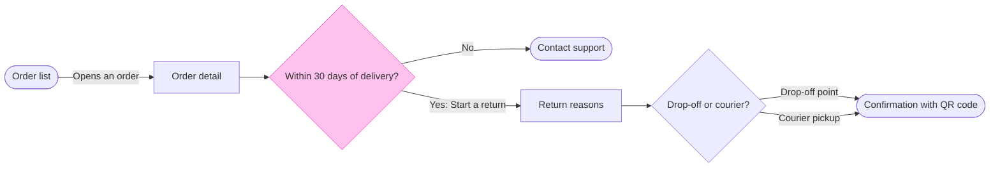

The model passed the check, and I haven't written anything to the board. This is the write confirmation, separate from the reading you approved.

### The sketch

The check printed 7 nodes and 7 connectors, 0 crossing pairs, a longest path of 6 steps and a widest rank of 2. The composer produced the board code without trouble.

### What the eye should do
- First glance: the "Within 30 days of delivery?" decision, a yellow diamond with the pink outline
- Second glance: the two places it leads, the green confirmation with the QR code and the orange Contact support exit
- Last glance: Return reasons and the method choice, which stay readable without competing

### The write
- File: `<draft-file-key>`, in the Fernhouse Product plan as you stated it. I can't confirm the plan from the file itself. The page is empty, so no section shares the title Start a return.
- Written: one framed board section titled Start a return, holding the title, the subtitle, 7 nodes, 7 connectors with the labels above, a key and the source line. It has no zones.
- Extensions: none
- Calls: one `use_figma` call that composes the board and one `get_figjam` read-back. I have already spent two calls, the session and the read of the empty file. If the plan or your seat is on the Starter or View and Collab allowance of six tool calls a month, this board takes four of them.
- Rollback: delete the one board section the write returns. I'd do that only on your yes to a question that names the section. The file already existed, so removing the file is not a rollback.

### One thing the board will carry
On your answer, the board draws the flow as current behavior. `context/fernhouse-context.md` (updated 2026-09-18) says there is no self-serve return, and I can't verify the flow's status from here. The reply will list this as a finding. If the flow turns out not to be live, the board gets a proposal status in its labels and I compose it again.

**Write the Start a return board to that file now?** Recommended: yes.