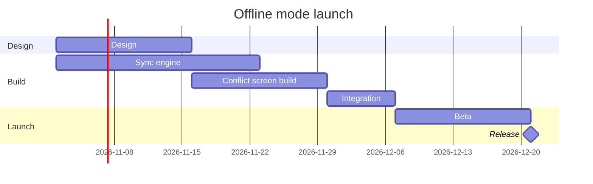

# FJ-009 turn 2 transcript

**User:** Yes, that reading is right.

**Tool call:** `ToolSearch` `{"query": "select:use_figma,get_figjam,whoami,create_session,generate_diagram", "max_results": 10}`

**Tool result:** `ToolSearch`

```text
"No matching deferred tools found"
```

**Tool call:** `ToolSearch` `{"query": "figma", "max_results": 10}`

**Tool result:** `ToolSearch`

```text
"No matching deferred tools found"
```

**Tool call:** `Read` `{"file_path": "/private/tmp/claude-501/-Users-michelkerkmeester-MEGA-Development-AI-Systems/348b59cb-58a2-4b49-8147-c40143312bc1/scratchpad/r042/tmp/FJ-009/devin-compare-bench/FJ-009/sk-create-figjam/references/style-guide.md", "limit": 80}`

**Tool result:** `Read`

```text
"1\t---\n2\ttitle: \"FigJam Diagram Style Guide\"\n3\tdescription: \"The colour every composed FigJam board draws by kind in the shipped design, the type scale and the 8 pixel grid, the palette pairs the check accepts with their measured contrast, and the spacing bands, translated from sk-design-diagram's style guide and derivation record.\"\n4\tcontextType: implementation\n5\timportance_tier: important\n6\ttrigger_phrases:\n7\t  - \"figjam style guide\"\n8\t  - \"figjam palette\"\n9\t  - \"figjam colour by kind\"\n10\t  - \"figjam type scale\"\n11\t  - \"palette derivation record\"\n12\t  - \"figjam contrast\"\n13\tversion: 1.0.3.0\n14\t---\n15\t\n16\t# FigJam Diagram Style Guide\n17\t\n18\tThe rules for colour, type and spacing on a FigJam board. The composer in `assets/compose-board.js` draws every board in the design `assets/figjam-design.md` holds, which ships as the tables below record, and every hex a model, a design or a note extension uses comes from the palette in Section 3. `scripts/flow_check.py` refuses any other.\n19\t\n20\t**Loading Condition:** CONDITIONAL, before the gate on every Flow route, and when a model or a note extension uses colour\n21\t**Purpose:** Names the colour each kind draws in, the type scale, the grid, the palette pairs the check accepts and the measured contrast record\n22\t**Scope:** The composed board, Mermaid `style`, `classDef` and `linkStyle` colours, sticky and pin colours for notes, and the contrast record the self-test re-measures\n
```

**Tool call:** `Bash` `{"command": "mktemp -d", "description": "Create scratch folder for model"}`

**Tool result:** `Bash`

```text
"/var/folders/3c/zfqcqsts0kn19cgblj82gqhm0000gn/T/tmp.PAFwjZWN1T"
```

**Tool call:** `Bash` `{"command": "S=/var/folders/3c/zfqcqsts0kn19cgblj82gqhm0000gn/T/tmp.PAFwjZWN1T && cat > $S/model.md <<'EOF'\n```mermaid\ngantt\n    title Offline mode launch\n    %% subtitle: Which work runs when before the offline mode release, and what sets the release date\n    %% source: Source: the Loomlist offline mode launch plan as briefed in chat. Left out: nothing.\n    %% focus: release\n    dateFormat YYYY-MM-DD\n    section Design\n    Design :design, 2026-11-02, 2w\n    section Build\n    Sync engine :engine, 2026-11-02, 3w\n    Conflict screen build :screen, after design, 2w\n    Integration :i`

**Tool result:** `Bash`

```text
"  diagram 1, gantt: ok, 6 tasks in 3 sections\nPASSED 1 diagram(s) in model.md\nexit 0\nCOMPOSED diagram 1, 6 tasks in 3 sections: 6 nodes and 5 connectors to read back, 18002 characters in /var/folders/3c/zfqcqsts0kn19cgblj82gqhm0000gn/T/tmp.PAFwjZWN1T/board1.js, drawn in the design FigJam default\nexit 0"
```

**Tool call:** `Bash` `{"command": "rm -rf /var/folders/3c/zfqcqsts0kn19cgblj82gqhm0000gn/T/tmp.PAFwjZWN1T && echo removed", "description": "Delete scratch folder"}`

**Tool result:** `Bash`

```text
"removed"
```

**Assistant:**

The pre-write check and the composer both pass on the model, but I can't write the board yet. No Figma route is connected.

I listed tools in the last turn and again this turn. Searching for `use_figma`, `get_figjam`, `whoami`, `create_session`, `generate_diagram` and "figma" found nothing either time. A gantt chart needs a hosted route, because the `fj` route can't draw one. So no board exists and nothing has been written.

To write it I need the Figma MCP connection (`https://mcp.figma.com/mcp`, through Figma's plugin or the client's connector) with `use_figma` and `get_figjam`. Because you named the file, I wouldn't need `whoami` or `create_new_file`.

This is the checked model, so you can keep it:



Once the connection is in place, this is what I would ask you to approve:

```text
Question: which work runs when, and what sets the release date?
Outcome: a reader can see how Design, the sync engine and the conflict screen build overlap, where Integration starts, and when the beta and the release land.
First glance: the Release milestone on 21 Dec, the date the reader came for.
Second glance: Integration, where the two builds join, and Conflict screen build, the longer path into it.
Last glance: Sync engine, which ends a week before Integration can start, and Design.
Plan: Loomlist Product, as you said. I can't verify which plan owns the file.
File: <draft-file-key>, existing, as a new section beside what it holds. Nothing already on it changes.
Writes: one composed board with 3 sections, 5 tasks, 1 milestone and 5 dependency arrows, plus a title, a key and a source line, at laptop reading distance.
Left out: nothing from your message.
Extensions: none.
Calls: create_session, one get_figjam read of the file before, one use_figma and one get_figjam read-back, plus one more read of the file to confirm nothing already there changed. On a Starter plan, or a View or Collab seat, Figma allows six tool calls a month, and this write spends five of them.
Rollback: delete the one new board section the write returns.
```

If the first read finds a section already titled "Offline mode launch", I'll stop and ask before writing, and recommend "Offline mode launch 2".

Once the Figma tools are connected, do you want me to write this board to that file?
