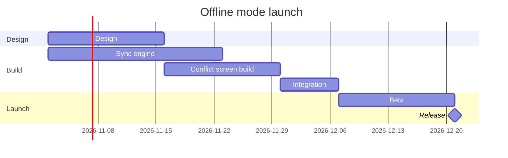

The pre-write check and the composer both pass on the model, but I can't write the board yet. No Figma route is connected.

I listed tools in the last turn and again this turn. Searching for `use_figma`, `get_figjam`, `whoami`, `create_session`, `generate_diagram` and "figma" found nothing either time. A gantt chart needs a hosted route, because the `fj` route can't draw one. So no board exists and nothing has been written.

To write it I need the Figma MCP connection (`https://mcp.figma.com/mcp`, through Figma's plugin or the client's connector) with `use_figma` and `get_figjam`. Because you named the file, I wouldn't need `whoami` or `create_new_file`.

This is the checked model, so you can keep it:



Once the connection is in place, this is what I would ask you to approve:

```text
Question: which work runs when, and what sets the release date?
Outcome: a reader can see how Design, the sync engine and the conflict screen build overlap, where Integration starts, and when the beta and the release land.
First glance: the Release milestone on 21 Dec, the date the reader came for.
Second glance: Integration, where the two builds join, and Conflict screen build, the longer path into it.
Last glance: Sync engine, which ends a week before Integration can start, and Design.
Plan: Loomlist Product, as you said. I can't verify which plan owns the file.
File: <draft-file-key>, existing, as a new section beside what it holds. Nothing already on it changes.
Writes: one composed board with 3 sections, 5 tasks, 1 milestone and 5 dependency arrows, plus a title, a key and a source line, at laptop reading distance.
Left out: nothing from your message.
Extensions: none.
Calls: create_session, one get_figjam read of the file before, one use_figma and one get_figjam read-back, plus one more read of the file to confirm nothing already there changed. On a Starter plan, or a View or Collab seat, Figma allows six tool calls a month, and this write spends five of them.
Rollback: delete the one new board section the write returns.
```

If the first read finds a section already titled "Offline mode launch", I'll stop and ask before writing, and recommend "Offline mode launch 2".

Once the Figma tools are connected, do you want me to write this board to that file?