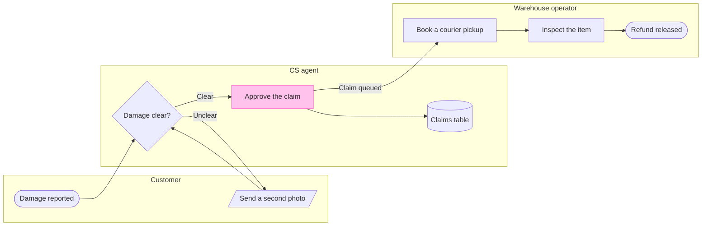

# FJ-023 turn 2 transcript

**User:** Yes, that reading is right.

**Tool call:** `ToolSearch` `{"query": "select:mcp__figma-remote__create_session,mcp__figma-remote__get_figjam,mcp__figma-remote__use_figma,mcp__figma-remote__whoami", "max_results": 4}`

**Tool result:** `ToolSearch`

```text
[{"type": "tool_reference", "tool_name": "mcp__figma-remote__create_session"}, {"type": "tool_reference", "tool_name": "mcp__figma-remote__get_figjam"}, {"type": "tool_reference", "tool_name": "mcp__figma-remote__use_figma"}, {"type": "tool_reference", "tool_name": "mcp__figma-remote__whoami"}]
```

**Tool call:** `Read` `{"file_path": "/private/tmp/claude-501/-Users-michelkerkmeester-MEGA-Development-AI-Systems/348b59cb-58a2-4b49-8147-c40143312bc1/scratchpad/r042/tmp/FJ-023/devin-compare-bench/FJ-023/sk-create-figjam/references/quality-rubric.md"}`

**Tool result:** `Read`

```text
"1\t---\n2\ttitle: \"FigJam Diagram Quality Rubric\"\n3\tdescription: \"The taste gate a FigJam model passes before the write gate, translated from sk-design-diagram's success criteria: type fit, the remove test, signal, the check, the board, the design rubric that scores a composed board and the reply.\"\n4\tcontextType: implementation\n5\timportance_tier: important\n6\ttrigger_phrases:\n7\t  - \"figjam quality rubric\"\n8\t  - \"diagram taste gate\"\n9\t  - \"remove test\"\n10\t  - \"figjam review checklist\"\n11\t  - \"figjam design rubric\"\n12\tversion: 1.0.5.0\n13\t---\n14\t\n15\t# FigJam Diagram Quality Rubric\n16\t\n17\tThe script checks what a script can see. This rubric is the rest: whether the diagram should exist, whether every node earns its place and whether the reader can trust what lands on the board. Walk it after the check passes and before the write gate.\n18\t\n19\t**Loading Condition:** CONDITIONAL, on every Flow route before the write gate\n20\t**Purpose:** The judgement pass between the pre-write check and the gate\n21\t**Scope:** The model, the provenance table, the planned extensions and, after the write, the board and the reply\n22\t\n23\t---\n24\t\n25\t## 1. TYPE FIT\n26\t\n27\t- [ ] The type answers the reader's question, as `references/flow-mode.md` Section 3 maps it\n28\t- [ ] A table, a list or a paragraph would not do the same job. If it would, say so and offer that instead\n29\t- [ ] The type's reference in `references/types/` was loaded and i
```

**Tool call:** `Read` `{"file_path": "/private/tmp/claude-501/-Users-michelkerkmeester-MEGA-Development-AI-Systems/348b59cb-58a2-4b49-8147-c40143312bc1/scratchpad/r042/tmp/FJ-023/devin-compare-bench/FJ-023/sk-create-figjam/references/style-guide.md"}`

**Tool result:** `Read`

```text
"1\t---\n2\ttitle: \"FigJam Diagram Style Guide\"\n3\tdescription: \"The colour every composed FigJam board draws by kind in the shipped design, the type scale and the 8 pixel grid, the palette pairs the check accepts with their measured contrast, and the spacing bands, translated from sk-design-diagram's style guide and derivation record.\"\n4\tcontextType: implementation\n5\timportance_tier: important\n6\ttrigger_phrases:\n7\t  - \"figjam style guide\"\n8\t  - \"figjam palette\"\n9\t  - \"figjam colour by kind\"\n10\t  - \"figjam type scale\"\n11\t  - \"palette derivation record\"\n12\t  - \"figjam contrast\"\n13\tversion: 1.0.3.0\n14\t---\n15\t\n16\t# FigJam Diagram Style Guide\n17\t\n18\tThe rules for colour, type and spacing on a FigJam board. The composer in `assets/compose-board.js` draws every board in the design `assets/figjam-design.md` holds, which ships as the tables below record, and every hex a model, a design or a note extension uses comes from the palette in Section 3. `scripts/flow_check.py` refuses any other.\n19\t\n20\t**Loading Condition:** CONDITIONAL, before the gate on every Flow route, and when a model or a note extension uses colour\n21\t**Purpose:** Names the colour each kind draws in, the type scale, the grid, the palette pairs the check accepts and the measured contrast record\n22\t**Scope:** The composed board, Mermaid `style`, `classDef` and `linkStyle` colours, sticky and pin colours for notes, and the contrast record the self-test re-measures\n
```

**Tool call:** `Bash` `{"command": "mktemp -d /tmp/fj-model.XXXXXX", "description": "Create scratch folder for the model"}`

**Tool result:** `Bash`

```text
"/tmp/fj-model.0pY6l6"
```

**Tool call:** `mcp__figma-remote__create_session` `{"fileKey": "<draft-file-key>", "description": "Read the existing FigJam file before adding a Damaged-item refund process board as a new section"}`

**Tool result:** `mcp__figma-remote__create_session`

```text
"{\"sessionId\":\"3ade3b28-b17d-429c-bd87-45e596fd142d\"}"
```

**Tool call:** `Write` `{"file_path": "/tmp/fj-model.0pY6l6/model.md", "content": "```mermaid\n%% type: process\nflowchart LR\n    %% title: Damaged-item refund\n    %% subtitle: Who handles a damaged-item claim, from the customer's report to the released refund\n    %% source: Source: the support runbook, as quoted in the request. Every decision is logged in the claims table. Left out: pickup skipped under €20, a pilot that is not live.\n    subgraph customer [\"Customer\"]\n        report([Damage reported])\n        photo[/Send a second photo/]\n    end\n    subgraph cs [\"CS agent\"]\n        check{Damage clear?}\`

**Tool result:** `Write`

```text
"File created successfully at: /tmp/fj-model.0pY6l6/model.md (file state is current in your context \u2014 no need to Read it back)"
```

**Tool call:** `mcp__figma-remote__get_figjam` `{"fileKey": "<draft-file-key>", "nodeId": "0:1", "sessionId": "3ade3b28-b17d-429c-bd87-45e596fd142d"}`

**Tool result:** `mcp__figma-remote__get_figjam`

```text
[{"type": "text", "text": "<canvas id=\"0:1\" name=\"Page 1\" x=\"0\" y=\"0\" width=\"0\" height=\"0\" />"}, {"type": "image", "source": {"type": "base64", "media_type": "image/png", "data": "iVBORw0KGgoAAAANSUhEUgAAAAEAAAABCAYAAAAfFcSJAAAACXBIWXMAAAsTAAALEwEAmpwYAAAAAXNSR0IArs4c6QAAAARnQU1BAACxjwv8YQUAAAAOdEVYdFNvZnR3YXJlAEZpZ21hnrGWYwAAABBJREFUeAEBBQD6/wAAAAAAAAUAAWR4lTgAAAAASUVORK5CYII="}}, {"type": "text", "text": "[Image: source: /Users/michelkerkmeester/.claude/projects/-private-tmp-claude-501--Users-michelkerkmeester-MEGA-Development-AI-Systems-348b59cb-58a2-4b49-8147-c40143312bc1-scratchpad-r042-tmp-FJ-023-devin-compare-bench-FJ-023/01e35c55-7413-47e0-ac6a-6dfeb4ae5e6b/tool-results/mcp-figma-remote-blob-1793097873568-mj0xqb.png]"}]
```

**Tool call:** `Bash` `{"command": "python3 -I sk-create-figjam/scripts/flow_check.py /tmp/fj-model.0pY6l6/model.md; echo \"exit $?\"; python3 -I sk-create-figjam/scripts/compose_board.py /tmp/fj-model.0pY6l6/model.md --diagram 1 --out /tmp/fj-model.0pY6l6/compose.js | head -c 3000; echo \"exit ${PIPESTATUS[0]}\"; wc -c /tmp/fj-model.0pY6l6/compose.js", "description": "Run pre-write check and compose the board code"}`

**Tool result:** `Bash`

```text
"  diagram 1, process: ok, 8 nodes and 8 connectors, widest rank 2 steps, longest path 6 steps, 1.0 connectors per step, labels average 16 characters, 0 crossing pairs\nPASSED 1 diagram(s) in model.md\nexit 0\nCOMPOSED diagram 1, 8 nodes and 8 connectors, widest rank 2 steps, longest path 6 steps, 1.0 connectors per step, labels average 16 characters, 0 crossing pairs: 8 nodes and 8 connectors to read back, 42153 characters in /tmp/fj-model.0pY6l6/compose.js, drawn in the design FigJam default\nexit \n   42155 /tmp/fj-model.0pY6l6/compose.js"
```

**Assistant:**

The model passes the pre-write check, and the file you named is empty, so no existing section shares the board's title. Here is the sketch. Nothing is written yet.



**Check:** passed, 8 nodes, 8 connectors, longest path 6 steps, 0 crossing pairs.

**Question:** who does what, and where does a damaged-item refund change hands?
**Outcome:** a reader sees which team owns each step and where the claim moves from CS to the warehouse.
**First glance:** Approve the claim, the step that hands the claim to the warehouse. It carries the pink accent, and the connector out of it is labelled Claim queued.
**Second glance:** Refund released, the green goal, and Damage reported, the light blue start.
**Last glance:** Damage clear?, the check that decides whether the claim moves on, and the claims table, where every decision is logged.
**Plan:** Fernhouse Product, as you stated it. I have not confirmed with `whoami` that this plan owns the file, because `whoami` lists your plans but not which one owns a file.
**File:** the existing FigJam file `<draft-file-key>`, with the board added as a new section. No new file is created.
**Writes:** one framed board titled Damaged-item refund, with 3 lanes, 8 nodes and 8 connectors, a subtitle, a key and a source line, at Laptop reading distance.
**Left out:** pickup skipped under €20, a pilot that is not live. Also not drawn because the runbook text does not cover them: a second photo that is still unclear, a claim CS does not approve and an inspection that finds a problem.
**Extensions:** none.
**Calls:** one `use_figma` to compose the board and one `get_figjam` to read it back. The read I made just now was the third call on this file. If your plan is a Starter plan, which allows six tool calls a month, this write brings the total to four.
**Rollback:** delete the one board section the write returns. That delete runs only after its own yes.

Write it?
