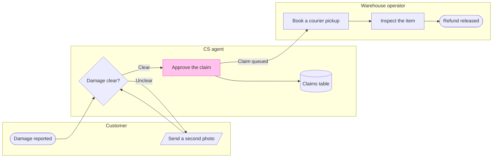

The model passes the pre-write check, and the file you named is empty, so no existing section shares the board's title. Here is the sketch. Nothing is written yet.

**Check:** passed, 8 nodes, 8 connectors, longest path 6 steps, 0 crossing pairs.

**Question:** who does what, and where does a damaged-item refund change hands?
**Outcome:** a reader sees which team owns each step and where the claim moves from CS to the warehouse.
**First glance:** Approve the claim, the step that hands the claim to the warehouse. It carries the pink accent, and the connector out of it is labelled Claim queued.
**Second glance:** Refund released, the green goal, and Damage reported, the light blue start.
**Last glance:** Damage clear?, the check that decides whether the claim moves on, and the claims table, where every decision is logged.
**Plan:** Fernhouse Product, as you stated it. I have not confirmed with `whoami` that this plan owns the file, because `whoami` lists your plans but not which one owns a file.
**File:** the existing FigJam file `<draft-file-key>`, with the board added as a new section. No new file is created.
**Writes:** one framed board titled Damaged-item refund, with 3 lanes, 8 nodes and 8 connectors, a subtitle, a key and a source line, at Laptop reading distance.
**Left out:** pickup skipped under €20, a pilot that is not live. Also not drawn because the runbook text does not cover them: a second photo that is still unclear, a claim CS does not approve and an inspection that finds a problem.
**Extensions:** none.
**Calls:** one `use_figma` to compose the board and one `get_figjam` to read it back. The read I made just now was the third call on this file. If your plan is a Starter plan, which allows six tool calls a month, this write brings the total to four.
**Rollback:** delete the one board section the write returns. That delete runs only after its own yes.

Write it?