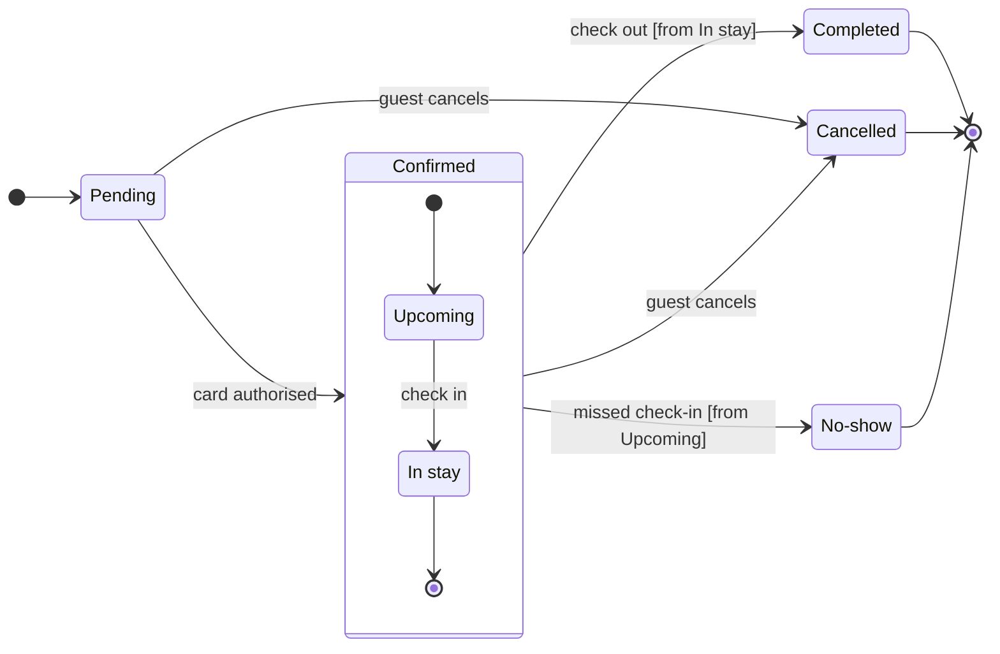

# FJ-026 turn 2 transcript

**User:** Yes, that reading is right.

**Tool call:** `Bash` `{"command": "mktemp -d /tmp/figjam-scratch.XXXXXX && cd \"/private/tmp/claude-501/-Users-michelkerkmeester-MEGA-Development-AI-Systems/348b59cb-58a2-4b49-8147-c40143312bc1/scratchpad/r042/tmp/FJ-026/devin-compare-bench/FJ-026/sk-create-figjam\" && python3 -I scripts/flow_check.py --help 2>&1 | head -30; python3 -I scripts/compose_board.py --help 2>&1 | head -30", "description": "Create scratch folder and show check and composer usage"}`

**Tool result:** `Bash`

```text
"/tmp/figjam-scratch.HPKWn3\nmermaid_extract: --help: not a Mermaid file\nUNREADABLE --help: the extractor refused it\n\n  compose_board.py <model.md> [--diagram N] [--out path]  -> 0 the filled code is written, 1 the model fails\n                                                             the check, 2 unreadable or no such diagram\n  compose_board.py <model.md> --model                      -> print the MODEL as JSON instead of the code\n  compose_board.py --template                              -> print the compact code with its MODEL and THEME\n                                                             placeholders, the text the Project's composer\n                                                             Knowledge file carries\n  compose_board.py --design-check                          -> print the design a board is drawn in, what it\n                                                             changes, its measures and the THEME it sends: 0 the\n                                                             design reads with no warning, 1 one or more warnings\n  compose_board.py --self-test                             -> prove every shipped model composes, its counts\n                                                             match the check, the code fits one use_figma call and\n                                                             the board it draws keeps its geometry and its design"
```

**Tool call:** `ToolSearch` `{"query": "select:mcp__figma-remote__whoami,mcp__figma-remote__create_session,mcp__figma-remote__get_figjam,mcp__figma-remote__use_figma,mcp__figma-remote__get_screenshot", "max_results": 5}`

**Tool result:** `ToolSearch`

```text
[{"type": "tool_reference", "tool_name": "mcp__figma-remote__whoami"}, {"type": "tool_reference", "tool_name": "mcp__figma-remote__create_session"}, {"type": "tool_reference", "tool_name": "mcp__figma-remote__get_figjam"}, {"type": "tool_reference", "tool_name": "mcp__figma-remote__use_figma"}, {"type": "tool_reference", "tool_name": "mcp__figma-remote__get_screenshot"}]
```

**Tool call:** `Write` `{"file_path": "/tmp/figjam-scratch.HPKWn3/model.md", "content": "```mermaid\nstateDiagram-v2\n    %% title: Booking status\n    %% subtitle: Every status a Roamstay booking passes through, and what moves it on\n    %% source: Source: the booking status description in the request. Left out: card decline, Pending expiry, refund and payment states.\n    %% focus: Cancelled because two statuses lead here\n    direction LR\n    state \"In stay\" as InStay\n    state \"No-show\" as NoShow\n    [*] --> Pending\n    Pending --> Confirmed: card authorised\n    state Confirmed {\n        [*] --> Upcomin`

**Tool result:** `Write`

```text
"File created successfully at: /tmp/figjam-scratch.HPKWn3/model.md (file state is current in your context \u2014 no need to Read it back)"
```

**Tool call:** `mcp__figma-remote__create_session` `{"fileKey": "<draft-file-key>", "description": "Add a Booking status state diagram board as a new section in the existing Roamstay FigJam file"}`

**Tool result:** `mcp__figma-remote__create_session`

```text
"{\"sessionId\":\"d6aceb1b-5dd3-4bc8-83fd-ce016fd9bf58\"}"
```

**Tool call:** `Bash` `{"command": "python3 -I scripts/flow_check.py /tmp/figjam-scratch.HPKWn3/model.md 2>&1; echo \"exit=$?\"; python3 -I scripts/compose_board.py /tmp/figjam-scratch.HPKWn3/model.md --diagram 1 --out /tmp/figjam-scratch.HPKWn3/code.js 2>&1; echo \"exit=$?\"; wc -c /tmp/figjam-scratch.HPKWn3/code.js", "description": "Run pre-write check and compose the board code"}`

**Tool result:** `Bash`

```text
"  diagram 1, state: ok, 7 states and 12 transitions\nPASSED 1 diagram(s) in model.md\nexit=0\nCOMPOSED diagram 1, 7 states and 12 transitions: 12 nodes and 12 connectors to read back, 42446 characters in /tmp/figjam-scratch.HPKWn3/code.js, drawn in the design FigJam default\nexit=0\n   42446 /tmp/figjam-scratch.HPKWn3/code.js"
```

**Tool call:** `mcp__figma-remote__get_figjam` `{"fileKey": "<draft-file-key>", "nodeId": "0:1", "sessionId": "d6aceb1b-5dd3-4bc8-83fd-ce016fd9bf58", "includeImagesOfNodes": false}`

**Tool result:** `mcp__figma-remote__get_figjam`

```text
[{"type": "text", "text": "<canvas id=\"0:1\" name=\"Page 1\" x=\"0\" y=\"0\" width=\"0\" height=\"0\" />"}]
```

**Assistant:**

The pre-write check passed, and the file you named is empty, so there's no same-titled section to collide with. This is the gate for the write.



**Question:** which statuses can a Roamstay booking be in, and what moves it between them?
**Outcome:** support can read every booking status and spot the three a booking ends in.
**First glance:** Cancelled, the end state with two ways in. It is light gray with the pink outline, and the key reads "In focus: two statuses lead here".
**Second glance:** Pending, the light blue first state, and the other two end states, Completed and No-show, in light gray.
**Last glance:** Upcoming and In stay, inside the Confirmed section, which reads as part of the frame.
**File:** `<draft-file-key>`, as a new section beside what it holds. It holds nothing today, so nothing existing changes.
**Writes:** one composed board with 7 states and 12 transitions, the end states in light gray, a title, a key and a source line, at the Laptop reading distance.
**Left out:** card decline, Pending expiry, and refund and payment states, because your message states none of them. They are named in the board's source line.
**Extensions:** none.
**Calls:** one `use_figma` and one `get_figjam` read-back. The session and the read of the file are already spent, and the file was empty, so no second comparison read is needed.
**Rollback:** delete the one board section the write returns, which I would do only on a yes that names it.

Write it?
