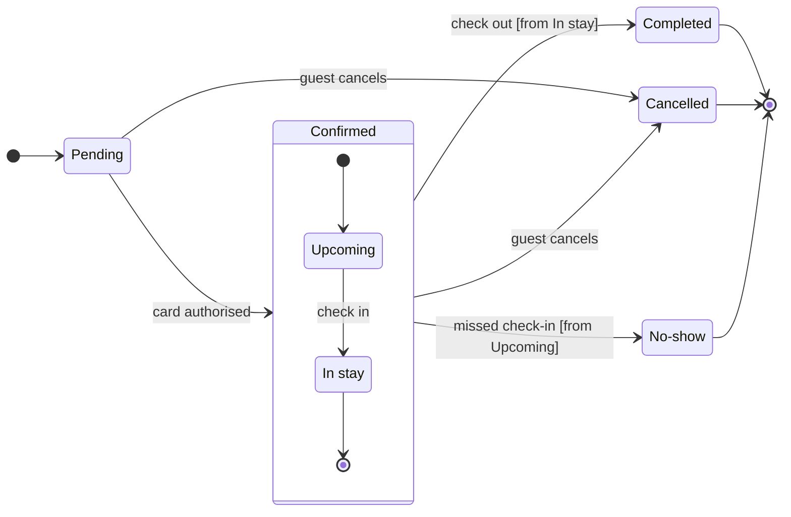

The pre-write check passed, and the file you named is empty, so there's no same-titled section to collide with. This is the gate for the write.

**Question:** which statuses can a Roamstay booking be in, and what moves it between them?
**Outcome:** support can read every booking status and spot the three a booking ends in.
**First glance:** Cancelled, the end state with two ways in. It is light gray with the pink outline, and the key reads "In focus: two statuses lead here".
**Second glance:** Pending, the light blue first state, and the other two end states, Completed and No-show, in light gray.
**Last glance:** Upcoming and In stay, inside the Confirmed section, which reads as part of the frame.
**File:** `<draft-file-key>`, as a new section beside what it holds. It holds nothing today, so nothing existing changes.
**Writes:** one composed board with 7 states and 12 transitions, the end states in light gray, a title, a key and a source line, at the Laptop reading distance.
**Left out:** card decline, Pending expiry, and refund and payment states, because your message states none of them. They are named in the board's source line.
**Extensions:** none.
**Calls:** one `use_figma` and one `get_figjam` read-back. The session and the read of the file are already spent, and the file was empty, so no second comparison read is needed.
**Rollback:** delete the one board section the write returns, which I would do only on a yes that names it.

Write it?