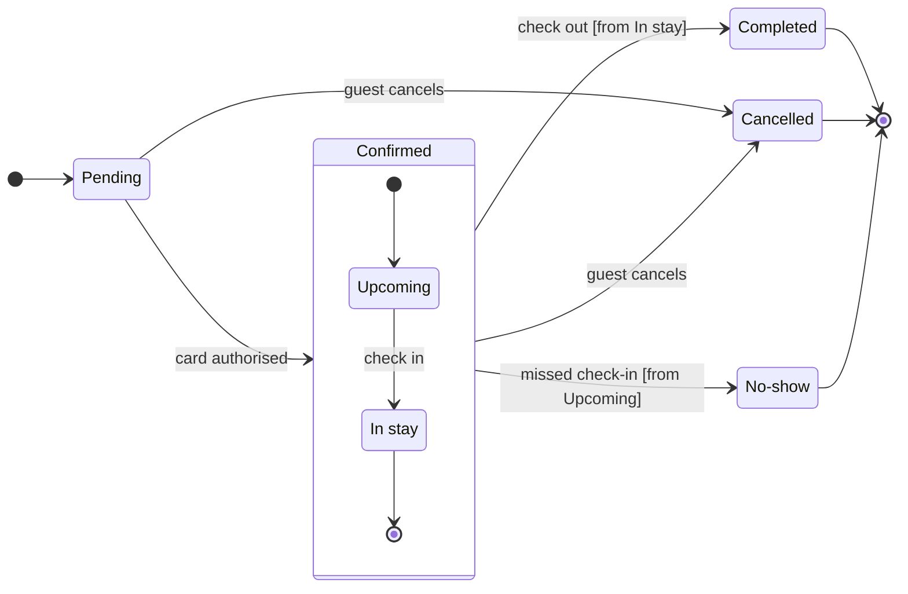

The model passes the check and composes. This is the sketch, which is not on any board yet:

**Question:** which statuses can a Roamstay booking have, and what moves it between them?
**Outcome:** a reader can see every status, which ones end a booking and what triggers each move.
**First glance:** Pending, the light blue first state where every booking starts.
**Second glance:** the end states Completed, Cancelled and No-show, each in light gray with a heavy outline.
**Last glance:** Upcoming and In stay, the states inside Confirmed, whose section reads as part of the frame.
**File:** your existing board `<draft-file-key>`, as a new section titled "Booking status" beside "Sprint retro". The six stickies and the Sprint retro section stay as they are, and no section there shares the title.
**Writes:** one composed board with 7 states, 12 transitions, a title, a subtitle, a key and a source line, at balanced detail for a mixed audience on a laptop.
**Extensions:** none.
**Calls:** one `use_figma` and one `get_figjam` read-back. Loading Figma's `figma-use` and `figma-use-figjam` skills comes first. I already read the board once, so I'll compare that read with the one after the write. Figma caps a Starter plan or a View or Collab seat at six tool calls a month. I don't know which seat you have, so the write and read-back may use most of that allowance.
**Left out:** payments and refunds, hotel-side screens and a timing rule for No-show, because your description gives none of them.
**Rollback:** delete the one new "Booking status" section, only on a second yes that names it.

Shall I write the board?