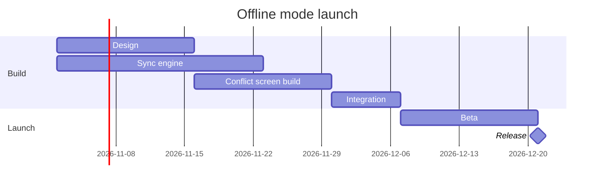

# FJ-009 turn 2 transcript

**User:** Yes, that reading is right.

**Tool call:** `ToolSearch` `{"query": "select:use_figma,get_figjam,whoami,create_session,generate_diagram", "max_results": 10}`

**Tool result:** `ToolSearch`

```text
"No matching deferred tools found"
```

**Tool call:** `Read` `{"file_path": "/private/tmp/claude-501/-Users-michelkerkmeester-MEGA-Development-AI-Systems/348b59cb-58a2-4b49-8147-c40143312bc1/scratchpad/r043/tmp/FJ-009/devin-compare-bench/FJ-009/sk-create-figjam/references/quality-rubric.md"}`

**Tool result:** `Read`

```text
"1\t---\n2\ttitle: \"FigJam Diagram Quality Rubric\"\n3\tdescription: \"The taste gate a FigJam model passes before the write gate, translated from sk-design-diagram's success criteria: type fit, the remove test, signal, the check, the board, the design rubric that scores a composed board and the reply.\"\n4\tcontextType: implementation\n5\timportance_tier: important\n6\ttrigger_phrases:\n7\t  - \"figjam quality rubric\"\n8\t  - \"diagram taste gate\"\n9\t  - \"remove test\"\n10\t  - \"figjam review checklist\"\n11\t  - \"figjam design rubric\"\n12\tversion: 1.0.6.0\n13\t---\n14\t\n15\t# FigJam Diagram Quality Rubric\n16\t\n17\tThe script checks what a script can see. This rubric is the rest: whether the diagram should exist, whether every node earns its place and whether the reader can trust what lands on the board. Walk it after the check passes and before the write gate.\n18\t\n19\t**Loading Condition:** CONDITIONAL, on every Flow route before the write gate\n20\t**Purpose:** The judgement pass between the pre-write check and the gate\n21\t**Scope:** The model, the provenance table, the planned extensions and, after the write, the board and the reply\n22\t\n23\t---\n24\t\n25\t## 1. TYPE FIT\n26\t\n27\t- [ ] The type answers the reader's question, as `references/flow-mode.md` Section 3 maps it\n28\t- [ ] A table, a list or a paragraph would not do the same job. If it would, say so and offer that instead\n29\t- [ ] The type's reference in `references/types/` was loaded and i
```

**Tool call:** `Bash` `{"command": "mktemp -d", "description": "Create scratch folder for the model"}`

**Tool result:** `Bash`

```text
"/var/folders/3c/zfqcqsts0kn19cgblj82gqhm0000gn/T/tmp.8NvkUpP26f"
```

**Tool call:** `Write` `{"file_path": "/var/folders/3c/zfqcqsts0kn19cgblj82gqhm0000gn/T/tmp.8NvkUpP26f/model.md", "content": "```mermaid\ngantt\n    title Offline mode launch\n    %% subtitle: Which work runs when before the offline mode release, and what Integration waits for\n    %% source: Source: the offline mode launch plan, as given in the request. Left out: none.\n    %% focus: integrate\n    dateFormat YYYY-MM-DD\n    section Build\n    Design :design, 2026-11-02, 2w\n    Sync engine :engine, 2026-11-02, 3w\n    Conflict screen build :screen, after design, 2w\n    Integration :integrate, after engine screen, `

**Tool result:** `Write`

```text
"File created successfully at: /var/folders/3c/zfqcqsts0kn19cgblj82gqhm0000gn/T/tmp.8NvkUpP26f/model.md (file state is current in your context \u2014 no need to Read it back)"
```

**Tool call:** `Bash` `{"command": "python3 -I sk-create-figjam/scripts/flow_check.py /var/folders/3c/zfqcqsts0kn19cgblj82gqhm0000gn/T/tmp.8NvkUpP26f/model.md; echo \"exit $?\"; python3 -I sk-create-figjam/scripts/compose_board.py /var/folders/3c/zfqcqsts0kn19cgblj82gqhm0000gn/T/tmp.8NvkUpP26f/model.md --diagram 1 --out /var/folders/3c/zfqcqsts0kn19cgblj82gqhm0000gn/T/tmp.8NvkUpP26f/code.js; echo \"exit $?\"", "description": "Run pre-write check and compose the gantt model"}`

**Tool result:** `Bash`

```text
"  diagram 1, gantt: ok, 6 tasks in 2 sections\nLabel: skipped, the trace failed (dyld[80266]: Library not loaded: /opt/homebrew/opt/simdutf/lib/libsimdutf.36.dylib), so read each label for one word alone on its last line\nPASSED 1 diagram(s) in model.md\nexit 0\nCOMPOSED diagram 1, 6 tasks in 2 sections: 6 nodes and 5 connectors to read back, 17952 characters in /var/folders/3c/zfqcqsts0kn19cgblj82gqhm0000gn/T/tmp.8NvkUpP26f/code.js, drawn in the design FigJam default\nexit 0"
```

**Tool call:** `Bash` `{"command": "rm -rf /var/folders/3c/zfqcqsts0kn19cgblj82gqhm0000gn/T/tmp.8NvkUpP26f && echo removed", "description": "Delete the scratch folder"}`

**Tool result:** `Bash`

```text
"removed"
```

**Assistant:**

The model passes the pre-write check (`PASSED`, gantt, 6 tasks in 2 sections) and composes into 6 nodes and 5 dependency arrows. The check's label trace couldn't run here (a missing library), so I read each label by eye. None wrap onto a second line.



**Question:** which work runs when on the offline mode launch, and what holds the release?
**Outcome:** a reader can see the order of the work from 2 November to the release, and which stream Integration waits on.
**First glance:** Integration, where the Sync engine and the Conflict screen build join.
**Second glance:** the Conflict screen build, the later of the two streams, and the Sync engine, which finishes a week earlier.
**Last glance:** Design at the start, and Beta and the Release milestone at the end.
**Target:** a new board section in FigJam file `<draft-file-key>`, in the Loomlist Product plan, beside what the file already holds. Nothing already there changes, and no new file or plan lookup is needed.
**Writes:** one composed board, 2 sections, 5 tasks and 1 milestone on one axis, with a title, a key and a source line, at laptop reading distance.
**Left out:** none
**Route:** the hosted Figma MCP is not connected, and I listed the tools again this turn with the same result. The `fj` route can't draw a gantt chart. I also couldn't read the file to check for a section that already shares the title "Offline mode launch". If one turns up once a route connects, I'll name it before any write and recommend a numbered title.

Send the model? A yes sends the checked model to keep, and a later write asks again.
