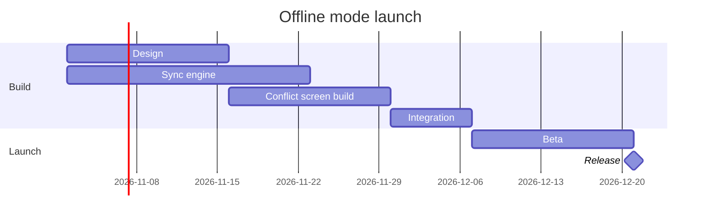

# FJ-009 turn 3 transcript

**User:** Yes, go ahead.

**Tool call:** `ToolSearch` `{"query": "select:use_figma,get_figjam,whoami,create_session,generate_diagram", "max_results": 10}`

**Tool result:** `ToolSearch`

```text
"No matching deferred tools found"
```

**Assistant:**

No board was written. I listed the Figma tools once more this turn (`use_figma`, `get_figjam`, `whoami`, `create_session` and `generate_diagram`) and none are connected. The `fj` route can't draw a gantt chart, so nothing was written to `<draft-file-key>`. Here is the checked model to keep:



Finding: to write the board, connect Figma's hosted MCP (`https://mcp.figma.com/mcp`) through Figma's plugin or your client's connector. It needs `use_figma` and `get_figjam`.
Finding: your earlier yes covered this model, not a write. Once the tools connect, send the request again and I'll ask for a yes to the write itself. That ask will first read the file for a section already titled "Offline mode launch" and name it if there is one.
HVR self-scan: 0 hard blockers. Fixed: none. Kept with reason: none.
