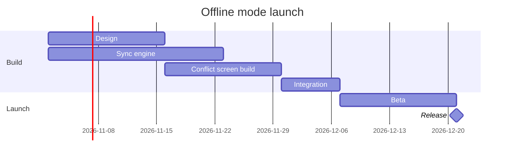

The model passes the pre-write check (`PASSED`, gantt, 6 tasks in 2 sections) and composes into 6 nodes and 5 dependency arrows. The check's label trace couldn't run here (a missing library), so I read each label by eye. None wrap onto a second line.

**Question:** which work runs when on the offline mode launch, and what holds the release?
**Outcome:** a reader can see the order of the work from 2 November to the release, and which stream Integration waits on.
**First glance:** Integration, where the Sync engine and the Conflict screen build join.
**Second glance:** the Conflict screen build, the later of the two streams, and the Sync engine, which finishes a week earlier.
**Last glance:** Design at the start, and Beta and the Release milestone at the end.
**Target:** a new board section in FigJam file `<draft-file-key>`, in the Loomlist Product plan, beside what the file already holds. Nothing already there changes, and no new file or plan lookup is needed.
**Writes:** one composed board, 2 sections, 5 tasks and 1 milestone on one axis, with a title, a key and a source line, at laptop reading distance.
**Left out:** none
**Route:** the hosted Figma MCP is not connected, and I listed the tools again this turn with the same result. The `fj` route can't draw a gantt chart. I also couldn't read the file to check for a section that already shares the title "Offline mode launch". If one turns up once a route connects, I'll name it before any write and recommend a numbered title.

Send the model? A yes sends the checked model to keep, and a later write asks again.