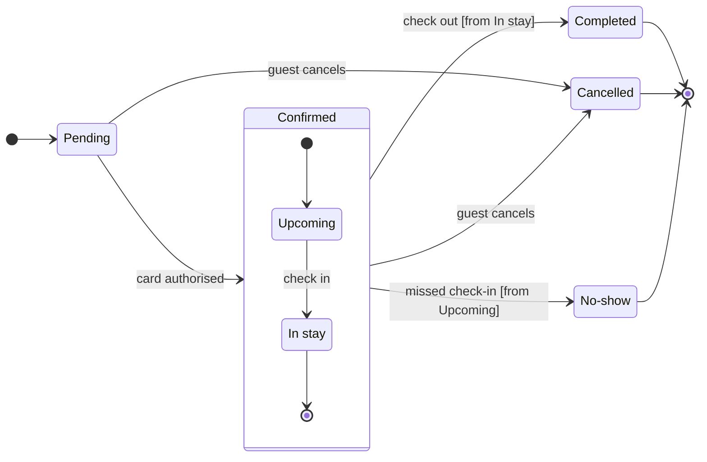

# FJ-017 turn 2 transcript

**User:** Yes, that reading is right.

**Tool call:** `ToolSearch` `{"query": "select:mcp__figma-remote__whoami,mcp__figma-remote__create_new_file,mcp__figma-remote__create_session,mcp__figma-remote__use_figma,mcp__figma-remote__get_figjam", "max_results": 5}`

**Tool result:** `ToolSearch`

```text
[{"type": "tool_reference", "tool_name": "mcp__figma-remote__whoami"}, {"type": "tool_reference", "tool_name": "mcp__figma-remote__create_new_file"}, {"type": "tool_reference", "tool_name": "mcp__figma-remote__create_session"}, {"type": "tool_reference", "tool_name": "mcp__figma-remote__use_figma"}, {"type": "tool_reference", "tool_name": "mcp__figma-remote__get_figjam"}]
```

**Tool call:** `Read` `{"file_path": "/private/tmp/claude-501/-Users-michelkerkmeester-MEGA-Development-AI-Systems/348b59cb-58a2-4b49-8147-c40143312bc1/scratchpad/r043/tmp/FJ-017/devin-compare-bench/FJ-017/sk-create-figjam/references/style-guide.md"}`

**Tool call:** `Bash` `{"command": "mktemp -d", "description": "Create scratch folder for model"}`

**Tool result:** `Read`

```text
"1\t---\n2\ttitle: \"FigJam Diagram Style Guide\"\n3\tdescription: \"The colour every composed FigJam board draws by kind in the shipped design, the type scale and the 8 pixel grid, the palette pairs the check accepts with their measured contrast, and the spacing bands, translated from sk-design-diagram's style guide and derivation record.\"\n4\tcontextType: implementation\n5\timportance_tier: important\n6\ttrigger_phrases:\n7\t  - \"figjam style guide\"\n8\t  - \"figjam palette\"\n9\t  - \"figjam colour by kind\"\n10\t  - \"figjam type scale\"\n11\t  - \"palette derivation record\"\n12\t  - \"figjam contrast\"\n13\tversion: 1.0.4.0\n14\t---\n15\t\n16\t# FigJam Diagram Style Guide\n17\t\n18\tThe rules for colour, type and spacing on a FigJam board. The composer in `assets/compose-board.js` draws every board in the design `assets/figjam-design.md` holds, which ships as the tables below record, and every hex a model, a design or a note extension uses comes from the palette in Section 3. `scripts/flow_check.py` refuses any other.\n19\t\n20\t**Loading Condition:** CONDITIONAL, before the gate on every Flow route, and when a model or a note extension uses colour\n21\t**Purpose:** Names the colour each kind draws in, the type scale, the grid, the palette pairs the check accepts and the measured contrast record\n22\t**Scope:** The composed board, Mermaid `style`, `classDef` and `linkStyle` colours, sticky and pin colours for notes, and the contrast record the self-test re-measures\n
```

**Tool result:** `Bash`

```text
"/var/folders/3c/zfqcqsts0kn19cgblj82gqhm0000gn/T/tmp.T5tq3KIVCW"
```

**Tool call:** `Write` `{"file_path": "/var/folders/3c/zfqcqsts0kn19cgblj82gqhm0000gn/T/tmp.T5tq3KIVCW/model.md", "content": "```mermaid\nstateDiagram-v2\n    %% title: Booking status\n    %% subtitle: Every status a Roamstay booking passes through and what moves it on, for support\n    %% source: Source: the booking lifecycle as described by the product owner. Left out: card authorisation failing, cancellation by anyone but the guest.\n    %% focus: Cancelled\n    direction LR\n    state \"In stay\" as InStay\n    state \"No-show\" as NoShow\n    [*] --> Pending\n    Pending --> Confirmed: card authorised\n    state`

**Tool result:** `Write`

```text
"File created successfully at: /var/folders/3c/zfqcqsts0kn19cgblj82gqhm0000gn/T/tmp.T5tq3KIVCW/model.md (file state is current in your context \u2014 no need to Read it back)"
```

**Tool call:** `Bash` `{"command": "cd /private/tmp/claude-501/-Users-michelkerkmeester-MEGA-Development-AI-Systems/348b59cb-58a2-4b49-8147-c40143312bc1/scratchpad/r043/tmp/FJ-017/devin-compare-bench/FJ-017/sk-create-figjam && python3 -I scripts/flow_check.py /var/folders/3c/zfqcqsts0kn19cgblj82gqhm0000gn/T/tmp.T5tq3KIVCW/model.md; echo \"exit=$?\"; python3 -I scripts/compose_board.py /var/folders/3c/zfqcqsts0kn19cgblj82gqhm0000gn/T/tmp.T5tq3KIVCW/model.md --diagram 1 --out /var/folders/3c/zfqcqsts0kn19cgblj82gqhm0000gn/T/tmp.T5tq3KIVCW/code.js; echo \"exit=$?\"", "description": "Run pre-write check and compose boar`

**Tool result:** `Bash`

```text
"  diagram 1, state: ok, 7 states and 12 transitions\nLabel: skipped, the trace failed (dyld[81736]: Library not loaded: /opt/homebrew/opt/simdutf/lib/libsimdutf.36.dylib), so read each label for one word alone on its last line\nPASSED 1 diagram(s) in model.md\nexit=0\nCOMPOSED diagram 1, 7 states and 12 transitions: 12 nodes and 12 connectors to read back, 42446 characters in /var/folders/3c/zfqcqsts0kn19cgblj82gqhm0000gn/T/tmp.T5tq3KIVCW/code.js, drawn in the design FigJam default\nexit=0"
```

**Tool call:** `mcp__figma-remote__whoami` `{}`

**Tool result:** `mcp__figma-remote__whoami`

```text
"{\"whoami\":{\"user_id\":\"<redacted>\",\"handle\":\"<redacted>\",\"email\":\"<email>\",\"code_layers_enabled\":true,\"plans\":[{\"name\":\"<figma-plan-3>\",\"seat\":\"View\",\"tier\":\"starter\",\"key\":\"team::955111831884247158\",\"role\":\"admin\",\"specs_enabled\":true,\"code_layers_enabled\":true},{\"name\":\"<figma-plan-1>\",\"seat\":\"Full\",\"tier\":\"pro\",\"key\":\"team::1297132374291579406\",\"role\":\"admin\",\"specs_enabled\":false,\"code_layers_enabled\":true},{\"name\":\"<figma-plan-2>\",\"seat\":\"Full\",\"tier\":\"pro\",\"key\":\"team::1285583218246154085\",\"role\":\"member\",\"specs_enabled\":false,\"code_layers_enabled\":true}]},\"instructions\":\"For more details on rate limits and access, refer to https://developers.figma.com/docs/figma-mcp-server/rate-limits-access/\"}"
```

**Assistant:**

The model passes the pre-write check: 7 states and 12 transitions. This is the gate, and it asks only about the write.

```text
Question: which statuses does a Roamstay booking pass through, what moves it between them, and who sets Cancelled and No-show?
Outcome: support can read every booking status and knows who to ask when a booking is Cancelled or No-show.
First glance: Cancelled, marked with the pink outline by the focus line.
Second glance: Pending, the light blue first state, then Upcoming and In stay, read with the Confirmed section around them.
Last glance: Completed and No-show, the final states in light gray, and the two notes beside Cancelled and No-show.
Plan: <figma-plan-1>, the Barter team plan (a Pro plan where you hold a Full seat). No plan on the account is named Roamstay Product, so I'm reading that as this one.
File: a new FigJam file named "Booking status", created in your drafts with no project.
Writes: one composed board with a title, a subtitle, a key and a source line, balanced detail, a mixed audience, laptop reading distance.
Extensions: two single stickies, no pins.
  beside Cancelled: "Set by the guest, while the booking is Pending or Confirmed"
  beside No-show: "Set by the hotel, after a missed check-in"
Left out: card authorisation failing or expiring, and cancellation by anyone but the guest, because neither is in your lines.
Calls: create_new_file, create_session, one use_figma for the board, one use_figma for the two notes, and a get_figjam read-back after each.
Rollback: delete the new file. For the notes alone, delete the two sticky ids the extension returns.
```

The sketch the board is composed from:



Write it?
