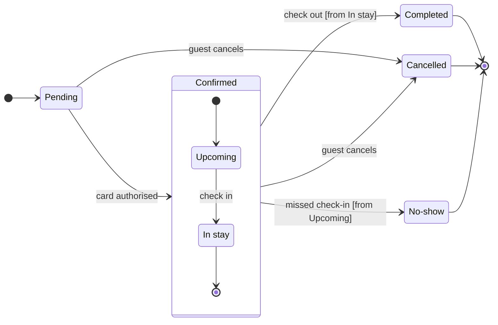

The model passes the pre-write check: 7 states and 12 transitions. This is the gate, and it asks only about the write.

```text
Question: which statuses does a Roamstay booking pass through, what moves it between them, and who sets Cancelled and No-show?
Outcome: support can read every booking status and knows who to ask when a booking is Cancelled or No-show.
First glance: Cancelled, marked with the pink outline by the focus line.
Second glance: Pending, the light blue first state, then Upcoming and In stay, read with the Confirmed section around them.
Last glance: Completed and No-show, the final states in light gray, and the two notes beside Cancelled and No-show.
Plan: <figma-plan-1>, the Barter team plan (a Pro plan where you hold a Full seat). No plan on the account is named Roamstay Product, so I'm reading that as this one.
File: a new FigJam file named "Booking status", created in your drafts with no project.
Writes: one composed board with a title, a subtitle, a key and a source line, balanced detail, a mixed audience, laptop reading distance.
Extensions: two single stickies, no pins.
  beside Cancelled: "Set by the guest, while the booking is Pending or Confirmed"
  beside No-show: "Set by the hotel, after a missed check-in"
Left out: card authorisation failing or expiring, and cancellation by anyone but the guest, because neither is in your lines.
Calls: create_new_file, create_session, one use_figma for the board, one use_figma for the two notes, and a get_figjam read-back after each.
Rollback: delete the new file. For the notes alone, delete the two sticky ids the extension returns.
```

The sketch the board is composed from:



Write it?