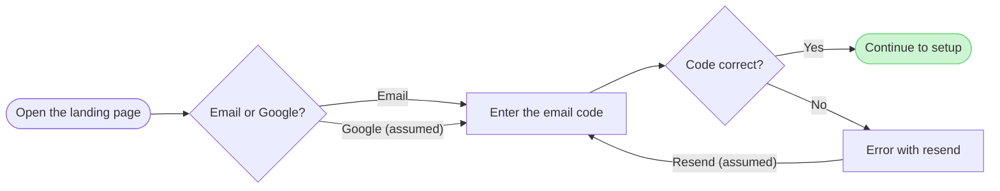
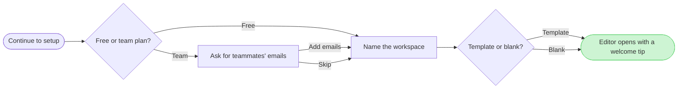

# FJ-029 turn 4 transcript

**User:** Yes, that reading is right.

**Tool call:** `Read` `{"file_path": "/private/tmp/claude-501/-Users-michelkerkmeester-MEGA-Development-AI-Systems/348b59cb-58a2-4b49-8147-c40143312bc1/scratchpad/r043/tmp/FJ-029/devin-compare-bench/FJ-029/sk-create-figjam/references/quality-rubric.md"}`

**Tool result:** `Read`

```text
"1\t---\n2\ttitle: \"FigJam Diagram Quality Rubric\"\n3\tdescription: \"The taste gate a FigJam model passes before the write gate, translated from sk-design-diagram's success criteria: type fit, the remove test, signal, the check, the board, the design rubric that scores a composed board and the reply.\"\n4\tcontextType: implementation\n5\timportance_tier: important\n6\ttrigger_phrases:\n7\t  - \"figjam quality rubric\"\n8\t  - \"diagram taste gate\"\n9\t  - \"remove test\"\n10\t  - \"figjam review checklist\"\n11\t  - \"figjam design rubric\"\n12\tversion: 1.0.6.0\n13\t---\n14\t\n15\t# FigJam Diagram Quality Rubric\n16\t\n17\tThe script checks what a script can see. This rubric is the rest: whether the diagram should exist, whether every node earns its place and whether the reader can trust what lands on the board. Walk it after the check passes and before the write gate.\n18\t\n19\t**Loading Condition:** CONDITIONAL, on every Flow route before the write gate\n20\t**Purpose:** The judgement pass between the pre-write check and the gate\n21\t**Scope:** The model, the provenance table, the planned extensions and, after the write, the board and the reply\n22\t\n23\t---\n24\t\n25\t## 1. TYPE FIT\n26\t\n27\t- [ ] The type answers the reader's question, as `references/flow-mode.md` Section 3 maps it\n28\t- [ ] A table, a list or a paragraph would not do the same job. If it would, say so and offer that instead\n29\t- [ ] The type's reference in `references/types/` was loaded and i
```

**Tool call:** `Read` `{"file_path": "/private/tmp/claude-501/-Users-michelkerkmeester-MEGA-Development-AI-Systems/348b59cb-58a2-4b49-8147-c40143312bc1/scratchpad/r043/tmp/FJ-029/devin-compare-bench/FJ-029/sk-create-figjam/references/style-guide.md"}`

**Tool result:** `Read`

```text
"1\t---\n2\ttitle: \"FigJam Diagram Style Guide\"\n3\tdescription: \"The colour every composed FigJam board draws by kind in the shipped design, the type scale and the 8 pixel grid, the palette pairs the check accepts with their measured contrast, and the spacing bands, translated from sk-design-diagram's style guide and derivation record.\"\n4\tcontextType: implementation\n5\timportance_tier: important\n6\ttrigger_phrases:\n7\t  - \"figjam style guide\"\n8\t  - \"figjam palette\"\n9\t  - \"figjam colour by kind\"\n10\t  - \"figjam type scale\"\n11\t  - \"palette derivation record\"\n12\t  - \"figjam contrast\"\n13\tversion: 1.0.4.0\n14\t---\n15\t\n16\t# FigJam Diagram Style Guide\n17\t\n18\tThe rules for colour, type and spacing on a FigJam board. The composer in `assets/compose-board.js` draws every board in the design `assets/figjam-design.md` holds, which ships as the tables below record, and every hex a model, a design or a note extension uses comes from the palette in Section 3. `scripts/flow_check.py` refuses any other.\n19\t\n20\t**Loading Condition:** CONDITIONAL, before the gate on every Flow route, and when a model or a note extension uses colour\n21\t**Purpose:** Names the colour each kind draws in, the type scale, the grid, the palette pairs the check accepts and the measured contrast record\n22\t**Scope:** The composed board, Mermaid `style`, `classDef` and `linkStyle` colours, sticky and pin colours for notes, and the contrast record the self-test re-measures\n
```

**Tool call:** `ToolSearch` `{"query": "select:mcp__figma-remote__create_session,mcp__figma-remote__get_figjam,mcp__figma-remote__use_figma,mcp__figma-remote__get_screenshot,mcp__figma-remote__whoami", "max_results": 5}`

**Tool result:** `ToolSearch`

```text
[{"type": "tool_reference", "tool_name": "mcp__figma-remote__create_session"}, {"type": "tool_reference", "tool_name": "mcp__figma-remote__get_figjam"}, {"type": "tool_reference", "tool_name": "mcp__figma-remote__use_figma"}, {"type": "tool_reference", "tool_name": "mcp__figma-remote__get_screenshot"}, {"type": "tool_reference", "tool_name": "mcp__figma-remote__whoami"}]
```

**Tool call:** `Bash` `{"command": "mktemp -d", "description": "Create scratch folder for model files"}`

**Tool result:** `Bash`

```text
"/var/folders/3c/zfqcqsts0kn19cgblj82gqhm0000gn/T/tmp.36xOpBSTVl"
```

**Tool call:** `Bash` `{"command": "cd /private/tmp/claude-501/-Users-michelkerkmeester-MEGA-Development-AI-Systems/348b59cb-58a2-4b49-8147-c40143312bc1/scratchpad/r043/tmp/FJ-029/devin-compare-bench/FJ-029/sk-create-figjam && python3 scripts/flow_check.py --help 2>&1 | head -30; ls assets/examples; sed -n 1,80p assets/examples/user-flow-fernhouse-return.md", "description": "Inspect check usage and example model format"}`

**Tool result:** `Bash`

```text
"mermaid_extract: --help: not a Mermaid file\nUNREADABLE --help: the extractor refused it\narchitecture-loomlist-sync.md\ner-roamstay-stays.md\ngantt-loomlist-offline.md\nprocess-fernhouse-refund.md\nsequence-roamstay-checkout.md\nstate-roamstay-booking.md\nuser-flow-fernhouse-return.md\n---\ntitle: \"Example - User Flow - Fernhouse Return\"\ndescription: \"A worked user flow on the fictional Fernhouse store: app screenshots and a returns doc turned into a checked model with its board lines and zones, a playback, a gate message and the reply.\"\ncontextType: general\nimportance_tier: normal\ntrigger_phrases:\n  - \"user flow example\"\n  - \"fernhouse return flow\"\nversion: 1.0.2.0\n---\n\n# Example - User Flow - Fernhouse Return\n\nFernhouse is a fictional store used across the Product Owner fixtures. Every name, screen and rule here is invented for the example.\n\n---\n\n## 1. REQUEST\n\n```text\n$flow how a customer starts a return in the app, from these screenshots and the returns doc\n```\n\nSources: five app screenshots and a returns doc.\n\n| Source | Says |\n|---|---|\n| `Orders - Tap_ Order row.png` | The order list, a row under the finger |\n| `Order detail - Tap_ Start a return.png` | The order page with a Start a return button |\n| `Return reason - Select_ Reason.png` | A list of reasons |\n| `Return method - Select_ Drop-off or pickup.png` | Two choices: a drop-off point or a courier pickup |\n| `Return confirmed.png` | A confirmation with a QR code |\n| Returns
```

**Tool call:** `Bash` `{"command": "sed -n 80,200p /private/tmp/claude-501/-Users-michelkerkmeester-MEGA-Development-AI-Systems/348b59cb-58a2-4b49-8147-c40143312bc1/scratchpad/r043/tmp/FJ-029/devin-compare-bench/FJ-029/sk-create-figjam/assets/examples/user-flow-fernhouse-return.md", "description": "Read rest of the worked example"}`

**Tool result:** `Bash`

```text
"```\n\nThat is ten nodes, one over the budget:\n\n```text\n  diagram 1, user flow: 10 nodes, at most 9: split the flow\n```\n\nThe merge dot goes: both methods lead straight to the confirmation, which says the same thing with one node less. The model that goes forward carries the board lines the composer reads:\n\n```mermaid\nflowchart LR\n    %% title: Start a return\n    %% subtitle: How a Fernhouse customer starts a return in the app, from the order list to a confirmed return\n    %% source: Sources: five app screenshots and the returns doc. Left out: a free pickup over \u20ac100, a proposal under review.\n    %% zone: Find the order: orders, detail\n    %% zone: Request the return: window, support, reason, method, dropoff, pickup\n    %% zone: Done: confirmed\n    orders([Order list]) --> detail[Order detail]\n    detail --> window{Within 30 days?}\n    window -->|No| support([Contact support])\n    window -->|Yes| reason[Pick a reason]\n    reason --> method{Drop-off or pickup?}\n    method -->|Drop-off| dropoff[Choose a drop-off point]\n    method -->|Pickup| pickup[Book a courier pickup]\n    dropoff --> confirmed([Return confirmed])\n    pickup --> confirmed\n    style confirmed fill:#CDF4D3,stroke:#66D575\n```\n\n### Provenance\n\n| Node | Source | Source class |\n|---|---|---|\n| orders | `Orders - Tap_ Order row.png` | current behavior |\n| detail | `Order detail - Tap_ Start a return.png` | current behavior |\n| window | Returns doc, Section 2 | current behavior 
```

**Tool call:** `Write` `{"file_path": "/var/folders/3c/zfqcqsts0kn19cgblj82gqhm0000gn/T/tmp.36xOpBSTVl/model.md", "content": "```mermaid\nflowchart LR\n    %% title: 1. Sign up\n    %% subtitle: How a new person signs up for Loomlist and gets past the email code, for the team reviewing first-run\n    %% source: Sources: the Loomlist onboarding doc, as quoted in the request. Left out: a separate email entry form and any Google account screen, which the doc does not name.\n    landing([Open the landing page]) --> method{Email or Google?}\n    method -->|Email| verify[Enter the email code]\n    method -->|\"Google (assu`

**Tool result:** `Write`

```text
"File created successfully at: /var/folders/3c/zfqcqsts0kn19cgblj82gqhm0000gn/T/tmp.36xOpBSTVl/model.md (file state is current in your context \u2014 no need to Read it back)"
```

**Tool call:** `Bash` `{"command": "python3 scripts/flow_check.py /var/folders/3c/zfqcqsts0kn19cgblj82gqhm0000gn/T/tmp.36xOpBSTVl/model.md", "description": "Run the pre-write check on the model"}`

**Tool result:** `Bash`

```text
"  diagram 1, user flow: ok, 6 nodes and 7 connectors, widest rank 2 steps, longest path 5 steps, 1.2 connectors per step, labels average 17 characters, 0 crossing pairs\nLabel: skipped, the trace failed (dyld[82217]: Library not loaded: /opt/homebrew/opt/simdutf/lib/libsimdutf.36.dylib), so read each label for one word alone on its last line\n  diagram 2, user flow: ok, 6 nodes and 8 connectors, widest rank 1 steps, longest path 6 steps, 1.3 connectors per step, labels average 21 characters, 0 crossing pairs\nLabel: skipped, the trace failed (dyld[82220]: Library not loaded: /opt/homebrew/opt/simdutf/lib/libsimdutf.36.dylib), so read each label for one word alone on its last line\nPASSED 2 diagram(s) in model.md"
```

**Tool call:** `Bash` `{"command": "T=/var/folders/3c/zfqcqsts0kn19cgblj82gqhm0000gn/T/tmp.36xOpBSTVl && python3 scripts/compose_board.py $T/model.md --diagram 1 --out $T/d1.js; echo \"exit $?\"; python3 scripts/compose_board.py $T/model.md --diagram 2 --out $T/d2.js; echo \"exit $?\"; wc -c $T/d1.js $T/d2.js", "description": "Compose both diagrams into code files"}`

**Tool result:** `Bash`

```text
"COMPOSED diagram 1, 6 nodes and 7 connectors, widest rank 2 steps, longest path 5 steps, 1.2 connectors per step, labels average 17 characters, 0 crossing pairs: 6 nodes and 7 connectors to read back, 41830 characters in /var/folders/3c/zfqcqsts0kn19cgblj82gqhm0000gn/T/tmp.36xOpBSTVl/d1.js, drawn in the design FigJam default\nexit 0\nCOMPOSED diagram 2, 6 nodes and 8 connectors, widest rank 1 steps, longest path 6 steps, 1.3 connectors per step, labels average 21 characters, 0 crossing pairs: 6 nodes and 8 connectors to read back, 41939 characters in /var/folders/3c/zfqcqsts0kn19cgblj82gqhm0000gn/T/tmp.36xOpBSTVl/d2.js, drawn in the design FigJam default\nexit 0\n   41830 /var/folders/3c/zfqcqsts0kn19cgblj82gqhm0000gn/T/tmp.36xOpBSTVl/d1.js\n   41939 /var/folders/3c/zfqcqsts0kn19cgblj82gqhm0000gn/T/tmp.36xOpBSTVl/d2.js\n   83769 total"
```

**Tool call:** `mcp__figma-remote__create_session` `{"fileKey": "<draft-file-key>", "description": "Add two user-flow boards, 1. Sign up and 2. Workspace setup, as new sections in the existing Loomlist FigJam file"}`

**Tool result:** `mcp__figma-remote__create_session`

```text
"{\"sessionId\":\"01acf791-a365-4748-933c-ce540dfc5a3a\"}"
```

**Tool call:** `mcp__figma-remote__get_figjam` `{"fileKey": "<draft-file-key>", "nodeId": "0:1", "includeImagesOfNodes": false, "sessionId": "01acf791-a365-4748-933c-ce540dfc5a3a"}`

**Tool result:** `mcp__figma-remote__get_figjam`

```text
[{"type": "text", "text": "<canvas id=\"0:1\" name=\"Page 1\" x=\"0\" y=\"0\" width=\"0\" height=\"0\" />"}]
```

**Assistant:**

The check passed on both diagrams and both composed. I have not written anything. Your file's page is empty, so no section shares a title and nothing already there can change.

**Question:** which screens does a new person pass through from the landing page to the editor, and where do they choose?
**Outcome:** the product and design team can see every branch and agree what each screen needs.

**The sketch**





Board 1 has 6 nodes and 7 connectors with 2 decisions, and board 2 has 6 nodes and 8 connectors with 3 decisions. Neither has a zone. The two assumed edges say so in their labels, because the doc states neither.

**Glances**
- **Board 1, first:** Continue to setup, the goal, in green with the pink outline
- **Board 1, second:** Open the landing page, the light blue entry, and Code correct? with the error beside it
- **Board 1, last:** Email or Google?, Enter the email code and Error with resend
- **Board 2, first:** Editor opens with a welcome tip, the goal
- **Board 2, second:** Continue to setup, the entry, and Free or team plan?
- **Board 2, last:** Ask for teammates' emails, Name the workspace and Template or blank?

**Sketch questions**
- **Where the eye goes first:** the green goal with the pink outline on each board. That is the right node, because the team reads each board to see where it ends
- **What can be removed:** nothing. Each node is a screen or a choice you named, and the error is a node because it has a way back
- **Whether exits read the same way:** Yes and Free sit on the main line, and No and Team branch beside it
- **Label risk:** the check could not trace label wrapping on this machine, so "Editor opens with a welcome tip" may wrap with "tip" alone on its last line. Shortening it would lose your wording, so I'm keeping it unless you say otherwise

**The write**
- **Plan and file:** Loomlist Product, on your word, since I can't read a plan from a file key. The file is `<draft-file-key>`, existing and empty
- **Writes:** two boards as new sections in that file at Laptop distance, "1. Sign up" and then "2. Workspace setup" 400 pixels to its right. Each has a title, a subtitle, a key and a source line
- **Extensions:** none
- **Calls:** two `use_figma` calls and a `get_figjam` read-back for each board. With the session and the read I already made, that is about five calls. If your seat is on a Starter plan or is View or Collab, Figma caps you at six a month
- **Rollback:** delete the two sections this write returns, which I'd do only on a yes to a question naming them

Left out: plan pricing, account settings and anything the editor does after the welcome tip, by your scope answer
Left out: a separate email entry form and any Google account screen, because the doc names neither
Left out: what happens to the teammates' emails after they are entered, because the doc stops at the screen
Left out: workspace setup, split into 2. Workspace setup, because the flow is over the 9-node budget

Write both boards to that file?
