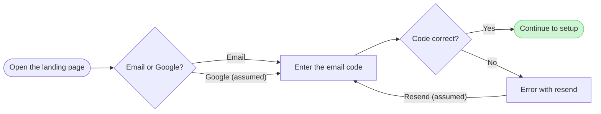
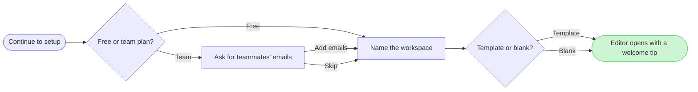

The check passed on both diagrams and both composed. I have not written anything. Your file's page is empty, so no section shares a title and nothing already there can change.

**Question:** which screens does a new person pass through from the landing page to the editor, and where do they choose?
**Outcome:** the product and design team can see every branch and agree what each screen needs.

**The sketch**

Board 1 has 6 nodes and 7 connectors with 2 decisions, and board 2 has 6 nodes and 8 connectors with 3 decisions. Neither has a zone. The two assumed edges say so in their labels, because the doc states neither.

**Glances**
- **Board 1, first:** Continue to setup, the goal, in green with the pink outline
- **Board 1, second:** Open the landing page, the light blue entry, and Code correct? with the error beside it
- **Board 1, last:** Email or Google?, Enter the email code and Error with resend
- **Board 2, first:** Editor opens with a welcome tip, the goal
- **Board 2, second:** Continue to setup, the entry, and Free or team plan?
- **Board 2, last:** Ask for teammates' emails, Name the workspace and Template or blank?

**Sketch questions**
- **Where the eye goes first:** the green goal with the pink outline on each board. That is the right node, because the team reads each board to see where it ends
- **What can be removed:** nothing. Each node is a screen or a choice you named, and the error is a node because it has a way back
- **Whether exits read the same way:** Yes and Free sit on the main line, and No and Team branch beside it
- **Label risk:** the check could not trace label wrapping on this machine, so "Editor opens with a welcome tip" may wrap with "tip" alone on its last line. Shortening it would lose your wording, so I'm keeping it unless you say otherwise

**The write**
- **Plan and file:** Loomlist Product, on your word, since I can't read a plan from a file key. The file is `<draft-file-key>`, existing and empty
- **Writes:** two boards as new sections in that file at Laptop distance, "1. Sign up" and then "2. Workspace setup" 400 pixels to its right. Each has a title, a subtitle, a key and a source line
- **Extensions:** none
- **Calls:** two `use_figma` calls and a `get_figjam` read-back for each board. With the session and the read I already made, that is about five calls. If your seat is on a Starter plan or is View or Collab, Figma caps you at six a month
- **Rollback:** delete the two sections this write returns, which I'd do only on a yes to a question naming them

Left out: plan pricing, account settings and anything the editor does after the welcome tip, by your scope answer
Left out: a separate email entry form and any Google account screen, because the doc names neither
Left out: what happens to the teammates' emails after they are entered, because the doc stops at the screen
Left out: workspace setup, split into 2. Workspace setup, because the flow is over the 9-node budget

Write both boards to that file?