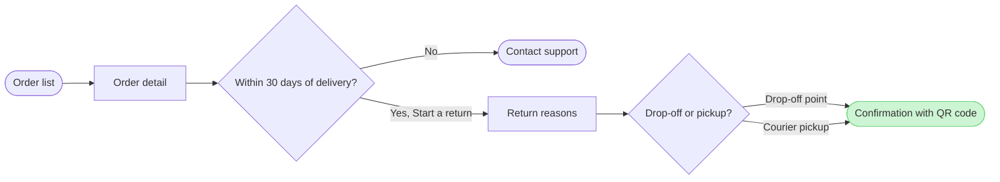

# FJ-031 turn 3 transcript

**User:** Yes, that reading is right.

**Tool call:** `Read` `{"file_path": "/private/tmp/claude-501/-Users-michelkerkmeester-MEGA-Development-AI-Systems/348b59cb-58a2-4b49-8147-c40143312bc1/scratchpad/r043/tmp/FJ-031/devin-compare-bench/FJ-031/sk-create-figjam/references/quality-rubric.md"}`

**Tool result:** `Read`

```text
"1\t---\n2\ttitle: \"FigJam Diagram Quality Rubric\"\n3\tdescription: \"The taste gate a FigJam model passes before the write gate, translated from sk-design-diagram's success criteria: type fit, the remove test, signal, the check, the board, the design rubric that scores a composed board and the reply.\"\n4\tcontextType: implementation\n5\timportance_tier: important\n6\ttrigger_phrases:\n7\t  - \"figjam quality rubric\"\n8\t  - \"diagram taste gate\"\n9\t  - \"remove test\"\n10\t  - \"figjam review checklist\"\n11\t  - \"figjam design rubric\"\n12\tversion: 1.0.6.0\n13\t---\n14\t\n15\t# FigJam Diagram Quality Rubric\n16\t\n17\tThe script checks what a script can see. This rubric is the rest: whether the diagram should exist, whether every node earns its place and whether the reader can trust what lands on the board. Walk it after the check passes and before the write gate.\n18\t\n19\t**Loading Condition:** CONDITIONAL, on every Flow route before the write gate\n20\t**Purpose:** The judgement pass between the pre-write check and the gate\n21\t**Scope:** The model, the provenance table, the planned extensions and, after the write, the board and the reply\n22\t\n23\t---\n24\t\n25\t## 1. TYPE FIT\n26\t\n27\t- [ ] The type answers the reader's question, as `references/flow-mode.md` Section 3 maps it\n28\t- [ ] A table, a list or a paragraph would not do the same job. If it would, say so and offer that instead\n29\t- [ ] The type's reference in `references/types/` was loaded and i
```

**Tool call:** `Read` `{"file_path": "/private/tmp/claude-501/-Users-michelkerkmeester-MEGA-Development-AI-Systems/348b59cb-58a2-4b49-8147-c40143312bc1/scratchpad/r043/tmp/FJ-031/devin-compare-bench/FJ-031/sk-create-figjam/references/style-guide.md"}`

**Tool result:** `Read`

```text
"1\t---\n2\ttitle: \"FigJam Diagram Style Guide\"\n3\tdescription: \"The colour every composed FigJam board draws by kind in the shipped design, the type scale and the 8 pixel grid, the palette pairs the check accepts with their measured contrast, and the spacing bands, translated from sk-design-diagram's style guide and derivation record.\"\n4\tcontextType: implementation\n5\timportance_tier: important\n6\ttrigger_phrases:\n7\t  - \"figjam style guide\"\n8\t  - \"figjam palette\"\n9\t  - \"figjam colour by kind\"\n10\t  - \"figjam type scale\"\n11\t  - \"palette derivation record\"\n12\t  - \"figjam contrast\"\n13\tversion: 1.0.4.0\n14\t---\n15\t\n16\t# FigJam Diagram Style Guide\n17\t\n18\tThe rules for colour, type and spacing on a FigJam board. The composer in `assets/compose-board.js` draws every board in the design `assets/figjam-design.md` holds, which ships as the tables below record, and every hex a model, a design or a note extension uses comes from the palette in Section 3. `scripts/flow_check.py` refuses any other.\n19\t\n20\t**Loading Condition:** CONDITIONAL, before the gate on every Flow route, and when a model or a note extension uses colour\n21\t**Purpose:** Names the colour each kind draws in, the type scale, the grid, the palette pairs the check accepts and the measured contrast record\n22\t**Scope:** The composed board, Mermaid `style`, `classDef` and `linkStyle` colours, sticky and pin colours for notes, and the contrast record the self-test re-measures\n
```

**Tool call:** `ToolSearch` `{"query": "select:mcp__figma-remote__whoami,mcp__figma-remote__create_session,mcp__figma-remote__get_figjam,mcp__figma-remote__use_figma,mcp__figma-remote__get_screenshot", "max_results": 5}`

**Tool result:** `ToolSearch`

```text
[{"type": "tool_reference", "tool_name": "mcp__figma-remote__whoami"}, {"type": "tool_reference", "tool_name": "mcp__figma-remote__create_session"}, {"type": "tool_reference", "tool_name": "mcp__figma-remote__get_figjam"}, {"type": "tool_reference", "tool_name": "mcp__figma-remote__use_figma"}, {"type": "tool_reference", "tool_name": "mcp__figma-remote__get_screenshot"}]
```

**Tool call:** `Bash` `{"command": "mktemp -d", "description": "Create scratch folder for the model"}`

**Tool result:** `Bash`

```text
"/var/folders/3c/zfqcqsts0kn19cgblj82gqhm0000gn/T/tmp.cq2gzzuYV4"
```

**Tool call:** `Write` `{"file_path": "/var/folders/3c/zfqcqsts0kn19cgblj82gqhm0000gn/T/tmp.cq2gzzuYV4/model.md", "content": "```mermaid\nflowchart LR\n    %% title: Start a return\n    %% subtitle: How a Fernhouse customer starts a return in the app, from the order list to a confirmed return\n    %% source: Sources: the app and the returns doc as described. Left out: free pickup over 100 euros, a proposal under review.\n    %% zone: Find the order: orders, detail\n    %% zone: Request the return: window, support, reason, method\n    %% zone: Done: confirmed\n    orders([Order list]) --> detail[Order detail]\n    det`

**Tool result:** `Write`

```text
"File created successfully at: /var/folders/3c/zfqcqsts0kn19cgblj82gqhm0000gn/T/tmp.cq2gzzuYV4/model.md (file state is current in your context \u2014 no need to Read it back)"
```

**Tool call:** `Bash` `{"command": "python3 sk-create-figjam/scripts/flow_check.py /var/folders/3c/zfqcqsts0kn19cgblj82gqhm0000gn/T/tmp.cq2gzzuYV4/model.md; echo \"exit $?\"", "description": "Run the pre-write check on the model"}`

**Tool result:** `Bash`

```text
"  diagram 1, user flow: ok, 7 nodes and 7 connectors, widest rank 2 steps, longest path 6 steps, 1.0 connectors per step, labels average 17 characters, 0 crossing pairs\nLabel: skipped, the trace failed (dyld[82517]: Library not loaded: /opt/homebrew/opt/simdutf/lib/libsimdutf.36.dylib), so read each label for one word alone on its last line\nPASSED 1 diagram(s) in model.md\nexit 0"
```

**Tool call:** `Bash` `{"command": "python3 sk-create-figjam/scripts/compose_board.py /var/folders/3c/zfqcqsts0kn19cgblj82gqhm0000gn/T/tmp.cq2gzzuYV4/model.md --diagram 1 --out /var/folders/3c/zfqcqsts0kn19cgblj82gqhm0000gn/T/tmp.cq2gzzuYV4/board1.js; echo \"exit $?\"; wc -c /var/folders/3c/zfqcqsts0kn19cgblj82gqhm0000gn/T/tmp.cq2gzzuYV4/board1.js", "description": "Compose the board code from the checked model"}`

**Tool result:** `Bash`

```text
"COMPOSED diagram 1, 7 nodes and 7 connectors, widest rank 2 steps, longest path 6 steps, 1.0 connectors per step, labels average 17 characters, 0 crossing pairs: 7 nodes and 7 connectors to read back, 42156 characters in /var/folders/3c/zfqcqsts0kn19cgblj82gqhm0000gn/T/tmp.cq2gzzuYV4/board1.js, drawn in the design FigJam default\nexit 0\n   42156 /var/folders/3c/zfqcqsts0kn19cgblj82gqhm0000gn/T/tmp.cq2gzzuYV4/board1.js"
```

**Tool call:** `mcp__figma-remote__create_session` `{"fileKey": "<draft-file-key>", "description": "Add a Start a return user flow board as a new section to the existing FigJam file"}`

**Tool result:** `mcp__figma-remote__create_session`

```text
"{\"sessionId\":\"7fccd1fb-fd3e-4713-9bd3-1defad11b529\"}"
```

**Assistant:**

Now the one read of the named file, so the gate can name any same-titled section and the read-back has a before to compare with.

**Tool call:** `mcp__figma-remote__get_figjam` `{"fileKey": "<draft-file-key>", "nodeId": "0:1", "sessionId": "7fccd1fb-fd3e-4713-9bd3-1defad11b529", "includeImagesOfNodes": false}`

**Tool result:** `mcp__figma-remote__get_figjam`

```text
[{"type": "text", "text": "<canvas id=\"0:1\" name=\"Page 1\" x=\"0\" y=\"0\" width=\"0\" height=\"0\" />"}]
```

**Assistant:**

Here is the checked model and the gate. Nothing is written yet.



Check: passed, 7 nodes and 7 connectors, 0 crossing pairs, and the board composes. The label-wrap trace could not run on this machine. I read the labels by eye instead, and "Within 30 days of delivery?" and "Confirmation with QR code" are the two that could wrap with one word alone on the last line. I'll check them on the board after the write.

Question: which screens does a customer pass through to start a return in the app, and where do they choose?
Outcome: a reader can follow a return from the order list to the QR confirmation and see where the 30-day window ends it.
First glance: Confirmation with QR code, the green goal at the end of the straight line.
Second glance: Order list, the light blue entry, and the two choices, "Within 30 days of delivery?" and "Drop-off or pickup?".
Last glance: Contact support, the orange exit, and the plain screens Order detail and Return reasons.
Plan: Fernhouse Product, as you stated. I have not verified it, because the tools say which plans your account holds but not which plan owns a file.
File: the existing FigJam file `<draft-file-key>`, not a new file. I read it once and it holds no content, so no section shares the title Start a return.
Writes: one new board section with 7 nodes and 7 connectors in three zones, with a title, a key and a source line, at the laptop reading distance. Nothing else on the file changes.
Left out: free pickup over 100 euros, a proposal under review
Extensions: none.
Assumed and re-read: your wording says Contact support appears after 30 days but not on which screen. The check at the order detail stays an assumption.
Calls: one `use_figma` write and one `get_figjam` read-back. If the plan is Starter, Figma limits tool calls to six a month and reads count, and I have already spent two.
Rollback: delete the one board section the write returns. I would ask you first and name it by its title.

Write it?
