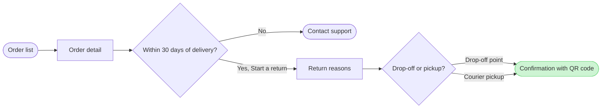

Here is the checked model and the gate. Nothing is written yet.

Check: passed, 7 nodes and 7 connectors, 0 crossing pairs, and the board composes. The label-wrap trace could not run on this machine. I read the labels by eye instead, and "Within 30 days of delivery?" and "Confirmation with QR code" are the two that could wrap with one word alone on the last line. I'll check them on the board after the write.

Question: which screens does a customer pass through to start a return in the app, and where do they choose?
Outcome: a reader can follow a return from the order list to the QR confirmation and see where the 30-day window ends it.
First glance: Confirmation with QR code, the green goal at the end of the straight line.
Second glance: Order list, the light blue entry, and the two choices, "Within 30 days of delivery?" and "Drop-off or pickup?".
Last glance: Contact support, the orange exit, and the plain screens Order detail and Return reasons.
Plan: Fernhouse Product, as you stated. I have not verified it, because the tools say which plans your account holds but not which plan owns a file.
File: the existing FigJam file `<draft-file-key>`, not a new file. I read it once and it holds no content, so no section shares the title Start a return.
Writes: one new board section with 7 nodes and 7 connectors in three zones, with a title, a key and a source line, at the laptop reading distance. Nothing else on the file changes.
Left out: free pickup over 100 euros, a proposal under review
Extensions: none.
Assumed and re-read: your wording says Contact support appears after 30 days but not on which screen. The check at the order detail stays an assumption.
Calls: one `use_figma` write and one `get_figjam` read-back. If the plan is Starter, Figma limits tool calls to six a month and reads count, and I have already spent two.
Rollback: delete the one board section the write returns. I would ask you first and name it by its title.

Write it?