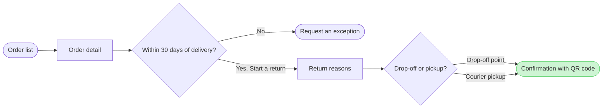

Here is the revised model and the gate. Nothing is written yet.

Check: passed, 7 nodes and 7 connectors, 0 crossing pairs, and the board composes. The label-wrap trace failed again on this machine. By eye, "Request an exception" will probably wrap with "exception" alone on its second line. I am keeping the app's wording rather than shortening it to "Request exception", and the screenshot after the write will show it.

Question: which screens does a customer pass through to start a return in the app, and where do they choose?
Outcome: a reader can follow a return from the order list to the QR confirmation and see where the 30-day window ends it.
First glance: Confirmation with QR code, the green goal. The accent stays on the goal because the change is to an exit.
Second glance: Request an exception, the orange exit that changed, alone.
Last glance: Order list, the light blue entry, the two choices and the plain screens Order detail and Return reasons.
Plan: Fernhouse Product, as you stated and still unverified.
File: the existing FigJam file `<draft-file-key>`. The write adds a new section 400 pixels to the right of the earlier board and changes nothing already on the file. The new section keeps the title Start a return because this is a revision, so it shares that title with the earlier section (`1:3`), which stays in place until you answer a separate question.
Writes: one composed board, 7 nodes and 7 connectors in three zones, with a title, a key and a source line, at the laptop reading distance.
Left out: free pickup over 100 euros, a proposal under review. Steps after the confirmation, and what happens after someone taps Request an exception, because none were described in the sources
Extensions: none.
Calls: one `use_figma` write, one `get_figjam` read-back of the new board and one `get_figjam` read of the page to compare the earlier board with the read I took after the first write. If the plan is Starter, Figma limits tool calls to six a month and reads count. I have spent six on this file already, so the write may be refused.
Rollback: delete the new section the write returns, on your yes to a question that names it. The earlier board stays either way.
Delete: after the read-back I will ask separately whether to delete the earlier section by its title and write time. With no second yes both boards stay.

Write it?