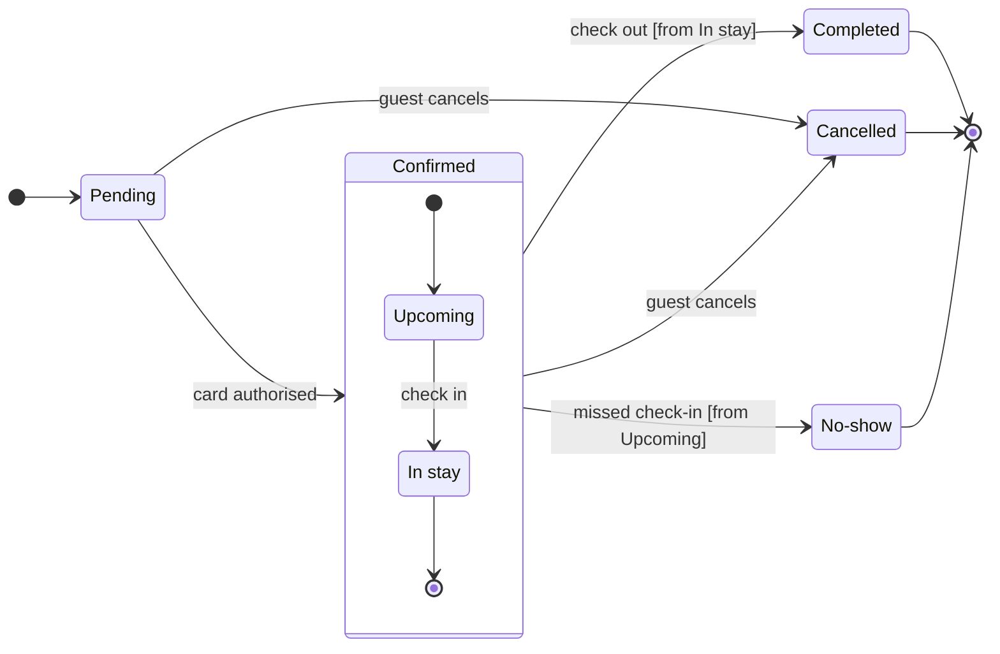

The model passed the pre-write check and composes cleanly. This is the sketch, and nothing is on the board yet.

**Question:** which statuses can a Roamstay booking have, and what moves it between them?
**Outcome:** the team can agree on every status and the event behind each move.
**First glance:** Pending, the light blue first state where every booking starts. The model has no focus line, so the layout decides, and the first state reads first.
**Second glance:** Upcoming and In stay, the states inside Confirmed, read with the section that frames them.
**Last glance:** Completed, Cancelled and No-show, the end states, each in light gray with a heavy outline.

**Rows that were not stated outright**

| Item | Source | Class | Confidence | Rung |
|---|---|---|---|---|
| Upcoming to In stay, "check in" | Your request names the two inner states and a missed check-in, but not this trigger | current behavior | medium | assumed, accepted in the playback |
| "[from In stay]" and "[from Upcoming]" guards | Your request does not say which inner state check-out and No-show leave from | current behavior | medium | assumed, accepted in the playback |

I re-read your request for both rows and it is silent on each, so they stay marked assumed.

**Left out:** a declined or expired card authorisation, refunds and edits to a booking, none of which were in the request.
**File:** your existing board `<draft-file-key>`. It holds one section, "Sprint retro", with six stickies and no section titled "Booking status". The board lands as a new section to the right of it, and nothing already there changes. A named existing file needs no plan and no new file.
**Writes:** one composed board titled "Booking status", with 7 states and 12 transitions, a subtitle, a key and a source line, at the Laptop reading distance.
**Extensions:** none.
**Calls:** one `use_figma` to compose, one `get_figjam` read-back of the new section and one `get_figjam` read of the existing content to compare with today's read. That is three more calls after the session and the read already spent. If your seat is on a Starter plan or is View or Collab, Figma caps tool calls at six a month, and this work will have used five.
**Rollback:** delete the one new section the write returns. That runs only on its own yes to a question that names it.

Write it?