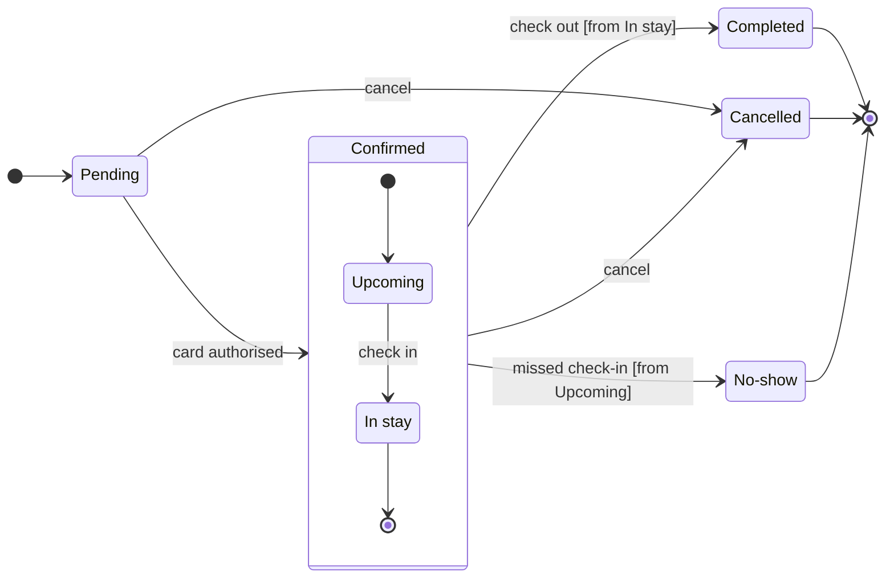

# FJ-017 turn 2 transcript

**User:** Yes, that reading is right.

**Assistant:**

The playback is confirmed, so next I'm building the model and running the pre-write check. I'll also read the plans on the account so the gate can name one.

**Tool call:** `Bash` `{"command": "S=$(mktemp -d) && echo \"$S\" && cat > \"$S/model.md\" <<'EOF'\n```mermaid\nstateDiagram-v2\n    %% title: Booking status\n    %% subtitle: Every status a Roamstay booking passes through, what moves it on, and who sets Cancelled and No-show\n    %% source: Source: the booking status request. Left out: card authorisation failing, anyone but the guest cancelling.\n    %% focus: Cancelled\n    direction LR\n    state \"In stay\" as InStay\n    state \"No-show\" as NoShow\n    [*] --> Pending\n    Pending --> Confirmed: card authorised\n    state Confirmed {\n        [*] --> Upcoming\`

**Tool call:** `mcp__figma-remote__whoami` `{}`

**Tool result:** `Bash`

```text
"/var/folders/3c/zfqcqsts0kn19cgblj82gqhm0000gn/T/tmp.2lKzaoxueW\n  diagram 1, state: ok, 7 states and 12 transitions\nLabel: skipped, the trace failed (dyld[77524]: Library not loaded: /opt/homebrew/opt/simdutf/lib/libsimdutf.36.dylib), so read each label for one word alone on its last line\nPASSED 1 diagram(s) in model.md\nexit 0\nsk-create-figjam/references/style-guide.md"
```

**Tool result:** `mcp__figma-remote__whoami`

```text
"{\"whoami\":{\"user_id\":\"<redacted>\",\"handle\":\"<redacted>\",\"email\":\"<email>\",\"code_layers_enabled\":true,\"plans\":[{\"name\":\"<figma-plan-3>\",\"seat\":\"View\",\"tier\":\"starter\",\"key\":\"team::955111831884247158\",\"role\":\"admin\",\"specs_enabled\":true,\"code_layers_enabled\":true},{\"name\":\"<figma-plan-1>\",\"seat\":\"Full\",\"tier\":\"pro\",\"key\":\"team::1297132374291579406\",\"role\":\"admin\",\"specs_enabled\":false,\"code_layers_enabled\":true},{\"name\":\"<figma-plan-2>\",\"seat\":\"Full\",\"tier\":\"pro\",\"key\":\"team::1285583218246154085\",\"role\":\"member\",\"specs_enabled\":false,\"code_layers_enabled\":true}]},\"instructions\":\"For more details on rate limits and access, refer to https://developers.figma.com/docs/figma-mcp-server/rate-limits-access/\"}"
```

**Tool call:** `Bash` `{"command": "S=/var/folders/3c/zfqcqsts0kn19cgblj82gqhm0000gn/T/tmp.2lKzaoxueW && python3 -I sk-create-figjam/scripts/compose_board.py \"$S/model.md\" --diagram 1 --out \"$S/board1.js\"; echo \"exit $?\"; wc -c \"$S/board1.js\""}`

**Tool result:** `Bash`

```text
"COMPOSED diagram 1, 7 states and 12 transitions: 12 nodes and 12 connectors to read back, 42472 characters in /var/folders/3c/zfqcqsts0kn19cgblj82gqhm0000gn/T/tmp.2lKzaoxueW/board1.js, drawn in the design FigJam default\nexit 0\n   42472 /var/folders/3c/zfqcqsts0kn19cgblj82gqhm0000gn/T/tmp.2lKzaoxueW/board1.js"
```

**Tool call:** `Read` `{"file_path": "/private/tmp/claude-501/-Users-michelkerkmeester-MEGA-Development-AI-Systems/348b59cb-58a2-4b49-8147-c40143312bc1/scratchpad/r044/tmp/FJ-017/devin-compare-bench/FJ-017/sk-create-figjam/references/style-guide.md", "limit": 140}`

**Tool result:** `Read`

```text
"1\t---\n2\ttitle: \"FigJam Diagram Style Guide\"\n3\tdescription: \"The colour every composed FigJam board draws by kind in the shipped design, the type scale and the 8 pixel grid, the palette pairs the check accepts with their measured contrast, and the spacing bands, translated from sk-design-diagram's style guide and derivation record.\"\n4\tcontextType: implementation\n5\timportance_tier: important\n6\ttrigger_phrases:\n7\t  - \"figjam style guide\"\n8\t  - \"figjam palette\"\n9\t  - \"figjam colour by kind\"\n10\t  - \"figjam type scale\"\n11\t  - \"palette derivation record\"\n12\t  - \"figjam contrast\"\n13\tversion: 1.0.4.0\n14\t---\n15\t\n16\t# FigJam Diagram Style Guide\n17\t\n18\tThe rules for colour, type and spacing on a FigJam board. The composer in `assets/compose-board.js` draws every board in the design `assets/figjam-design.md` holds, which ships as the tables below record, and every hex a model, a design or a note extension uses comes from the palette in Section 3. `scripts/flow_check.py` refuses any other.\n19\t\n20\t**Loading Condition:** CONDITIONAL, before the gate on every Flow route, and when a model or a note extension uses colour\n21\t**Purpose:** Names the colour each kind draws in, the type scale, the grid, the palette pairs the check accepts and the measured contrast record\n22\t**Scope:** The composed board, Mermaid `style`, `classDef` and `linkStyle` colours, sticky and pin colours for notes, and the contrast record the self-test re-measures\n
```

**Assistant:**

Check passed and the composer built the board, so this is the write gate.



`flow_check.py` printed `PASSED`, with 7 states and 12 transitions. `compose_board.py` printed `COMPOSED`, with 12 nodes and 12 connectors to read back. The check's label-wrap trace could not run (a missing library on this machine). I read the labels by hand instead, and the longest is "missed check-in [from Upcoming]" at 31 characters.

**Question:** which statuses can a Roamstay booking have, what moves it between them, and who sets Cancelled and No-show?
**Outcome:** support can read every status and knows who to ask about a Cancelled or a No-show booking.
**First glance:** Cancelled, a light gray end state with the pink accent outline, marked by the focus line.
**Second glance:** the two notes, then Pending (the light blue first state) and Upcoming and In stay, read with the Confirmed section around them.
**Last glance:** Completed and No-show, the other end states, each in light gray with a heavy outline.
**Sketch check:** the eye should land on Cancelled, the status you named a note for first. Nothing in the outline is removable, because each state and move comes from your request.

**Plan:** your account has no plan called Roamstay Product. Its plans are <figma-plan-3>, <figma-plan-1> and <figma-plan-2> I read "the Barter team plan" as <figma-plan-1>
**File:** a new FigJam file named "Booking status" in the <figma-plan-1> plan. It goes in drafts with no project, so only you see it until you share it.
**Writes:** one composed board with 7 states, 12 transitions, a title, a key and a source line, at Laptop reading distance.
**Extensions:** 2 single stickies, each placed 64 pixels clear of its state.
* Cancelled: "Set by the guest, while the booking is Pending or Confirmed"
* No-show: "Set by the hotel, after a missed check-in"

**Left out:** card authorisation failing, because the request gives no move out of Pending for it. Anyone but the guest cancelling, because the request names only the guest, so the Cancelled note says "guest" and nothing wider.
**Calls:** `create_new_file`, `create_session`, one `use_figma` to compose the board, one `use_figma` for the two notes and `get_figjam` for the read-back. `whoami` is already spent.
**Rollback:** delete the new file.

Write it?
