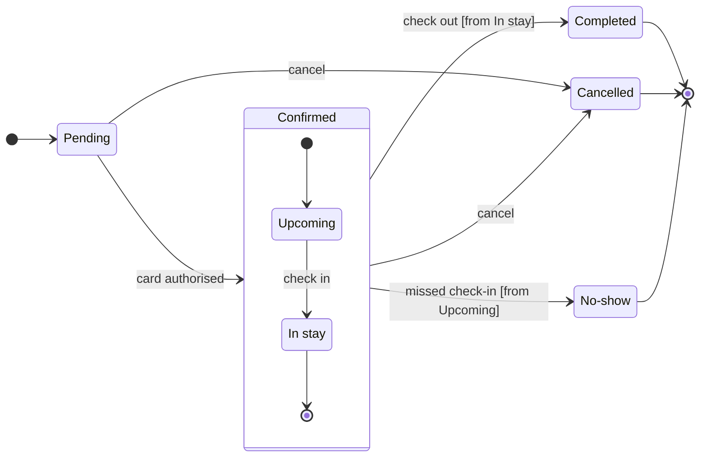

Check passed and the composer built the board, so this is the write gate.

`flow_check.py` printed `PASSED`, with 7 states and 12 transitions. `compose_board.py` printed `COMPOSED`, with 12 nodes and 12 connectors to read back. The check's label-wrap trace could not run (a missing library on this machine). I read the labels by hand instead, and the longest is "missed check-in [from Upcoming]" at 31 characters.

**Question:** which statuses can a Roamstay booking have, what moves it between them, and who sets Cancelled and No-show?
**Outcome:** support can read every status and knows who to ask about a Cancelled or a No-show booking.
**First glance:** Cancelled, a light gray end state with the pink accent outline, marked by the focus line.
**Second glance:** the two notes, then Pending (the light blue first state) and Upcoming and In stay, read with the Confirmed section around them.
**Last glance:** Completed and No-show, the other end states, each in light gray with a heavy outline.
**Sketch check:** the eye should land on Cancelled, the status you named a note for first. Nothing in the outline is removable, because each state and move comes from your request.

**Plan:** your account has no plan called Roamstay Product. Its plans are <figma-plan-3>, <figma-plan-1> and <figma-plan-2> I read "the Barter team plan" as <figma-plan-1>
**File:** a new FigJam file named "Booking status" in the <figma-plan-1> plan. It goes in drafts with no project, so only you see it until you share it.
**Writes:** one composed board with 7 states, 12 transitions, a title, a key and a source line, at Laptop reading distance.
**Extensions:** 2 single stickies, each placed 64 pixels clear of its state.
* Cancelled: "Set by the guest, while the booking is Pending or Confirmed"
* No-show: "Set by the hotel, after a missed check-in"

**Left out:** card authorisation failing, because the request gives no move out of Pending for it. Anyone but the guest cancelling, because the request names only the guest, so the Cancelled note says "guest" and nothing wider.
**Calls:** `create_new_file`, `create_session`, one `use_figma` to compose the board, one `use_figma` for the two notes and `get_figjam` for the read-back. `whoami` is already spent.
**Rollback:** delete the new file.

Write it?