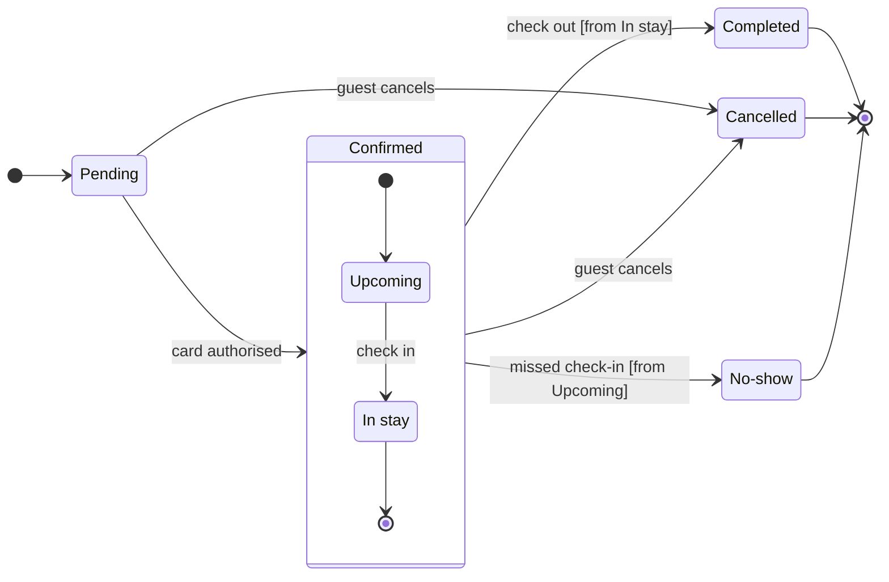

# FJ-026 turn 2 transcript

**User:** Yes, that reading is right.

**Tool call:** `ToolSearch` `{"query": "select:mcp__figma-remote__create_session,mcp__figma-remote__get_figjam,mcp__figma-remote__use_figma", "max_results": 5}`

**Tool result:** `ToolSearch`

```text
[{"type": "tool_reference", "tool_name": "mcp__figma-remote__create_session"}, {"type": "tool_reference", "tool_name": "mcp__figma-remote__get_figjam"}, {"type": "tool_reference", "tool_name": "mcp__figma-remote__use_figma"}]
```

**Tool call:** `Read` `{"file_path": "/private/tmp/claude-501/-Users-michelkerkmeester-MEGA-Development-AI-Systems/348b59cb-58a2-4b49-8147-c40143312bc1/scratchpad/r044/tmp/FJ-026/devin-compare-bench/FJ-026/sk-create-figjam/references/quality-rubric.md"}`

**Tool result:** `Read`

```text
"1\t---\n2\ttitle: \"FigJam Diagram Quality Rubric\"\n3\tdescription: \"The taste gate a FigJam model passes before the write gate, translated from sk-design-diagram's success criteria: type fit, the remove test, signal, the check, the board, the design rubric that scores a composed board and the reply.\"\n4\tcontextType: implementation\n5\timportance_tier: important\n6\ttrigger_phrases:\n7\t  - \"figjam quality rubric\"\n8\t  - \"diagram taste gate\"\n9\t  - \"remove test\"\n10\t  - \"figjam review checklist\"\n11\t  - \"figjam design rubric\"\n12\tversion: 1.0.7.0\n13\t---\n14\t\n15\t# FigJam Diagram Quality Rubric\n16\t\n17\tThe script checks what a script can see. This rubric is the rest: whether the diagram should exist, whether every node earns its place and whether the reader can trust what lands on the board. Walk it after the check passes and before the write gate.\n18\t\n19\t**Loading Condition:** CONDITIONAL, on every Flow route before the write gate\n20\t**Purpose:** The judgement pass between the pre-write check and the gate\n21\t**Scope:** The model, the provenance table, the planned extensions and, after the write, the board and the reply\n22\t\n23\t---\n24\t\n25\t## 1. TYPE FIT\n26\t\n27\t- [ ] The type answers the reader's question, as `references/flow-mode.md` Section 3 maps it\n28\t- [ ] A table, a list or a paragraph would not do the same job. If it would, say so and offer that instead\n29\t- [ ] The type's reference in `references/types/` was loaded and i
```

**Tool call:** `Bash` `{"command": "mktemp -d", "description": "Create scratch folder for model"}`

**Tool result:** `Bash`

```text
"/var/folders/3c/zfqcqsts0kn19cgblj82gqhm0000gn/T/tmp.w3OVyyUtgF"
```

**Tool call:** `Bash` `{"command": "S=/var/folders/3c/zfqcqsts0kn19cgblj82gqhm0000gn/T/tmp.w3OVyyUtgF && cat > $S/model.md <<'EOF'\n```mermaid\nstateDiagram-v2\n    %% title: Booking status\n    %% subtitle: Every status a Roamstay booking passes through, and what moves it on\n    %% source: Source: the booking status lifecycle described in the request.\n    %% focus: Cancelled\n    direction LR\n    state \"In stay\" as InStay\n    state \"No-show\" as NoShow\n    [*] --> Pending\n    Pending --> Confirmed: card authorised\n    state Confirmed {\n        [*] --> Upcoming\n        Upcoming --> InStay: check in\n    `

**Tool result:** `Bash`

```text
"  diagram 1, state: ok, 7 states and 12 transitions\nLabel: skipped, the trace failed (dyld[78108]: Library not loaded: /opt/homebrew/opt/simdutf/lib/libsimdutf.36.dylib), so read each label for one word alone on its last line\nPASSED 1 diagram(s) in model.md\nexit 0\nCOMPOSED diagram 1, 7 states and 12 transitions: 12 nodes and 12 connectors to read back, 42410 characters in /var/folders/3c/zfqcqsts0kn19cgblj82gqhm0000gn/T/tmp.w3OVyyUtgF/code.js, drawn in the design FigJam default\nexit 0\n   42410 /var/folders/3c/zfqcqsts0kn19cgblj82gqhm0000gn/T/tmp.w3OVyyUtgF/code.js"
```

**Tool call:** `mcp__figma-remote__create_session` `{"fileKey": "<draft-file-key>", "description": "Add a Roamstay booking status lifecycle state diagram as a new board section in this FigJam file, leaving existing content unchanged"}`

**Tool result:** `mcp__figma-remote__create_session`

```text
"{\"sessionId\":\"eb0749bf-6d9f-4607-9380-18011290c189\"}"
```

**Tool call:** `mcp__figma-remote__get_figjam` `{"fileKey": "<draft-file-key>", "nodeId": "0:1", "sessionId": "eb0749bf-6d9f-4607-9380-18011290c189", "includeImagesOfNodes": false}`

**Tool result:** `mcp__figma-remote__get_figjam`

```text
[{"type": "text", "text": "<canvas id=\"0:1\" name=\"Page 1\" x=\"0\" y=\"0\" width=\"0\" height=\"0\" />"}]
```

**Assistant:**

The check passed and I read the file. Nothing is written yet.

The file `<draft-file-key>` has an empty page, so no section shares the title "Booking status".

**Sketch** (checked model, not on the board)



`flow_check.py` printed `PASSED`, with 7 states and 12 transitions. The composer's label trace could not run because a system library is missing. I read the labels by hand instead, and none leaves one word alone on a last line.

**Critique questions on the sketch**
- Where does the eye go first? Cancelled, which carries the pink accent. It is the end reached from two states, so it is the one support most needs to spot.
- Does every state earn its place? Yes. Cutting any one loses a status you named.
- Is anything drawn that you did not say? Only the two guards, `[from In stay]` and `[from Upcoming]`, which you accepted as assumed.
- Does it read without colour? Yes. The ends have a heavy outline, a "Final state" key entry and the arrow into the end dot.

**Glance plan**
- First glance: Cancelled, marked by the focus line.
- Second glance: Pending, the light blue entry, then Upcoming and In stay, read with the Confirmed section around them.
- Last glance: Completed and No-show, the other two ends, in light gray with a heavy outline.

**Plan:** Roamstay Product, as you stated. The file already exists, so it keeps its plan and I create no new file.
**File:** `<draft-file-key>`
**Writes:** one composed board named "Booking status", with 7 states and 12 transitions, a title, a subtitle, a key and a source line, at the laptop reading distance. The three end states are light gray, and nothing else on the file changes.
**Extensions:** none
**Calls:** `create_session` and one `get_figjam` read are already spent. The write spends one `use_figma` and one `get_figjam` read-back. If the plan is Starter, that is 4 of the 6 monthly tool calls.
**Left out:** payment retries, refunds, booking changes and any hotel action other than marking no-show, as you agreed.
**Rollback:** delete the one "Booking status" section the write returns.

Write the board into this file?
