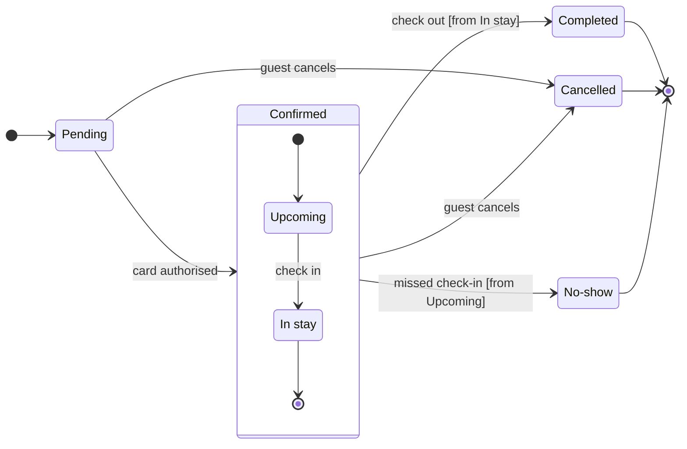

The check passed and I read the file. Nothing is written yet.

The file `<draft-file-key>` has an empty page, so no section shares the title "Booking status".

**Sketch** (checked model, not on the board)

`flow_check.py` printed `PASSED`, with 7 states and 12 transitions. The composer's label trace could not run because a system library is missing. I read the labels by hand instead, and none leaves one word alone on a last line.

**Critique questions on the sketch**
- Where does the eye go first? Cancelled, which carries the pink accent. It is the end reached from two states, so it is the one support most needs to spot.
- Does every state earn its place? Yes. Cutting any one loses a status you named.
- Is anything drawn that you did not say? Only the two guards, `[from In stay]` and `[from Upcoming]`, which you accepted as assumed.
- Does it read without colour? Yes. The ends have a heavy outline, a "Final state" key entry and the arrow into the end dot.

**Glance plan**
- First glance: Cancelled, marked by the focus line.
- Second glance: Pending, the light blue entry, then Upcoming and In stay, read with the Confirmed section around them.
- Last glance: Completed and No-show, the other two ends, in light gray with a heavy outline.

**Plan:** Roamstay Product, as you stated. The file already exists, so it keeps its plan and I create no new file.
**File:** `<draft-file-key>`
**Writes:** one composed board named "Booking status", with 7 states and 12 transitions, a title, a subtitle, a key and a source line, at the laptop reading distance. The three end states are light gray, and nothing else on the file changes.
**Extensions:** none
**Calls:** `create_session` and one `get_figjam` read are already spent. The write spends one `use_figma` and one `get_figjam` read-back. If the plan is Starter, that is 4 of the 6 monthly tool calls.
**Left out:** payment retries, refunds, booking changes and any hotel action other than marking no-show, as you agreed.
**Rollback:** delete the one "Booking status" section the write returns.

Write the board into this file?