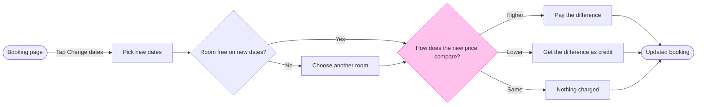

# FJ-036 turn 4 transcript

**User:** Yes, that reading is right.

**Tool call:** `ToolSearch` `{"query": "select:mcp__figma-remote__get_figjam,mcp__figma-remote__create_session,mcp__figma-remote__use_figma,mcp__figma-remote__whoami", "max_results": 4}`

**Tool result:** `ToolSearch`

```text
[{"type": "tool_reference", "tool_name": "mcp__figma-remote__get_figjam"}, {"type": "tool_reference", "tool_name": "mcp__figma-remote__create_session"}, {"type": "tool_reference", "tool_name": "mcp__figma-remote__use_figma"}, {"type": "tool_reference", "tool_name": "mcp__figma-remote__whoami"}]
```

**Tool call:** `Read` `{"file_path": "/private/tmp/claude-501/-Users-michelkerkmeester-MEGA-Development-AI-Systems/348b59cb-58a2-4b49-8147-c40143312bc1/scratchpad/r044/tmp/FJ-036/devin-compare-bench/FJ-036/sk-create-figjam/assets/examples/user-flow-fernhouse-return.md"}`

**Tool result:** `Read`

```text
"1\t---\n2\ttitle: \"Example - User Flow - Fernhouse Return\"\n3\tdescription: \"A worked user flow on the fictional Fernhouse store: app screenshots and a returns doc turned into a checked model with its board lines and zones, a playback, a gate message and the reply.\"\n4\tcontextType: general\n5\timportance_tier: normal\n6\ttrigger_phrases:\n7\t  - \"user flow example\"\n8\t  - \"fernhouse return flow\"\n9\tversion: 1.0.3.0\n10\t---\n11\t\n12\t# Example - User Flow - Fernhouse Return\n13\t\n14\tFernhouse is a fictional store used across the Product Owner fixtures. Every name, screen and rule here is invented for the example.\n15\t\n16\t---\n17\t\n18\t## 1. REQUEST\n19\t\n20\t```text\n21\t$flow how a customer starts a return in the app, from these screenshots and the returns doc\n22\t```\n23\t\n24\tSources: five app screenshots and a returns doc.\n25\t\n26\t| Source | Says |\n27\t|---|---|\n28\t| `Orders - Tap_ Order row.png` | The order list, a row under the finger |\n29\t| `Order detail - Tap_ Start a return.png` | The order page with a Start a return button |\n30\t| `Return reason - Select_ Reason.png` | A list of reasons |\n31\t| `Return method - Select_ Drop-off or pickup.png` | Two choices: a drop-off point or a courier pickup |\n32\t| `Return confirmed.png` | A confirmation with a QR code |\n33\t| Returns doc, Section 2 | Returns are open for 30 days after delivery. After that the app shows Contact support. Current behavior |\n34\t| Returns doc, Section 4 | A free pi
```

**Tool call:** `Read` `{"file_path": "/private/tmp/claude-501/-Users-michelkerkmeester-MEGA-Development-AI-Systems/348b59cb-58a2-4b49-8147-c40143312bc1/scratchpad/r044/tmp/FJ-036/devin-compare-bench/FJ-036/sk-create-figjam/references/quality-rubric.md"}`

**Tool result:** `Read`

```text
"1\t---\n2\ttitle: \"FigJam Diagram Quality Rubric\"\n3\tdescription: \"The taste gate a FigJam model passes before the write gate, translated from sk-design-diagram's success criteria: type fit, the remove test, signal, the check, the board, the design rubric that scores a composed board and the reply.\"\n4\tcontextType: implementation\n5\timportance_tier: important\n6\ttrigger_phrases:\n7\t  - \"figjam quality rubric\"\n8\t  - \"diagram taste gate\"\n9\t  - \"remove test\"\n10\t  - \"figjam review checklist\"\n11\t  - \"figjam design rubric\"\n12\tversion: 1.0.7.0\n13\t---\n14\t\n15\t# FigJam Diagram Quality Rubric\n16\t\n17\tThe script checks what a script can see. This rubric is the rest: whether the diagram should exist, whether every node earns its place and whether the reader can trust what lands on the board. Walk it after the check passes and before the write gate.\n18\t\n19\t**Loading Condition:** CONDITIONAL, on every Flow route before the write gate\n20\t**Purpose:** The judgement pass between the pre-write check and the gate\n21\t**Scope:** The model, the provenance table, the planned extensions and, after the write, the board and the reply\n22\t\n23\t---\n24\t\n25\t## 1. TYPE FIT\n26\t\n27\t- [ ] The type answers the reader's question, as `references/flow-mode.md` Section 3 maps it\n28\t- [ ] A table, a list or a paragraph would not do the same job. If it would, say so and offer that instead\n29\t- [ ] The type's reference in `references/types/` was loaded and i
```

**Tool call:** `Read` `{"file_path": "/private/tmp/claude-501/-Users-michelkerkmeester-MEGA-Development-AI-Systems/348b59cb-58a2-4b49-8147-c40143312bc1/scratchpad/r044/tmp/FJ-036/devin-compare-bench/FJ-036/sk-create-figjam/references/style-guide.md"}`

**Tool result:** `Read`

```text
"1\t---\n2\ttitle: \"FigJam Diagram Style Guide\"\n3\tdescription: \"The colour every composed FigJam board draws by kind in the shipped design, the type scale and the 8 pixel grid, the palette pairs the check accepts with their measured contrast, and the spacing bands, translated from sk-design-diagram's style guide and derivation record.\"\n4\tcontextType: implementation\n5\timportance_tier: important\n6\ttrigger_phrases:\n7\t  - \"figjam style guide\"\n8\t  - \"figjam palette\"\n9\t  - \"figjam colour by kind\"\n10\t  - \"figjam type scale\"\n11\t  - \"palette derivation record\"\n12\t  - \"figjam contrast\"\n13\tversion: 1.0.4.0\n14\t---\n15\t\n16\t# FigJam Diagram Style Guide\n17\t\n18\tThe rules for colour, type and spacing on a FigJam board. The composer in `assets/compose-board.js` draws every board in the design `assets/figjam-design.md` holds, which ships as the tables below record, and every hex a model, a design or a note extension uses comes from the palette in Section 3. `scripts/flow_check.py` refuses any other.\n19\t\n20\t**Loading Condition:** CONDITIONAL, before the gate on every Flow route, and when a model or a note extension uses colour\n21\t**Purpose:** Names the colour each kind draws in, the type scale, the grid, the palette pairs the check accepts and the measured contrast record\n22\t**Scope:** The composed board, Mermaid `style`, `classDef` and `linkStyle` colours, sticky and pin colours for notes, and the contrast record the self-test re-measures\n
```

**Tool call:** `Bash` `{"command": "cd /private/tmp/claude-501/-Users-michelkerkmeester-MEGA-Development-AI-Systems/348b59cb-58a2-4b49-8147-c40143312bc1/scratchpad/r044/tmp/FJ-036/devin-compare-bench/FJ-036/sk-create-figjam && grep -rn -i \"actor\\|automatic\" scripts/figjam_checks/*.py scripts/flow_check.py | head -30; python3 scripts/flow_check.py --help 2>&1 | head -20; mktemp -d", "description": "Look up actor syntax, check usage, make scratch dir"}`

**Tool result:** `Bash`

```text
"scripts/figjam_checks/er.py:6:\"\"\"An entity-relationship diagram, parsed here because the shared extractor\nscripts/figjam_checks/fixtures.py:538:    \"an actor keyword\": (\"\"\"sequenceDiagram\nscripts/figjam_checks/fixtures.py:539:    actor Guest\nscripts/figjam_checks/flowchart.py:70:# the arrow the rule names, and the extractor reads both as plain edges.\nscripts/figjam_checks/flowchart.py:75:# extractor cannot read it, so it is rewritten as `b -->|\"Refund\"| a` first.\nscripts/figjam_checks/flowchart.py:80:    \"\"\"Turn each `a <--- b` line into the forward edge the extractor reads, and name the pairs turned.\"\"\"\nscripts/figjam_checks/gantt.py:6:\"\"\"A gantt chart, parsed here because the shared extractor refuses gantt.\nscripts/figjam_checks/sequence.py:37:PARTICIPANT = re.compile(r\"^(participant|actor)\\s+(\\S+?)(@\\{.*\\})?(?:\\s+as\\s+(.+))?$\", re.I)\nscripts/figjam_checks/sequence.py:62:            if keyword.lower() == \"actor\":\nscripts/figjam_checks/sequence.py:64:                    f\"line {number}: actor {name} renders as the same rectangle as a participant: \"\nscripts/flow_check.py:29:extractor kept in step through `vendor.json`. It parses text only and never\nscripts/flow_check.py:31:by their own modules, because the extractor drops a sequence's dropped\nscripts/flow_check.py:225:        print(f\"UNREADABLE {path}: the extractor refused it\")\nmermaid_extract: --help: not a Mermaid file\nUNREADABLE --help: the extractor refused it\n/var/folders
```

**Tool call:** `mcp__figma-remote__create_session` `{"fileKey": "<draft-file-key>", "description": "Read the existing FigJam file, then add one user flow board section for how a Roamstay guest changes booking dates"}`

**Tool result:** `mcp__figma-remote__create_session`

```text
"{\"sessionId\":\"4eda5188-40e5-434a-9e3a-cbc0b8064ba0\"}"
```

**Tool call:** `Bash` `{"command": "S=/var/folders/3c/zfqcqsts0kn19cgblj82gqhm0000gn/T/tmp.j56tYmSArZ\ncat > $S/model.md <<'EOF'\n```mermaid\nflowchart LR\n    %% title: Change booking dates\n    %% subtitle: How a Roamstay guest changes the dates of a booking in the app, from the booking page to the updated booking\n    %% source: Source: the team's description of the flow. Left out: card entry and payment failures, cancellation, change fees and deadlines, the case with no other room free, where the credit goes afterwards.\n    %% zone: Find a room: booking, pickDates, roomFree, otherRooms\n    %% zone: Settle the `

**Tool result:** `Bash`

```text
"  diagram 1, user flow: ok, 9 nodes and 11 connectors, widest rank 3 steps, longest path 7 steps, 1.2 connectors per step, labels average 19 characters, 0 crossing pairs\nLabel: skipped, the trace failed (dyld[79822]: Library not loaded: /opt/homebrew/opt/simdutf/lib/libsimdutf.36.dylib), so read each label for one word alone on its last line\nPASSED 1 diagram(s) in model.md"
```

**Tool call:** `mcp__figma-remote__get_figjam` `{"fileKey": "<draft-file-key>", "nodeId": "0:1", "sessionId": "4eda5188-40e5-434a-9e3a-cbc0b8064ba0", "includeImagesOfNodes": false}`

**Tool result:** `mcp__figma-remote__get_figjam`

```text
[{"type": "text", "text": "<canvas id=\"0:1\" name=\"Page 1\" x=\"0\" y=\"0\" width=\"0\" height=\"0\" />"}]
```

**Tool call:** `Bash` `{"command": "S=/var/folders/3c/zfqcqsts0kn19cgblj82gqhm0000gn/T/tmp.j56tYmSArZ\ncd /private/tmp/claude-501/-Users-michelkerkmeester-MEGA-Development-AI-Systems/348b59cb-58a2-4b49-8147-c40143312bc1/scratchpad/r044/tmp/FJ-036/devin-compare-bench/FJ-036/sk-create-figjam && python3 scripts/compose_board.py $S/model.md --diagram 1 --out $S/board.js; echo exit=$?; wc -c $S/board.js; ls $S", "description": "Compose the board code from the checked model"}`

**Tool result:** `Bash`

```text
"COMPOSED diagram 1, 9 nodes and 11 connectors, widest rank 3 steps, longest path 7 steps, 1.2 connectors per step, labels average 19 characters, 0 crossing pairs: 9 nodes and 11 connectors to read back, 42649 characters in /var/folders/3c/zfqcqsts0kn19cgblj82gqhm0000gn/T/tmp.j56tYmSArZ/board.js, drawn in the design FigJam default\nexit=0\n   42649 /var/folders/3c/zfqcqsts0kn19cgblj82gqhm0000gn/T/tmp.j56tYmSArZ/board.js\nboard.js\nmodel.md"
```

**Assistant:**

The model passes the pre-write check and composes. Nothing is written yet.



Check: 9 nodes, 11 connectors, widest rank 3, longest path 7 steps, 0 crossing pairs. The composed code is 42,649 characters, so it fits one `use_figma` call.

Question: which screens does a guest pass through to change their booking dates, and where does the flow branch?
Outcome: the product team agrees the branches (room not free, price higher, lower or the same) before design and build.
First glance: How does the new price compare?, the decision with the pink outline.
Second glance: Booking page, the light blue entry, and Updated booking, the green goal. Then the main row in path order: Pick new dates, Room free on new dates? and the three outcomes, Pay the difference, Get the difference as credit and Nothing charged.
Last glance: Choose another room, the detour.
Source: all 9 nodes come from your description, classed as current behavior and assumed.
File: the existing FigJam file <draft-file-key>, as a new section named "Change booking dates". The file sits in Roamstay Product, as you said, so no plan lookup is needed. I read it once and its page is empty, so no section shares the title and nothing already there can change.
Writes: one composed board with 9 nodes, 11 connectors, 5 labelled decision exits, 2 zones, a title, a key and a source line, at the Laptop reading distance.
Left out: card entry and payment failures, cancellation, change fees and deadlines, the case with no other room free, where the credit goes afterwards.
Extensions: none.
Calls: one `use_figma` and one `get_figjam` read-back. The session and the file read are already spent, so the write takes 2 more. A Starter plan or a View or Collab seat is limited to 6 tool calls a month.
Rollback: delete the one board section the write returns. That needs your yes to a question that names it.

Two findings, so you can correct them before the write:
* The label-wrap check could not run (a missing system library), so I read the labels by hand. "How does the new price compare?" is the longest at 31 characters and could wrap in its diamond. If the read-back shows a word alone on the last line, I'll report it.
* I said earlier that the system steps would be drawn as automatic. A user flow has no marker for that, so the board shows no actors. The actor split stays in the provenance record only.

Write it?
