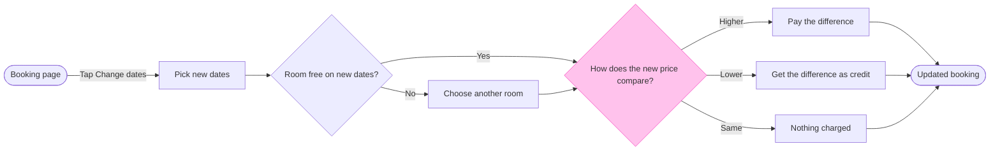

The model passes the pre-write check and composes. Nothing is written yet.

Check: 9 nodes, 11 connectors, widest rank 3, longest path 7 steps, 0 crossing pairs. The composed code is 42,649 characters, so it fits one `use_figma` call.

Question: which screens does a guest pass through to change their booking dates, and where does the flow branch?
Outcome: the product team agrees the branches (room not free, price higher, lower or the same) before design and build.
First glance: How does the new price compare?, the decision with the pink outline.
Second glance: Booking page, the light blue entry, and Updated booking, the green goal. Then the main row in path order: Pick new dates, Room free on new dates? and the three outcomes, Pay the difference, Get the difference as credit and Nothing charged.
Last glance: Choose another room, the detour.
Source: all 9 nodes come from your description, classed as current behavior and assumed.
File: the existing FigJam file <draft-file-key>, as a new section named "Change booking dates". The file sits in Roamstay Product, as you said, so no plan lookup is needed. I read it once and its page is empty, so no section shares the title and nothing already there can change.
Writes: one composed board with 9 nodes, 11 connectors, 5 labelled decision exits, 2 zones, a title, a key and a source line, at the Laptop reading distance.
Left out: card entry and payment failures, cancellation, change fees and deadlines, the case with no other room free, where the credit goes afterwards.
Extensions: none.
Calls: one `use_figma` and one `get_figjam` read-back. The session and the file read are already spent, so the write takes 2 more. A Starter plan or a View or Collab seat is limited to 6 tool calls a month.
Rollback: delete the one board section the write returns. That needs your yes to a question that names it.

Two findings, so you can correct them before the write:
* The label-wrap check could not run (a missing system library), so I read the labels by hand. "How does the new price compare?" is the longest at 31 characters and could wrap in its diamond. If the read-back shows a word alone on the last line, I'll report it.
* I said earlier that the system steps would be drawn as automatic. A user flow has no marker for that, so the board shows no actors. The actor split stays in the provenance record only.

Write it?