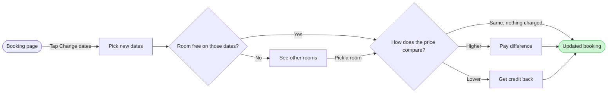

# FJ-036 turn 3 transcript

**User:** Yes, that reading is right.

**Tool call:** `Read` `{"file_path": "/private/tmp/claude-501/-Users-michelkerkmeester-MEGA-Development-AI-Systems/348b59cb-58a2-4b49-8147-c40143312bc1/scratchpad/r045run/tmp/FJ-036/devin-compare-bench/FJ-036/sk-create-figjam/references/quality-rubric.md"}`

**Tool result:** `Read`

```text
"1\t---\n2\ttitle: \"FigJam Diagram Quality Rubric\"\n3\tdescription: \"The taste gate a FigJam model passes before the write gate, translated from sk-design-diagram's success criteria: type fit, the remove test, signal, the check, the board, the design rubric that scores a composed board and the reply.\"\n4\tcontextType: implementation\n5\timportance_tier: important\n6\ttrigger_phrases:\n7\t  - \"figjam quality rubric\"\n8\t  - \"diagram taste gate\"\n9\t  - \"remove test\"\n10\t  - \"figjam review checklist\"\n11\t  - \"figjam design rubric\"\n12\tversion: 1.0.8.0\n13\t---\n14\t\n15\t# FigJam Diagram Quality Rubric\n16\t\n17\tThe script checks what a script can see. This rubric is the rest: whether the diagram should exist, whether every node earns its place and whether the reader can trust what lands on the board. Walk it after the check passes and before the write gate.\n18\t\n19\t**Loading Condition:** CONDITIONAL, on every Flow route before the write gate\n20\t**Purpose:** The judgement pass between the pre-write check and the gate\n21\t**Scope:** The model, the provenance table, the planned extensions and, after the write, the board and the reply\n22\t\n23\t---\n24\t\n25\t## 1. TYPE FIT\n26\t\n27\t- [ ] The type answers the reader's question, as `references/flow-mode.md` Section 3 maps it\n28\t- [ ] A table, a list or a paragraph would not do the same job. If it would, say so and offer that instead\n29\t- [ ] The type's reference in `references/types/` was loaded and i
```

**Tool call:** `Read` `{"file_path": "/private/tmp/claude-501/-Users-michelkerkmeester-MEGA-Development-AI-Systems/348b59cb-58a2-4b49-8147-c40143312bc1/scratchpad/r045run/tmp/FJ-036/devin-compare-bench/FJ-036/sk-create-figjam/references/style-guide.md"}`

**Tool result:** `Read`

```text
"1\t---\n2\ttitle: \"FigJam Diagram Style Guide\"\n3\tdescription: \"The colour every composed FigJam board draws by kind in the shipped design, the type scale and the 8 pixel grid, the palette pairs the check accepts with their measured contrast, and the spacing bands, translated from sk-design-diagram's style guide and derivation record.\"\n4\tcontextType: implementation\n5\timportance_tier: important\n6\ttrigger_phrases:\n7\t  - \"figjam style guide\"\n8\t  - \"figjam palette\"\n9\t  - \"figjam colour by kind\"\n10\t  - \"figjam type scale\"\n11\t  - \"palette derivation record\"\n12\t  - \"figjam contrast\"\n13\tversion: 1.0.5.0\n14\t---\n15\t\n16\t# FigJam Diagram Style Guide\n17\t\n18\tThe rules for colour, type and spacing on a FigJam board. The composer in `assets/compose-board.js` draws every board in the design `assets/figjam-design.md` holds, which ships as the tables below record, and every hex a model, a design or a note extension uses comes from the palette in Section 3. `scripts/flow_check.py` refuses any other.\n19\t\n20\t**Loading Condition:** CONDITIONAL, before the gate on every Flow route, and when a model or a note extension uses colour\n21\t**Purpose:** Names the colour each kind draws in, the type scale, the grid, the palette pairs the check accepts and the measured contrast record\n22\t**Scope:** The composed board, Mermaid `style`, `classDef` and `linkStyle` colours, sticky and pin colours for notes, and the contrast record the self-test re-measures\n
```

**Tool call:** `Bash` `{"command": "mktemp -d /tmp/figjam-scratch.XXXXXX", "description": "Create scratch folder for the model"}`

**Tool result:** `Bash`

```text
"/tmp/figjam-scratch.k4TmoI"
```

**Tool call:** `Write` `{"file_path": "/tmp/figjam-scratch.k4TmoI/model.md", "content": "```mermaid\n%% title: Change booking dates\n%% subtitle: How a Roamstay guest changes booking dates in the app, from the booking page to the updated booking\n%% source: Sources: the change-dates request. Left out: cancelling, payment failure, guest count changes and the host side.\nflowchart LR\n    bookingPage([Booking page]) -->|Tap Change dates| pickDates[Pick new dates]\n    pickDates --> roomFree{Room free on those dates?}\n    roomFree -->|Yes| priceCheck{How does the new price compare?}\n    roomFree -->|No| otherRooms[See`

**Tool result:** `Write`

```text
"File created successfully at: /tmp/figjam-scratch.k4TmoI/model.md (file state is current in your context \u2014 no need to Read it back)"
```

**Tool call:** `Bash` `{"command": "python3 -I sk-create-figjam/scripts/flow_check.py --help 2>&1 | head -30", "description": "Show flow_check usage"}`

**Tool result:** `Bash`

```text
"mermaid_extract: --help: not a Mermaid file\nUNREADABLE --help: the extractor refused it"
```

**Tool call:** `Bash` `{"command": "python3 -I sk-create-figjam/scripts/flow_check.py /tmp/figjam-scratch.k4TmoI/model.md 2>&1 | head -40", "description": "Run the pre-write check on the model"}`

**Tool result:** `Bash`

```text
"  diagram 1, user flow: ok, 8 nodes and 10 connectors, widest rank 2 steps, longest path 7 steps, 1.2 connectors per step, labels average 20 characters, 0 crossing pairs\nLabel: How does the new price compare? leaves 'compare?' alone on its last line, so shorten it when a shorter label keeps the source's words\nLabel: Pay the difference leaves 'difference' alone on its last line, so shorten it when a shorter label keeps the source's words\nLabel: Get the difference as credit leaves 'credit' alone on its last line, so shorten it when a shorter label keeps the source's words\nPASSED 1 diagram(s) in model.md"
```

**Tool call:** `Bash` `{"command": "S=/tmp/figjam-scratch.k4TmoI && for v in \"A|How does the price compare?|Pay difference|Get credit back\" \"B|Is the new price higher?|Pay the extra|Get the credit\" \"C|New price compared?|Pay difference|Credit the difference\"; do IFS='|' read n a b c <<< \"$v\"; sed -e \"s/How does the new price compare?/$a/\" -e \"s/Pay the difference/$b/\" -e \"s/Get the difference as credit/$c/\" $S/model.md > $S/model-$n.md; echo \"== $n: $a / $b / $c\"; python3 -I sk-create-figjam/scripts/flow_check.py $S/model-$n.md 2>&1 | grep -E \"Label|PASSED|FAIL\"; done", "description": "Try shorter `

**Tool result:** `Bash`

```text
"== A: How does the price compare? / Pay difference / Get credit back\nPASSED 1 diagram(s) in model-A.md\n== B: Is the new price higher? / Pay the extra / Get the credit\nPASSED 1 diagram(s) in model-B.md\n== C: New price compared? / Pay difference / Credit the difference\nLabel: New price compared? leaves 'compared?' alone on its last line, so shorten it when a shorter label keeps the source's words\nLabel: Credit the difference leaves 'difference' alone on its last line, so shorten it when a shorter label keeps the source's words\nPASSED 1 diagram(s) in model-C.md"
```

**Tool call:** `Bash` `{"command": "S=/tmp/figjam-scratch.k4TmoI && for c in \"Difference as credit\" \"Get difference as credit\" \"Credit the difference\"; do sed -e \"s/How does the new price compare?/How does the price compare?/\" -e \"s/Pay the difference/Pay difference/\" -e \"s/Get the difference as credit/$c/\" $S/model.md > $S/model-t.md; echo \"== $c\"; python3 -I sk-create-figjam/scripts/flow_check.py $S/model-t.md 2>&1 | grep -E \"Label|PASSED|FAIL\"; done", "description": "Test credit label variants"}`

**Tool result:** `Bash`

```text
"== Difference as credit\nLabel: Difference as credit leaves 'credit' alone on its last line, so shorten it when a shorter label keeps the source's words\nPASSED 1 diagram(s) in model-t.md\n== Get difference as credit\nLabel: Get difference as credit leaves 'credit' alone on its last line, so shorten it when a shorter label keeps the source's words\nPASSED 1 diagram(s) in model-t.md\n== Credit the difference\nLabel: Credit the difference leaves 'difference' alone on its last line, so shorten it when a shorter label keeps the source's words\nPASSED 1 diagram(s) in model-t.md"
```

**Assistant:**

Status: the pre-write check passes on the 8-node, 10-connector model. I'm settling three labels the board would wrap awkwardly, then I'll read the existing file once and write the gate message.

**Tool call:** `Bash` `{"command": "S=/tmp/figjam-scratch.k4TmoI && cp $S/model-A.md $S/final.md && cat $S/final.md && python3 -I sk-create-figjam/scripts/flow_check.py $S/final.md && python3 -I sk-create-figjam/scripts/compose_board.py $S/final.md --diagram 1 --out $S/compose.js 2>&1 | tail -8; wc -c $S/compose.js", "description": "Check final model and compose the board code"}`

**Tool call:** `mcp__figma-remote__create_session` `{"fileKey": "<draft-file-key>", "description": "Add a user flow board for Roamstay guests changing booking dates to the existing FigJam file as a new section"}`

**Tool result:** `Bash`

```text
"```mermaid\n%% title: Change booking dates\n%% subtitle: How a Roamstay guest changes booking dates in the app, from the booking page to the updated booking\n%% source: Sources: the change-dates request. Left out: cancelling, payment failure, guest count changes and the host side.\nflowchart LR\n    bookingPage([Booking page]) -->|Tap Change dates| pickDates[Pick new dates]\n    pickDates --> roomFree{Room free on those dates?}\n    roomFree -->|Yes| priceCheck{How does the price compare?}\n    roomFree -->|No| otherRooms[See other rooms]\n    otherRooms -->|Pick a room| priceCheck\n    priceCheck -->|Higher| payDifference[Pay difference]\n    priceCheck -->|Lower| getCredit[Get credit back]\n    priceCheck -->|Same, nothing charged| updatedBooking([Updated booking])\n    payDifference --> updatedBooking\n    getCredit --> updatedBooking\n    style updatedBooking fill:#CDF4D3,stroke:#66D575\n```\n  diagram 1, user flow: ok, 8 nodes and 10 connectors, widest rank 2 steps, longest path 7 steps, 1.2 connectors per step, labels average 17 characters, 0 crossing pairs\nPASSED 1 diagram(s) in final.md\nCOMPOSED diagram 1, 8 nodes and 10 connectors, widest rank 2 steps, longest path 7 steps, 1.2 connectors per step, labels average 17 characters, 0 crossing pairs: 8 nodes and 10 connectors to read back, 42231 characters in /tmp/figjam-scratch.k4TmoI/compose.js, drawn in the design FigJam default\n   42231 /tmp/figjam-scratch.k4TmoI/compose.js"
```

**Tool result:** `mcp__figma-remote__create_session`

```text
"{\"sessionId\":\"930a9584-a356-48ef-a301-efc657779dda\"}"
```

**Tool call:** `mcp__figma-remote__get_figjam` `{"fileKey": "<draft-file-key>", "nodeId": "0:1", "sessionId": "930a9584-a356-48ef-a301-efc657779dda", "includeImagesOfNodes": false}`

**Tool result:** `mcp__figma-remote__get_figjam`

```text
[{"type": "text", "text": "<canvas id=\"0:1\" name=\"Page 1\" x=\"0\" y=\"0\" width=\"0\" height=\"0\" />"}]
```

**Assistant:**

Here is the write gate. Nothing has been written to the file yet.

### What the check found

The file has an empty page, so the new section cannot clash with an existing title. The model passes the pre-write check as a user flow, with these measures:

* Size: 8 nodes and 10 connectors
* Layout: widest rank 2 steps, longest path 7 steps, 0 crossing pairs
* Composed board code: 42,231 characters, under the 50,000 limit of one call

Three labels changed from the outline you approved, because the board would have wrapped a single word onto its own line:

* "How does the new price compare?" is now "How does the price compare?"
* "Pay the difference" is now "Pay difference"
* "Get the difference as credit" is now "Get credit back"

The credit label no longer says the amount is the difference. The "Lower" exit and the decision above it carry that. Say so if you want the longer label back and accept the wrapped line.

### The sketch



### Purpose and glance order

* Question the board answers: which screens a guest passes through when changing booking dates, and where they choose
* Outcome: the product and design team can check that every price outcome and the no-room case has a way out
* First glance: Updated booking, the goal, in green with the pink outline
* Second glance: the main row in path order, Booking page, Pick new dates, Room free on those dates?, See other rooms, How does the price compare?, Pay difference
* Last glance: Get credit back, the one node off the main row

### Answers to the four critique questions

* Where the eye goes first: the pink-outlined Updated booking, which is the node the board most needs read
* All three price exits: they leave one diamond with the labels Higher, Lower and Same, so none needs tracing through another node
* The no-room path: it leaves the Yes/No diamond at No and rejoins at the price check through "Pick a room", so it reads as a detour
* Labels repeating their shape: none does

I will check the first and second answers on the composed board after the write.

### Target, write and rollback

* File: <draft-file-key>, in the Roamstay Product plan as you named it. I have not confirmed the plan, because `whoami` lists the plans your account holds and not which one owns a file. No new file is created
* Written: one new section titled "Change booking dates", holding the 8 nodes, 10 connectors, a key and the source line, with no zones
* Extensions: none
* Calls: one `use_figma` call to compose the board, then one `get_figjam` call to read it back. The file held nothing, so no comparison read is needed. If your seat is Starter or View or Collab, Figma allows six tool calls a month and the file read I just did used one of them
* Rollback: delete the one section the write returns, through `use_figma`, and only after you answer a question that names it by title

Left out: cancelling, payment failure, guest count changes and the host side, each a later board
Left out: going back from other rooms to pick other dates, declining the extra payment and what the credit is used for, points the request left open

Do you want me to write this board as a new section in file <draft-file-key>?

HVR self-scan: 0 hard blockers. Fixed: none. Kept with reason: none.
