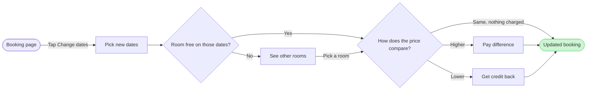

Here is the write gate. Nothing has been written to the file yet.

### What the check found

The file has an empty page, so the new section cannot clash with an existing title. The model passes the pre-write check as a user flow, with these measures:

* Size: 8 nodes and 10 connectors
* Layout: widest rank 2 steps, longest path 7 steps, 0 crossing pairs
* Composed board code: 42,231 characters, under the 50,000 limit of one call

Three labels changed from the outline you approved, because the board would have wrapped a single word onto its own line:

* "How does the new price compare?" is now "How does the price compare?"
* "Pay the difference" is now "Pay difference"
* "Get the difference as credit" is now "Get credit back"

The credit label no longer says the amount is the difference. The "Lower" exit and the decision above it carry that. Say so if you want the longer label back and accept the wrapped line.

### The sketch

### Purpose and glance order

* Question the board answers: which screens a guest passes through when changing booking dates, and where they choose
* Outcome: the product and design team can check that every price outcome and the no-room case has a way out
* First glance: Updated booking, the goal, in green with the pink outline
* Second glance: the main row in path order, Booking page, Pick new dates, Room free on those dates?, See other rooms, How does the price compare?, Pay difference
* Last glance: Get credit back, the one node off the main row

### Answers to the four critique questions

* Where the eye goes first: the pink-outlined Updated booking, which is the node the board most needs read
* All three price exits: they leave one diamond with the labels Higher, Lower and Same, so none needs tracing through another node
* The no-room path: it leaves the Yes/No diamond at No and rejoins at the price check through "Pick a room", so it reads as a detour
* Labels repeating their shape: none does

I will check the first and second answers on the composed board after the write.

### Target, write and rollback

* File: <draft-file-key>, in the Roamstay Product plan as you named it. I have not confirmed the plan, because `whoami` lists the plans your account holds and not which one owns a file. No new file is created
* Written: one new section titled "Change booking dates", holding the 8 nodes, 10 connectors, a key and the source line, with no zones
* Extensions: none
* Calls: one `use_figma` call to compose the board, then one `get_figjam` call to read it back. The file held nothing, so no comparison read is needed. If your seat is Starter or View or Collab, Figma allows six tool calls a month and the file read I just did used one of them
* Rollback: delete the one section the write returns, through `use_figma`, and only after you answer a question that names it by title

Left out: cancelling, payment failure, guest count changes and the host side, each a later board
Left out: going back from other rooms to pick other dates, declining the extra payment and what the credit is used for, points the request left open

Do you want me to write this board as a new section in file <draft-file-key>?

HVR self-scan: 0 hard blockers. Fixed: none. Kept with reason: none.